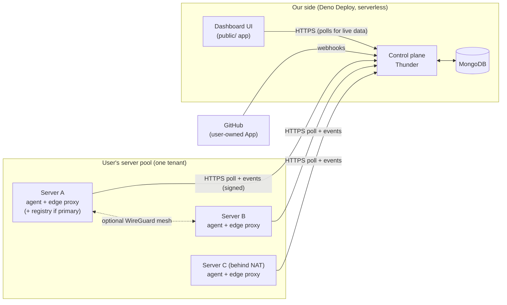
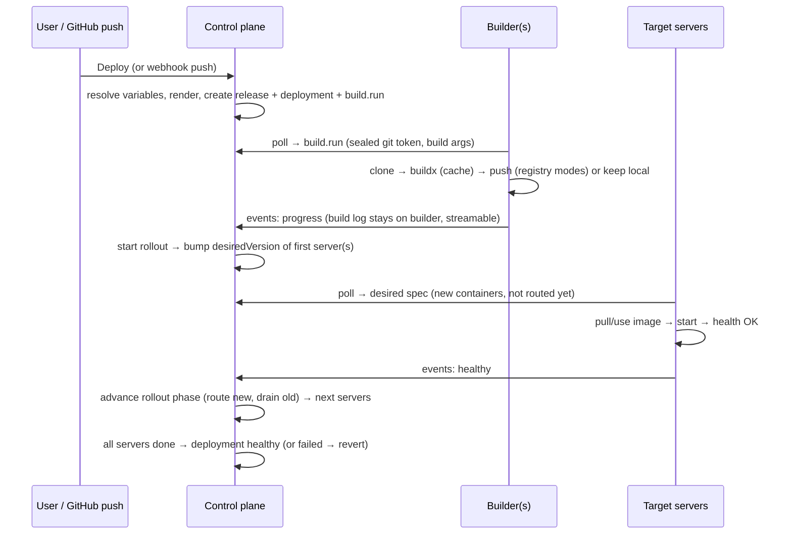

# Huruf Deploy — Product & Technical Plan

> Status: **Draft v4 — planning only, no code yet.**
> Product: **Huruf Deploy**. Reference product: Dokploy (inspiration, not a clone).
> Every phase in §16 ends with a review checkpoint before the next one starts.

**v4.5:**
- **Managed servers** (D42, §24): optional future option, implemented only with the owner's explicit consent. The structural seams are prepared now.
- §20.3: safety limits are read through a cached `Settings` wrapper (the DB-backed env fallback is uncached).
- §20.2: the thunder-core `guard` hook must cost zero DB operations on agent polls (verified in Phase 1).

**v4.4:**
- Code quality and architecture (§23): layers, shared building blocks, strategy interfaces, no-duplication rules enforced in CI.
- Open questions in §18 accepted as proposed.

**v4.3:**
- Agent renamed to `huruf-deploy-agent`.
- **Usage plans and subscriptions** (§22): public and private plans, Free by default, wallet charging, a payment log that drives the automatic Free fallback.
- Limits split into **plan quotas**, **safety limits** and **agent defaults** (§20.3), with cheap atomic enforcement.
- **Bounded in-memory caches** with a memory budget (§20.4).
- Plans and billing get their own phase (Phase 10); domains move to Phase 11.

**v4.2:**
- Product name and agent naming (D35).
- Docker Hub + generic registry config (D36).
- Footprints and capacity history kept **only on agents** (D37). Platform-wide footprint averages dropped.
- Default limits as admin-configurable platform settings (D38, §20.3).
- 20 s offline-alert grace confirmed.

**v4.1:**
- Lease is 10 s with 5 s idle polls. Poll-hot fields moved to a tiny `serverLeases` document, so each poll is one database operation.
- No cron of any kind.
- Route sub-folders are organizational, so routes are grouped by nav group.
- SDK workflow: overwrite the same SDK version, then rebuild.
- The agent uses the same license.

**Changes since v3:**
- **Offline detection redesigned for scale (§3.4):**
  - Polls renew a lease instead of writing on every poll.
  - The sweep is sharded, and each Deno Deploy instance checks in memory whether a sweep is due, so it touches the DB only then.
  - Alerts go out through a separate outbox, so sending them never slows a poll.
- **Desired specs are precomputed and sealed when they change**, never computed on the poll path (§4.4).
- **Stop first** is a user-selectable deploy strategy (§10).
- **Frontend standards (§15):** thunder-ui rules, shadcn-first component policy, design and accessibility principles, the "essential now, heavy on demand" approach to detail pages, and frontend performance.
- **Backend engineering and performance budget (§20).**
- **Repository layout and contributor experience (§21):** a monorepo, the protocol as a generated contract, an agent simulator, and ADRs.

**Changes in v3:**
- The control plane is hosted on **Deno Deploy**.
- Polls carry a **sequence cursor** that acknowledges what the agent has already fetched.
- **The poll is the heartbeat.** No separate tick or cron. Dead servers are detected from `lastSeenAt`, and offline handling is piggybacked on other agents' polls.
- The **interactive terminal is in the MVP**, using a fast "terminal mode" poll.
- Image distribution has three modes. **Build on every server** is the fallback when there is no registry.
- Deploy strategies: **Rolling** or **All at once** (blue-green). Docker restarts crashed containers itself.
- Server selection is done by the user, **based on free resources** shown in the UI ("self-hosted AWS"). Automatic rescheduling to other servers is dropped.
- The private network is **optional per server**. Servers behind NAT work fine for apps that don't need it.

---

## 1. Goal

A free-to-use SaaS that deploys and operates apps on **the user's own machines** using Docker. It works like a self-hosted AWS: the user keeps adding servers to a pool as their apps and system grow, and places projects on them.

- We host the **control plane** (dashboard + API, Thunder on Deno Deploy).
- Users bring their own machines (VMs, EC2, bare metal — Ubuntu only for MVP) and run our **agent** on them.
- All builds and workloads run on the user's machines. We store as little as possible.

---

## 2. Decisions

| # | Decision |
|---|---|
| D1 | SaaS control plane: Thunder (Deno + MongoDB) on **Deno Deploy**, serverless. Only the agent is self-hosted. |
| D2 | **No gateway, no persistent connections.** Agents poll for work and push results/data to a webhook endpoint with a `request` reference and data type. |
| D3 | **The poll is the heartbeat.** Polls renew a server **lease** (`aliveUntil`), which decides online/offline. No separate heartbeat or cron. Dead servers are found by a sharded, throttled, piggybacked sweep designed for scale (§3.4). |
| D4 | **Cursor acknowledgement.** Every poll sends the agent's cursors (last command sequence, applied desired-state version). The control plane returns only newer items and marks older ones delivered (§3.3). |
| D5 | **Desired-state reconciliation.** The control plane stores *what should run where*; agents converge to it. Imperative commands only for one-off tasks. |
| D6 | **Adaptive polling:** idle / active / terminal modes (§3.2). |
| D7 | Manual install needs **only the tenant ID** (no API key). The user accepts or rejects in the dashboard. Identity is a keypair plus a pairing code (§4.2). |
| D8 | **SSH wizard install:** the user gives SSH access once, the deploy app installs the agent, then the credentials are discarded (§4.3). |
| D9 | **Store the minimum on our side** (§3.5). Logs and metrics stay on the agent machine, bounded, and are streamed read-only on request. Deployment status and metadata are stored with us. |
| D10 | Toolchains live inside Docker images, never on the host. BuildKit cache **with escape hatches**: "Clear build cache" and "Deploy without cache". |
| D11 | Templates: system (admin), tenant/custom (user), clone-and-extend, versioned. |
| D12 | Image distribution: user's registry → built-in registry → **build on every server** fallback (§8.4). |
| D13 | **No Docker Swarm.** Plain Docker managed by the agent. Docker's restart policy restarts crashed containers. The control plane orchestrates rollouts across servers. |
| D14 | Deploy strategies, selectable per project: **Rolling**, **All at once (blue-green)** and **Stop first** (§10). |
| D15 | **No cluster concept.** A tenant's servers form a pool. The user picks a project's servers from free-resource information (§7). |
| D16 | The private network (WireGuard mesh) is **optional per server**. A server that can't join it still runs apps. Fixing reachability for apps that need the private network is the user's job; we show clear status (§8.2). |
| D17 | **Interactive terminal is in the MVP**, over polling in terminal mode (§3.6). |
| D18 | macOS is out of scope for MVP. Ubuntu 22.04/24.04, amd64/arm64. |
| D19 | GitHub integration is a GitHub App created on the user's account/org (Manifest flow), optionally shared with the tenant. |
| D20 | Sources: GitHub + template, generic Git + template, Dockerfile, docker-compose (also covers "image from registry"). No Nixpacks/Railpack. |
| D21 | RBAC, tenants and the wallet come from thunder-core. Roles: `admin` (platform, `root`) and `user`. |
| D22 | No environments inside a project (staging = a separate project). Projects can be grouped. |
| D23 | Deploy on push is on by default (can be disabled). Manual deploy is always available. |
| D24 | Rollback uses the last N stored releases (N by plan). |
| D25 | One-click services are built-in service templates. Alerts are user-configurable. |
| D26 | Variable manager scopes: **global (the user, across all their tenants)**, tenant, project. Encrypted, and reachable externally via API/SDK. |
| D27 | Agent language: **Go**. |
| D28 | Domains and public load balancing are **deferred** to a Cloudflare-based phase. The deploy app never hosts a load balancer. MVP access is `server-ip:port`. |
| D29 | Built and reviewed phase by phase (§16). |
| D30 | **Backend performance is the top non-functional priority.** Every hot path has a budget, enforced by load tests (§20). |
| D31 | Backend follows the Thunder `llms.txt` and thunder-core conventions. Frontend follows the thunder-ui `llms.txt` (§15, §20). |
| D32 | UI component priority: **shadcn/ui first**, then shadcn-compatible registries, then justified third-party libraries, then custom (§15.3). Modern, minimal, accessible (WCAG 2.2 AA). |
| D33 | Open source: structured for outside contributors (§21). **Monorepo.** The agent uses the same license as the rest of the project. |
| D34 | **Lease = 10 s** with 5 s idle polls. Offline is detected in ~10–15 s. The `agentOffline` alert has a 20 s grace by default. **No cron at all** (no `Deno.cron`). |
| D35 | **Product name: Huruf Deploy.** Agent naming (`huruf-deploy-agent`): binary `huruf-deploy-agent`, systemd unit `huruf-deploy-agent.service`, config `/etc/huruf-deploy-agent/`, state `/var/lib/huruf-deploy-agent/`, Docker labels `deploy.huruf.*`, internal network `huruf-internal`. |
| D36 | **External registries:** Docker Hub, plus a generic third-party registry config (any registry URL + username + password/token), which covers GHCR, GitLab, Harbor, a self-hosted registry, etc. (§8.4). |
| D37 | **Footprints and capacity history stay on the agent nodes.** The control plane fetches them on demand and never stores them (§7.1). |
| D38 | **Limits are mandatory, to prevent abuse** (§20.3). **Plan quotas** are per tenant and raised by plans. **Safety limits** are platform-wide, admin-only, and stored in thunder-core's database-backed env. **Agent defaults** protect the user's disk. |
| D39 | **Usage plans** (admin CRUD, public or **private**). Every tenant is on **Free** by default. Paid plans are charged from the tenant's thunder-core wallet, and each paid period is logged in `subscriptionPeriods`. **No current paid period → automatic fallback to Free** (§22). |
| D40 | **Every in-memory cache is size-capped** (max entries + TTL + LRU), with a per-instance memory budget. Correctness never depends on a cache (§20.4). |
| D41 | **Code quality:** no duplication. Composable modules and classes in layers (routes → services → building blocks), strategy interfaces for variants, schemas as the single source of truth. Enforced in CI (§23). |
| D42 | **Managed servers (optional, needs owner consent):** provision EC2 instances on the platform's AWS account and bill plan + metered usage from the wallet. The MVP only prepares the seams (§24). |

---

## 3. Architecture and transport



### 3.1 Components

| Component | Where | Responsibility |
|---|---|---|
| **Control plane** | This repo (`routes/`, `schemas/`, `hooks/`, `lib/`, `scripts/`) | Auth, tenants, RBAC, CRUD, GitHub webhooks, template rendering, releases, desired state per server, rollout orchestration (event-driven), variable encryption, agent poll/event endpoints, stream buffers, offline detection, alert delivery, SSH bootstrap. |
| **Agent** | `agent/` Go module in this monorepo (§21) | Host bootstrap, reconciliation, builds, image distribution, edge proxy config, optional mesh and DNS, bounded logs/metrics, terminal (PTY), local alert evaluation, autoscaling, backups, self-update. |
| **Dashboard UI** | `public/<app>` via `deno task generate:app` | Screens in §15. |

### 3.2 Poll modes

| Mode | Interval | When |
|---|---|---|
| **Idle** | 5 s | Nothing active on the server (must stay below half the 10 s lease) |
| **Active** | 1 s | A build or deploy targets the server, or someone is viewing its logs/metrics |
| **Terminal** | ≈ 300 ms | A terminal session is open on the server |

- Every poll response includes `nextPollMs`, so the control plane decides the mode.
- Modes are driven by fields on the `servers` document (`fastPollUntil`, `terminalUntil`), which UI activity keeps extending.
- When the activity stops, the server drops back to idle automatically.
- **Request volume and cost per poll:** see the performance budget in §20.2. An idle poll where nothing changed costs exactly one `findOneAndUpdate` on a tiny document (lease renew + read of the hot fields). Fast modes cost more only while someone is actively using them.

### 3.3 Poll request/response and cursors

**Poll request** (`POST /agents/api/poll`):

```jsonc
{
  "commandCursor": 41,          // highest command seq the agent has durably received
  "appliedVersion": 17,         // desired-state version the agent has applied
  "streams": { "<session>": 9 },// per open stream: highest input seq received (terminal keystrokes)
  "summary": { "cpu": 0.31, "memFree": 2.1e9, "diskFree": 4.0e10, "containers": [/* id, project, state, health */] }
}
```

**Poll response:**

```jsonc
{
  "nextPollMs": 1000,
  "desired": { "version": 18, "spec": { /* only if version > appliedVersion */ } },
  "commands": [ { "seq": 42, "type": "logs.stream", "payload": "…sealed…" } ],
  "streamInput": { "<session>": [ { "seq": 10, "data": "ls -la\r" } ] },
  "closeStreams": ["<session>"]
}
```

**Why sequence numbers instead of timestamps:**
- Clock skew between the agent and Deno Deploy can make timestamps skip or repeat items.
- Two items written in the same millisecond can't be ordered by timestamp.
- So each server has an atomic counter (`servers.commandSeq`, `$inc` on insert) and each command stores its `seq`.

How acknowledgement works:
- A poll with `commandCursor = 41` means "I have everything up to 41". Commands ≤ 41 are marked delivered, and only commands > 41 are returned.
- If a response is lost, the agent sends the same cursor again and gets the same commands back, so nothing is missed.
- Executing twice is prevented by the agent's local record of completed seqs.
- The same pattern is used for terminal input (per-session `seq`) and stream output chunks.

**Events / webhook** (`POST /agents/api/events`): batched `{ id, type, request?, data }`. Types:
- command results
- deployment progress
- stream output chunks
- container state changes
- alerts

Each event id is unique (index), so retries never double-apply.

### 3.4 Heartbeat, leases and offline detection at scale

**Why the simple version breaks at scale:**
1. Writing `lastSeenAt` on every poll means 100k servers polling every 10 s cause **10k writes/s** for liveness alone.
2. A single global lock document that every poll tries to take becomes a **hot document** with constant write contention.
3. An unbounded sweep inside someone's request makes that request's latency unpredictable.
4. Sending alerts (SMTP, webhooks) inside a poll ties agent latency to third-party services.

**Design:**

1. **Short leases, one database operation per poll.**
   - **Lease = 10 s.** Idle polls run every **5 s**, so one lost or late poll (±20% jitter) never marks a healthy server offline.
   - A poll renews `aliveUntil = now + 10 s` whenever less than 6 s remain, which in practice is every idle poll. In fast modes, renewal happens at most every ~4 s, not on every poll.
   - **Hot/cold split:** all poll-hot fields live in a tiny `serverLeases` document: `aliveUntil`, `shard`, `status`, `desiredVersion`, `commandSeq`, `fastPollUntil`, `terminalUntil`, `offlineSince`.
     - The poll renews the lease *and* reads those fields in **one `findOneAndUpdate`**, filtered on `status: "active"`. One round trip, one write.
     - The large `servers` document (identity, inventory, labels, mesh) is never rewritten by polls.
   - **Signature verification without a DB read:** agent public keys are cached in each instance's memory by fingerprint. Revocation still takes effect immediately, because the `status: "active"` filter on the lease update rejects removed or rejected servers.
   - **Lease writes skip the journal** (`{ w: 1, j: false }`). Losing the last few hundred milliseconds of liveness timestamps in a database crash is harmless and noticeably cheaper.
   - Online means `aliveUntil > now`, computed for free in the UI and API.
   - **Detection latency: about 10–15 s** (lease plus sweep interval). The UI shows offline after that.
   - The `agentOffline` alert has a configurable grace period (`forSec`, default 20 s) so brief network blips don't send alerts.
2. **Sharded sweep state.**
   - Each server gets a fixed `shard = hash(_id) mod 64` at creation. There are 64 tiny `sweepShards` docs `{ _id: k, nextRunAt }`.
   - Spreading the work over 64 docs removes the hot-document problem.
3. **The due check happens in memory, so the DB is touched only when a sweep is due.**
   - Each Deno Deploy instance keeps the last known `nextRunAt` per shard in memory.
   - A request checks memory only. Only when a shard looks due does it run `findOneAndUpdate({ _id: k, nextRunAt: { $lte: now } }, { $set: { nextRunAt: now + 5s } })`.
   - One request wins; the others learn the new `nextRunAt` and go back to memory-only checks.
   - **The whole system's sweep coordination costs ≈ 64 tiny writes per 5 s (~13/s), independent of server count.**
4. **Which requests check which shards.**
   - Every agent poll checks its own shard plus one random shard, and dashboard API requests check one random shard.
   - With 5 s idle polls, every shard is swept within ~5–10 s as long as *any* agent or user is active anywhere. A shard containing a single dead server is still covered.
5. **Bounded sweep work.**
   - The winner runs one indexed query on `serverLeases`: `{ shard: k, status: "active", offlineSince: null, aliveUntil: { $lt: now } }`, limit 200, backed by a partial index.
   - It sets `offlineSince` with one `bulkWrite` and inserts `alertEvents` into an **outbox**. This is milliseconds of work, never unbounded.
6. **Alert delivery is outside the hot path (outbox).**
   - Outbox items are claimed with `findOneAndUpdate` plus a `claimedUntil` lease, piggybacked the same way (one item per request, at most a few per second system-wide).
   - Claims happen on **dashboard/API requests and event ingestion, not on agent polls**, with a strict per-item timeout. Failed items retry with backoff.
   - Email goes through an HTTP mail API (`Mailer.onSendMail`) rather than SMTP, to keep each send fast.
7. **Recovery is in-request and per server.** When a poll arrives from a server with `offlineSince` set, that same request clears the flag and queues a "resolved" alert.
8. **Total silence** (no agent and no user active anywhere): nothing sweeps. This is accepted, since there is nobody to alert in that state. There is **no cron of any kind**, including `Deno.cron`.

### 3.5 Data minimization

| Stored with us | Ephemeral with us (TTL) | Never stored with us |
|---|---|---|
| Accounts, tenants, servers (public keys, inventory summary, last resource summary), latest sealed spec per server, projects (desired spec), templates, releases (last N), deployment metadata (status, commit, timings, one-line error), encrypted variables, git credentials (encrypted), alert rules and fired-alert history, audit events | Commands (hours), stream sessions, stream chunks and terminal input (minutes), pairing requests (15 min), bootstrap progress (hours) | Container logs, build logs, metrics history, footprints and capacity history, terminal history, SSH credentials, plaintext secrets, image contents |

### 3.6 Streams and terminal over polling

**Read-only streams** (logs, build output, metrics, exec output):
1. The UI opens a `streamSessions` doc, which puts the server in active mode.
2. The agent picks the session up on its next poll and posts output chunks about every 500 ms through events.
3. The chunks land in `streamChunks` (TTL ≈ 2 min).
4. The UI polls `GET /streams/api/:id?after=<seq>` about every second.
5. If the UI stops polling for 30 s, the session closes.

**Terminal:**
- The agent opens a PTY: `docker exec` with a TTY into a container, or a host shell (a separate permission).
- The server switches to **terminal mode** (≈ 300 ms polls).
- Keystrokes are posted by the UI (`POST /streams/api/:id/input`), batched every ~50 ms, and delivered on the next agent poll.
- PTY output is batched every ~100 ms and posted as events. The UI polls output about every 300 ms. **xterm.js** renders it.
- Expected keystroke-to-echo time: ≈ 0.4–1 s. Fine for typing commands and reading output; full-screen tools (vim, top) work but feel laggy.
- Optional **line mode**: local echo and line editing in the browser, sending on Enter. It feels instant for normal shell use.
- Every session is audited (who, server/container, start, end). The content is never stored with us.
- **Possible later optimization (spike):** long-polling or a streamed response on Deno Deploy, which would make streams near-instant within the same polling model.

---

## 4. Agent ↔ control plane protocol

### 4.1 Request authentication (no API key)

Every agent request carries:
- `X-Agent-Key`: fingerprint of the agent's Ed25519 public key
- `X-Agent-Timestamp`
- `X-Agent-Signature`: Ed25519 signature over `method ‖ path ‖ timestamp ‖ sha256(body)`

The control plane rejects requests with clock skew over 60 s, an unknown key, or an inactive server (except `hello`). The `agents` router is reachable by the RBAC `guest` role (added to the `public` policy), and the signature is verified inside the handlers.

### 4.2 Pairing

1. On first run, the agent generates an **Ed25519** key (signing) and an **X25519** key (receiving sealed secrets) in `/var/lib/huruf-deploy-agent/identity` with mode `0600`.
2. It sends `POST /agents/api/hello {tenant, signPublicKey, boxPublicKey, inventory, joinToken?}`.
3. If there is a valid one-time `joinToken` (SSH wizard), the server becomes **active** immediately.
4. Otherwise the server becomes **pending**:
   - `pairingCode = base32(sha256(signPublicKey))[0..6]`, expiring after 15 min.
   - The agent prints the same code in its terminal, and the user accepts only if the two codes match.
5. Abuse limits: at most 5 pending servers per tenant, a per-IP rate limit, and auto-expiry.
6. Secrets sent to an agent are **sealed with its X25519 public key**.

### 4.3 SSH wizard install (what "SSH install" means)

This is the onboarding flow from the original requirements: *"the user provides secure SSH access to his machine, and our app auto-installs the agent."* To install anything on the user's machine, the deploy app (on Deno Deploy) must open an SSH connection to it **once**:

1. The user enters host, port, user, and a key or password in the wizard (`POST /servers/api/bootstrap`). The credentials are used in memory only and never written to the DB.
2. The handler SSHes in, uploads the installer, starts it **detached** (`nohup … &`) with a one-time join token, then disconnects. This takes seconds, well within a serverless request.
3. The installer installs Docker and the agent. The agent registers with the join token (auto-accepted) and reports progress through events, which the wizard polls.

> **Spike (Phase 2):** confirm that an SSH client library (e.g. `npm:ssh2`) works on Deno Deploy with outbound TCP. If it doesn't, the wizard falls back to the one-line manual install command, which needs no SSH from our side.

### 4.4 Desired state

- Each server has a `desiredVersion`. It is incremented whenever anything affecting that server changes: project spec, active release, rollout phase, replicas, variables, mesh peers, DNS records, alert rules.
- The spec is **computed once when it changes** (at the moment `desiredVersion` is bumped), sealed to the agent's key, and stored in `serverSpecs` (latest version only).
  - The poll path only returns the stored blob. **No joins, rendering or decryption ever happen on a poll.**
  - Changes that touch many servers (e.g. a tenant variable) recompute specs in bounded batches inside the triggering request, or through the outbox when more than a batch limit is affected.
- It contains:
  - containers to run, with image, env (sealed), volumes, resources, health, and whether each is **routed** (receives traffic)
  - edge-proxy routes
  - mesh peers
  - internal DNS records
  - alert rules
  - autoscale rules
- The agent applies the spec and reports `appliedVersion` plus per-container state and health.

### 4.5 One-off command types

`build.run`, `image.pull`, `logs.stream`, `metrics.stream`, `exec.run`, `terminal.open`, `cache.clear`, `volume.backup`, `volume.restore`, `agent.update`, `docker.ensure`.

---

## 5. Core concepts

| Concept | Meaning |
|---|---|
| **Tenant** | thunder-core tenant. Owns a **server pool**. |
| **Server** | One machine with our agent. It reports capacity and free resources on every poll. Optionally joins the tenant's private network. |
| **Primary server** | The server hosting the built-in image registry (optional, §8.4). |
| **Project** | One deployable app or one-click service, running on the **servers the user selected**, with N replicas per server. |
| **Project group** | Organizational grouping of projects. |
| **Template** | A versioned recipe producing a Dockerfile (app) or a compose spec (service). |
| **Release** | Immutable rendered runtime spec + image reference + encrypted variable snapshot. |
| **Deployment** | One attempt to build and roll out a release (metadata only). |
| **Rollout** | The control-plane state machine of a deployment across servers (rolling or all at once). |
| **Variable** | An encrypted key/value at the global (user), tenant or project scope. |
| **Git integration** | A user-owned GitHub App plus its installations, optionally shared with the tenant. |

---

## 6. Data model (MongoDB)

Thunder naming rules apply: reference fields are named after the entity, never `…Id`. Tenant-owned collections carry `tenant` and are isolated through `createCRUD` `isolationFields`. Key fields only; exact Zod schemas are written in the phase that introduces them.

| Collection | Key fields |
|---|---|
| `networks` | tenant, cidr (e.g. `10.210.0.0/16`), nextSubnetIndex, primaryServer(server)?, registry {mode: `none`/`builtin`/`external`, meshAddress?, external(registry)?, usernameEnc?, passwordEnc?} (the built-in registry's credentials, or a reference to an external `registries` entry) |
| `servers` | tenant, name, status (`pending`/`active`/`rejected`/`removed`), identity {signPublicKey, boxPublicKey, fingerprint}, pairingCode, pairingExpiresAt, installMethod (`ssh`/`manual`, later `managed`), provider {kind: `byo`/`managed`, cloud?, region?, instanceId?, instanceType?} (§24), labels{}, inventory {hostname, os, arch, cpuCores, memory, disk, publicIp, privateIp, dockerVersion, agentVersion}, resources {cpuUsed, memFree, diskFree, reportedAt}, mesh {enabled, reachable, publicKey, meshIp, endpoint, containerSubnet}, appliedVersion, acceptedBy(user). **Cold document:** polls never write it. |
| `serverLeases` | _id = server, tenant, shard, status (mirrors `servers.status`), aliveUntil, offlineSince?, desiredVersion, commandSeq, fastPollUntil, terminalUntil. **Hot document:** one `findOneAndUpdate` per poll; partial index `{shard, aliveUntil}` where `status: "active", offlineSince: null`. |
| `sweepShards` | _id (shard 0–63), nextRunAt |
| `serverSpecs` | server, version, specSealed, createdAt. Only the latest version per server is kept. |
| `agentCommands` | tenant, server, seq, type, payloadSealed, status (`pending`/`delivered`/`done`/`failed`), result, error, createdBy(user), expiresAt (TTL). Unique index (server, seq). |
| `agentEvents` | server, eventId (unique), type, expiresAt (short TTL, idempotency only) |
| `streamSessions` | tenant, server, kind (`logs`/`build`/`metrics`/`exec`/`terminal`), params, inputSeq, createdBy, lastReadAt, expiresAt (TTL) |
| `streamChunks` | session, direction (`in`/`out`), seq, data, expiresAt (TTL ≈ 2 min) |
| `bootstrapSessions` | tenant, server?, status, steps[], oneTimeTokenHash, createdBy, expiresAt (SSH credentials never stored) |
| `gitIntegrations` | tenant, owner(user), provider, appId, appSlug, clientId, clientSecretEnc, privateKeyEnc, webhookSecretEnc, account {login, type}, installations[], sharedWithTenant |
| `templates` | scope (`system`/`tenant`), tenant?, kind (`app`/`service`), name, slug, description, icon, clonedFrom(template)?, latestVersion, isPublished |
| `templateVersions` | template, version, dockerfile or compose (Handlebars), inputs[{key, label, type, default, required, secret}], defaults {port, healthcheck, startCommand, buildCommand, resources}, cachePaths[], changelog, createdBy |
| `projectGroups` | tenant, name, description |
| `projects` | tenant, group?, name, slug, kind, source {type, gitIntegration?, repo, branch, gitUrl?, deployKeyEnc?, rootDir, dockerfile?, compose?}, template?, templateVersion?, templateInputs{}, runtime {port, healthcheck, resources {cpuLimit, memLimit, cpuReserve, memReserve}}, servers[server], replicasPerServer, needsPrivateNetwork, publicPort?, volumes[{name, mountPath, type: `local`/`s3`, s3Config?}], deployStrategy (`rolling`/`allAtOnce`/`stopFirst`), autoscale {enabled, min, max, cpuTarget, memTarget, cooldownSec}, autoDeploy, activeRelease(release), cacheEpoch, status |
| `releases` | tenant, project, number, runtimeSpec, imageRef, commit {sha, message, author}, variableSnapshotEnc, createdBy, createdAt. Last N kept per project. |
| `deployments` | tenant, project, release?, trigger (`manual`/`push`/`rollback`), strategy, distribution (`registry`/`perServer`), status (`queued`/`building`/`distributing`/`deploying`/`healthy`/`failed`/`cancelled`), buildServers[server], rollout {phase, servers[{server, state}]}, noCache, commit, startedAt, finishedAt, durationMs, errorSummary (one line), triggeredBy(user) |
| `variables` | scope (`global`/`tenant`/`project`), user? (global), tenant?, project?, key, valueEnc, isSecret, kind (`env`/`file`), stage (`build`/`runtime`/`both`), description, version, updatedBy |
| `keyring` | owner {kind: `user`/`tenant`, ref}, dataKeyEnc, keyVersion |
| `alertRules` | tenant, target {kind: `server`/`project`, ref}, metric, threshold, forSec, channels[{type: `email`/`webhook`/`slack`, target}], enabled |
| `alertEvents` | tenant, rule, firedAt, resolvedAt, value, deliveredChannels[], delivery {status, attempts, nextAttemptAt, claimedUntil} (outbox) |
| `auditEvents` | tenant, actor(user), action, target, metadata, createdAt |
| `registries` | tenant, name, kind (`dockerhub`/`generic`), url (generic only), username, secretEnc (password or token), isDefault, createdBy |

Indexes (including the TTL indexes) live in `scripts/syncDeployIndexes.ts` and are run by setup, never at startup.

---

## 7. Server pool and placement ("self-hosted AWS")

- **Adding capacity:** the user keeps adding servers to the tenant pool (SSH wizard or manual). Every server reports capacity and free CPU/RAM/disk on each poll.
- **The UI shows, per server:**
  - capacity and live usage bars
  - **reserved** resources: the sum of `cpuReserve`/`memReserve` of the projects placed on it
  - **free-to-allocate** = capacity − reserved
  - online status, and private network reachability
- **Project placement:** the user selects servers and sets `replicasPerServer`.
  - The wizard sorts servers by free-to-allocate, and **warns or blocks** if the project's reservation doesn't fit.
  - A "suggest servers" helper picks the emptiest ones. The user still confirms.
- **Moving a project:** change its servers and redeploy. The new servers come up and the old ones drain, following the chosen strategy.
- **No automatic rescheduling:** the user chose the servers explicitly, so a dead server raises an alert instead of silently moving workloads. "Standby servers" or auto-placement are backlog.
- **Labels** are kept for filtering and organization (e.g. `region=eu`, `builder=true`).

### 7.1 Capacity insights ("how many more apps fit, and when do I need another server?")

The pool is shown as one combined compute budget. The user also gets guidance based on **observed footprints** of what they actually run, not only on declared reservations.

**Footprints live only on the agent (D37):**
- Per container, the agent rolls up **p95 and peak** CPU and memory, plus disk (image + volumes + logs), over rolling **24 h and 7 d** windows. Each footprint is tagged with project and template.
- It also keeps **one row per day** of server peaks (memory, CPU p95, disk) for **90 days**. That's a few kilobytes in total, enough for growth forecasts.
- Both are stored in the agent's embedded store, and retention is adjustable in the agent config.
- Nothing is pushed to us. When the user opens the pool overview, a server page or the deploy wizard:
  1. The control plane sends a `capacity.report` command to the tenant's servers and puts them in fast-poll mode.
  2. Each agent replies with its footprints and trend summary within ~1–5 s, as a stream session (TTL'd, like logs).
  3. The UI combines the replies, and the result is cached only in the browser for the session.
- The only capacity data on our side is the **current** free-resource snapshot from the poll summary (overwritten, no history), used to sort servers instantly in the wizard.
- **Class footprints:** the typical footprint of a *kind* of app (all of the tenant's projects using the same template) is aggregated **in the browser** from the agents' replies, e.g. "a Thunder app here typically needs 180 MB / 0.08 CPU at p95".
  - New projects with no history use the class footprint.
  - With no class history either, they use the template default or the declared reservation.
- **Offline servers** show "capacity unavailable" with their last known snapshot.

**Fit calculation:**
- `room_r = capacity_r − safety headroom − max(reserved_r, observed p95 usage_r)` for each resource r (CPU, memory, disk).
- Safety headroom covers the OS, agent and Caddy (default 15%), plus **build headroom** on servers that build.
- `fits = min over resources of floor(room_r / footprint_r)`. **Memory is the hard limit** (exceeding it gets containers killed). CPU can be overcommitted, and the UI says so.
- Each project's footprint is multiplied by its replicas, and by **autoscale max** when autoscaling is on (worst case).
- **Fit is per server, not just a pool sum.** "5 servers with 4 GB free in total" doesn't fit a 2 GB app if each has only 800 MB. The UI shows both the pool total and the largest server slot.

**What the user sees:**
- **Pool overview:** combined CPU, memory and disk (capacity / reserved / actual) and "fits N more apps like X" for the user's most-used app classes.
- **Per server:** room in "app units" ("≈ 4 more Node apps, ≈ 1 more Postgres").
- **Deploy wizard:** the fit check uses footprints, suggests servers, and shows the impact ("after this, server A fits 2 more").
- **Growth forecast:** a linear trend over daily memory and disk peaks, giving "pool memory full in ~3 weeks" and catching slowly growing apps (memory leaks, growing volumes).
- **Recommendations** (advice only, never automatic):
  - "Add a server: ≥ 4 GB RAM covers your next ~6 apps."
  - "Server C is 10% used; consider placing new projects there."
  - "Project X reserves 1 GB but uses 150 MB; lower its reservation."
- **Capacity alert** (optional rule): a server's room below N app units or X% headroom, **evaluated by that server's agent** like other metric alerts.

---

## 8. Networking without Swarm

### 8.1 Default (no private network needed)

- Each server has a local Docker network `huruf-internal`. Projects **on the same server** reach each other by name through the agent's DNS server (`<project>.internal`).
- Public access goes through the server's edge proxy on `publicPort` (§14).
- This works everywhere, including servers behind NAT.

### 8.2 Private network (optional WireGuard mesh)

- A server joins the tenant's mesh when the user enables it (on by default if reachable). It gets a WireGuard keypair (only the public key goes to us), a mesh IP and a **unique container subnet** (`10.210.N.0/24`). Containers can then reach containers on other mesh servers directly.
- **Reachability:** the mesh needs UDP 51820 reachable between servers (public IP or same LAN/VPC).
  - The agent probes each peer and reports `mesh.reachable` per pair.
  - NAT'd servers simply aren't mesh-reachable and keep working for everything else.
- **Projects that need it:** a project can be marked `needsPrivateNetwork`, or that is inferred from references to other projects' `.internal` names or variables. If its servers can't reach the servers of its dependencies, the UI warns clearly with fix instructions (open UDP 51820, same VPC). **Fixing it is the user's responsibility.** We don't build relays in the MVP.

### 8.3 Service discovery

- The agent's embedded DNS server is bound on the bridge gateway, and containers use it as their resolver.
- `<project>.internal` returns the IPs of **healthy, routed** replicas: local ones, plus remote ones on mesh-reachable servers. Multiple A records, TTL 5 s.
- Works for HTTP and plain TCP (e.g. `postgres.internal:5432`).

### 8.4 Image distribution (D12)

Decided per deployment, in this order:

| Mode | When | How |
|---|---|---|
| **External registry** | The user connected a registry: **Docker Hub**, or a **generic** registry (URL + username + password/token, e.g. GHCR, GitLab, Harbor, self-hosted). Registries whose tokens expire, such as AWS ECR (12 h tokens), need provider-specific refresh and are backlog. | One auto-selected server builds and pushes; the others pull. |
| **Built-in registry** | No external registry, a primary server exists, and all target servers are mesh-reachable to it | One auto-selected server builds and pushes to the registry on the primary server (mesh-only, htpasswd); the others pull. |
| **Build on every server** (fallback) | Neither of the above, or the user prefers it | Each target server builds the same commit SHA itself. No registry needed. |

- The single builder is the least loaded online target server, preferring servers labeled `builder=true`.
- With one target server, it just builds and runs locally, with no distribution step.
- Build-on-every-server costs N× build time, and images can differ slightly if base images or unpinned dependencies change between builds. Mitigations:
  - All servers build the **same commit**.
  - The first builder reports the base image digest, and the other servers pin to it.
  - The UI warns when the lockfile is missing.

### 8.5 Self-healing

- **Crashed containers** are restarted by Docker's restart policy (`unless-stopped`).
- **Reboots or deleted containers** are recreated by the reconciler from the desired state.
- **Dead servers** raise an alert through the offline sweep (§3.4). Workloads are not moved automatically (§7).

### 8.6 Why no Swarm (for the record)

| | Swarm | No Swarm (chosen) |
|---|---|---|
| Effort | Lower (built-in scheduling/overlay) | ~3–5 weeks more (reconciler, mesh, DNS, rollouts) |
| Mixed networks / NAT | Every node must reach every node | Servers work standalone; the private network is optional |
| Control and debuggability | Black box | Ours end to end |
| Blue-green / all at once | Not native | Natural (edge proxy + desired state) |
| Single source of truth | Swarm Raft + us | Us |

---

## 9. Build pipeline and templates

### 9.1 Templates

- **Scopes:** `system` (admin) and `tenant` (users). **Clone** copies the latest version into a tenant template and keeps `clonedFrom`.
- **Kinds:**
  - `app`: Handlebars Dockerfile plus inputs.
  - `service`: Handlebars compose plus inputs, for one-click services. Generated passwords become project secret variables.
- **Versioning:** every save creates an immutable version. Projects pin a version, and the UI offers "upgrade to vN" with a diff.
- **Rendering** happens on the control plane with the built-in `handlebarsRender`. The agent receives final files only.
- **Compose sources** are parsed by the agent with `compose-go` into the same runtime spec, so they get the same reconciler, health checks, rollouts and DNS. Unsupported keys are reported up front.
- **Seed system templates** (data, not code): Thunder, React/Vite (static), Next.js, Node, Deno, plus one-click Postgres, MongoDB, Redis, MySQL, MinIO.
- **Later:** an AI assistant drafts a template from a prompt.

### 9.2 Cache, with escape hatches

How caching stays fast and correct:
- Layer cache is content-addressed, so changed files always invalidate correctly.
- Cache mounts (`--mount=type=cache,id=<project>-<cacheEpoch>-npm,…`) hold only **package-manager download stores**, never build outputs.
- Template guidelines require multi-stage builds, copying the lockfile before the source, and no outputs in cache mounts.

Escape hatches:
- **"Deploy without cache"** checkbox on any deploy (`--no-cache`, recorded on the deployment).
- **"Clear build cache"** per project: bumps `cacheEpoch` and sends `cache.clear` to that project's build servers. Other projects are unaffected.
- A server-level "Prune build cache and unused images" action, plus an automatic prune above a disk threshold.

### 9.3 Deploy flow



Rules:
- One active deployment per project. A newer push supersedes a queued one.
- Image tags: `<project-slug>:<release>-<shortsha>`. The images of the last N releases are kept on the servers/registry; older ones are garbage-collected.
- Image-only sources skip the build.
- Private GitHub repos use an installation token (1 h) minted by the control plane and sealed to the builder(s). Generic Git uses a per-project deploy key.

---

## 10. Deploy strategies, rollback, scaling

The **control plane orchestrates rollouts across servers**. There is no background job: each agent event (`healthy`, `failed`) advances the rollout state machine inside the event request and bumps the next server's `desiredVersion`. The agent performs the per-server mechanics (start, health check, route switch in the proxy and DNS, drain).

| Strategy | How |
|---|---|
| **Rolling** (default) | One server at a time (and one replica at a time within a server): start new → healthy → route new → drain and remove old → next. Capacity never drops below N−1 replicas. |
| **All at once (blue-green)** | Phase 1: every target server starts the full new set **unrouted**, next to the old set. Phase 2: when *all* servers report healthy, every server switches routing to the new set in the same poll cycle. Phase 3: drain and remove the old set. If anything fails in phase 1, the new set is removed everywhere and the old set never stops serving. |

- **Stop first** (user-selectable): stop the old container → start the new one, per replica, server by server. There is brief downtime, shown in the UI before deploying.
  - It is the **default for projects with a `local` volume**, because two containers writing the same volume can corrupt data.
  - Choosing Rolling or All at once for such a project shows that warning and requires confirmation.
- **Failures:** a server that doesn't report healthy within the timeout fails the deployment. Servers already switched revert to the previous release.
- **Crash restarts** are handled by Docker. Rollouts are handled by us.
- **Rollback:** select a kept release → a new deployment (`trigger: rollback`) rolls it out with the project's strategy, without rebuilding while the image is still kept.
- **Manual scale:** `replicasPerServer`.
- **Autoscale (MVP):** agent-local, within min/max replicas per server, using CPU/memory targets with cooldown. Changes are reported as events. Adding servers stays manual (§7).

---

## 11. Volumes and storage

| Type | Use | Behavior |
|---|---|---|
| `local` | DBs, stateful apps | Docker named volume. The project is restricted to **one server**, with stop-first deploys (§10). |
| `s3` | Shared files across replicas and servers | rclone volume plugin, installed on demand. The UI warns it is **not for databases**. |

- **Backups:** per-volume schedule plus an S3 target (credentials as encrypted variables). Run by the agent on its own timer, with retention N. Restore on demand.
- One-click DB services default to a `local` volume plus a backup schedule.

---

## 12. Variables manager

- **Scopes:** `global` (owned by the user, usable in all their tenants), `tenant`, `project`. Precedence: **project > tenant > global**.
- **References:** e.g. `DATABASE_URL=${{tenant.MONGO_URL}}` or `${{shop-db.PASSWORD}}`, with cycle checks.
- **Encryption (envelope):**
  - Master key in env `DEPLOY_MASTER_KEY` (separate from `SECRET_KEY`).
  - A data key per user (global) and per tenant, stored encrypted in `keyring`.
  - AES-256-GCM via WebCrypto (no new dependency). A re-wrap script handles rotation.
- **Secrets:** masked in the UI, and every reveal is audited.
- **Delivery:** resolved at deploy time, snapshotted (encrypted) into the release, and sealed to each agent.
  - `env` variables become container env.
  - `file` variables are mounted read-only from tmpfs at `/run/secrets/<KEY>`.
  - `build` variables are passed as BuildKit secrets.
- **External access:** a `variables.resolve` endpoint authenticated with thunder-core **API keys** (`X-Api-Key` + `X-TENANT-ID`, narrowed by `resourceGrant`). Reads are audited, and the SDK comes from `generate:sdk`.

---

## 13. Observability and alerts

- **Container logs:** Docker `local` driver with caps (default 10 MB × 5 per container). Streamed on demand (§3.6) with tail N, since, follow, and per-replica filters.
- **Build logs:** files on the builder(s), last N per project, size-capped. Live during the build and readable afterwards while the file exists.
- **Metrics:** host CPU, memory, disk and network, plus per-container CPU, memory and restarts. Kept on the agent (24 h at 1-minute resolution), streamed for charts. The poll summary carries only current free resources (for placement).
- **Alerts:**
  - Metric rules are delivered in the desired state and evaluated on the agent, which pushes `alert.fired` / `alert.resolved` events.
  - `agentOffline` comes from the piggybacked sweep (§3.4). `deployFailed` comes from the rollout state machine.
  - Delivery happens inside those requests: email (thunder-core `Mailer`), generic webhook, Slack incoming webhook. Includes dedupe and resolve notices.

---

## 14. Public access and domains

**MVP:**
- A project can set a `publicPort`. The edge proxy (Caddy, configured by the agent through its admin API) on each of its servers listens on that port and forwards to the local routed replicas, so access is `http://<server-ip>:<port>`.
- Zero-downtime switches happen behind the proxy, so the port never moves.

**Deferred phase: Cloudflare integration** (the deploy app never hosts a load balancer). The user connects Cloudflare with a scoped API token (stored encrypted).

| Mode | How | Cost | Notes |
|---|---|---|---|
| **Cloudflare Tunnel** | The agent runs `cloudflared` on each project server; hostnames route to the local edge proxy | Free | No open ports or public IP needed (works behind NAT). Cloudflare handles TLS and DNS. Multiple servers act as failover connectors. |
| **Cloudflare Load Balancer** | Origin pool = the project's servers (IP:port), with health checks | Paid add-on | True health-checked balancing and steering. |

Both require the user's domain to be on Cloudflare. Other providers can be added later behind an "ingress provider" interface.

---

## 15. Frontend (thunder-ui)

### 15.1 Ground rules (from the thunder-ui `llms.txt`)

- **Location and ownership.** The app lives in `public/app/`, generated by `deno task generate:app`.
  - **Never edit `public/app/src/core/`.** `generate:app --forceSync` overwrites it without warning.
  - Our code goes in `src/pages/`, `src/components/`, `src/hooks/`, `src/lib/`, `src/locals/`, `src/overrides/*`, `src/index.css` and `src/App.tsx`.
- **SDK workflow:**
  - `deno task generate:app` generates the SDK the first time and links it into the app through npm (`thunder-sdk` → `file:` link to `public/www/sdk@<version>/npm`).
  - After that, every backend schema or route change is picked up by **overwriting that same SDK version** (`deno task generate:sdk -v 0.0.1 --overwrite`) and rebuilding the app (`npm run build` in `public/app`).
  - `generate:app --forceSync` is only for pulling thunder-ui core updates.
  - "SDK regenerated + app rebuilt" is a PR checklist item.
- **Schema-driven first.** Resource CRUD uses `createCRUD`, and the backend zod schemas carry the UI `.meta()` keys (`label`, `description`, `group`/`groupClassName`, `fieldHint`, `canFilter`, `ref`/`refLabel`/`refFilters`, `example`).
  - Generated list, form and detail screens are used wherever they are good enough.
  - Hand-built screens are registered through `src/overrides/` (`routes`, `cards`, `views`, `forms`, `icons`), never by changing core.
  - Remember that `canFilter` is opt-in, and that grouped fields must be declared consecutively.
- **Modules and navigation.**
  - The backend router function name is the UI module name *and* the permission scope.
  - `.group("Label")` is the nav group.
  - Order and visibility live in `overrides/routes.tsx`, with `display: () => ThunderSDK.isPermitted(...)`.
- **Card views** must call `fetcher()` with a projection from `zodToMongoProjection`, and virtualize with `react-virtuoso` (`customScrollParent`).
- **Detail views** take no props. They read the id from the route, fetch through `ThunderSDK.useCaching` + `use()`, and set the breadcrumb via navigate `state.name` or `useBreadcrumbTitle`.
- **i18n:** every string goes through `t()`, with keys in `src/locals/{en,ar}`. RTL is supported. `npm run i18n:check` runs in CI.
- **Theme:** only through tokens in `src/index.css` (OKLCH, light and dark). Keep the `@source inline(...)` block.
- **Layout: `navbar`** (decided): collapsible icon sidebar plus a header with breadcrumb and actions. It is the default when `VITE_APP_LAYOUT` is unset.
- **Serving:** the app is generated in `public/app/` and served at `/app` from its build output `public/app/www` (`routes/index.ts`, handler `app`). The API's own static files stay in `public/www`.

### 15.2 Navigation (from backend `.group()` labels)

| Nav group | Modules (router names) |
|---|---|
| *Overview* (built-in, replaced) | Pool dashboard: capacity, fit, forecast, recent deployments, alerts |
| **Infrastructure** | `servers`, `registries` |
| **Applications** | `projects`, `projectGroups` (deployments, releases and streams are deep links, not nav items) |
| **Build** | `templates`, `gitIntegrations` |
| **Configuration** | `variables` |
| **Monitoring** | `alertRules`, `alertEvents` |
| **Account** | Plan & usage (custom page), `subscriptionPeriods` (history) |
| **Administration** (admin only, permission-gated) | `systemTemplates`, `plans`, `subscriptions`, thunder-core `users`, `envs` (platform settings), `accessControl`, `accessControlPolicies` |

API keys, OAuth apps, tenants, members and invitations are served by the thunder-core auth app (`/auth`), so they are hidden from this dashboard.

### 15.3 Component priority (D32)

1. **shadcn/ui first.** The scaffold already uses shadcn (`base-luma` style on Base UI primitives, Tabler icons). Missing pieces are added with the shadcn CLI into `src/components/ui`: e.g. `chart` (Recharts), `tabs`, `sheet`, `command`, `progress`, `hover-card`, `toggle-group`, `sonner`.
2. **shadcn-compatible registries** already configured in `components.json` (`@reui`, `@coss`), for pieces shadcn lacks (e.g. a stepper for wizards), if they have a fitting component.
3. **Justified third-party libraries**, each lazy-loaded on its route:
   - **xterm.js** for the terminal (nothing comparable in shadcn).
   - **CodeMirror 6** for the Dockerfile/compose/Handlebars template editor, plus `@codemirror/merge` for version and release diffs.
   - A tiny ANSI parser for coloured logs.
   - Already-present dependencies are reused before adding anything: `react-virtuoso`, `@tanstack/react-table`, `react-hook-form`, `sonner`, `motion`, `date-fns`, `zod`.
4. **Custom** only when nothing above fits, and built from shadcn primitives: log viewer (virtuoso + ANSI), capacity bar (on `Progress`), status indicator, rollout timeline, pairing-code display.

Every new dependency is justified in its PR (the same rule as the backend's CLAUDE.md).

### 15.4 Design principles

- **Modern and minimal:**
  - Neutral palette with one accent, generous spacing, few borders, subtle card elevation.
  - Monospace with a copy button for ids, hashes and IPs.
  - Relative times with the absolute time in a tooltip.
  - Skeletons instead of spinners, and an empty state with the next action ("Add your first server").
- **Lists:**
  - **Cards** for things you scan by status: servers, projects, templates.
  - **Tables** for dense, bounded data: variables, releases, alert rules.
  - Collections that keep growing (deployments, alert events, audit) use **server-paginated** views, because the generated table loads the whole collection.
- **Detail pages: "everything essential at a glance, everything heavy on demand."**
  - **Header:** name, status (icon + text), primary actions (Deploy, Rollback, Terminal…), overflow menu.
  - **Summary:** one projected request, rendered as a dense grid of essentials:
    - *Project:* active release, commit, strategy, servers with per-server replica health, public port, last deployment and its status, resource reservation vs observed footprint, template version, auto-deploy.
    - *Server:* online state, IPs, OS, agent version, capacity, reserved and used, room in app units, projects on it, mesh reachability.
  - **Tabs load lazily on first open**, and their data never loads with the page:
    - logs, metrics and terminal (streams)
    - full build logs
    - release spec and diffs
    - deployment history (latest 5 in the summary, the rest paginated)
    - variables (values masked; a secret is revealed per click, and audited)
    - volumes and backups
    - audit trail
  - **Drill-downs open in a `Sheet`** (e.g. a deployment's details from the project page), so the user keeps context.
- **Accessibility (WCAG 2.2 AA):**
  - Everything works by keyboard, with visible focus and labelled inputs.
  - `aria-live="polite"` announces deploy and rollout status changes.
  - Log tails can be paused and are not announced line by line.
  - Status is never shown by colour alone.
  - Contrast is checked in both themes.
  - `prefers-reduced-motion` is respected.
  - Logical CSS properties keep RTL correct.
  - Terminal **line mode** serves as the accessible alternative to raw PTY.
  - Touch targets are at least 24 px.

### 15.5 Frontend performance

- Projections on every list and detail request. Server pagination for growing collections. Virtualized long lists and logs.
- **Polling discipline:**
  - Poll only while the view is visible (`document.visibilityState`) and slow down when nothing is changing.
  - Stop immediately when a stream view closes, which also lets the server leave fast-poll mode sooner.
  - Reuse the SDK cache (`VITE_DEFAULT_CACHE_TTL`).
- Heavy libraries (xterm, CodeMirror, Recharts) are code-split per route. A per-route bundle budget is checked in CI.

### 15.6 Screens

1. **Onboarding wizard:** add first server (SSH or manual + pairing code) → connect GitHub (optional) → create first project.
2. **Server pool:** combined pool budget, "fits N more apps like X", growth forecast and recommendations (§7.1), per-server capacity, usage, reserved and free bars, room in app units, online status (lease), private network reachability matrix, labels, primary flag, accept/reject pending, remove, **terminal**, prune cache.
3. **Project create wizard:** source → template + inputs → **servers (sorted by free resources, fit check)** + replicas per server → resources → volumes → strategy (rolling / all at once / stop first) and autoscale → public port → **create (does not deploy)**.
4. **Project page:** overview, deployments (history, live build log, rollout progress per server, rollback, deploy without cache), logs, metrics, **container terminal**, variables, volumes and backups, settings (auto-deploy, template upgrade, clear build cache, move servers).
5. **Project groups.**
6. **Templates:** gallery (system + tenant), clone, editor with versions and diff. The admin can edit system templates.
7. **Variables:** global (account), tenant, API keys for external access.
8. **Integrations:** GitHub Apps; external registry. Later: Cloudflare.
9. **Alerts:** rules, channels, history.
10. **Admin:** system templates, users, tenants (thunder-core).

---

## 16. Phases

Each phase ends with a **review checkpoint** (demo + code review + approval). Phases 0–10 are the MVP. Phase 11 (domains) starts when you decide.

### Phase 0 — Foundations
- Built in reviewable sub-phases:
  - **0a:** backend foundations (building blocks, encryption, plans and entitlements, setup via `deno task setup:dev` / `setup:prod`).
  - **0b:** dashboard scaffold.
  - **0c:** repository, CI, docs/ADRs.
  - Moved out of Phase 0:
    - The agent simulator, load-test harness and PROTOCOL.md move to Phase 1, since they need the protocol.
    - The first deploy waits on the owner's Deno Deploy project.
    - CODEOWNERS waits on the maintainers' GitHub handles.
- **Repository:** monorepo layout (§21), `deno.json` excludes for `agent/` and `public/app/`, CI pipeline, PR/issue templates, CODEOWNERS.
- **Docs:** ARCHITECTURE.md, PROTOCOL.md (skeleton), first ADRs (no gateway, no Swarm, polling with leases, shadcn-first), contributor guide updates.
- Install and set up thunder-core.
- RBAC seed script: a `deploy` policy attached to `user`, `agents` added to `public`, system-template permissions limited to `root`.
- Envelope encryption library and `keyring`.
- Index script (including TTL and partial indexes).
- **Dashboard scaffold:**
  - App already generated in `public/app` (navbar layout). Theme tokens (light/dark), nav groups and route overrides, replaced overview placeholder.
  - Baseline shadcn components, and en/ar locale files.
- **Limits and plans foundation:**
  - `plans` schema plus a seeded **Free** plan.
  - Entitlements service (effective plan = current paid period, else Free).
  - `tenantUsage` conditional counters and `rateCounters`.
  - Safety-limit settings, the `BoundedCache` utility, and the cache inventory test.
  - Every later phase enforces its own quotas from day one.
- **Architecture skeleton (§23):**
  - Layer folders and the composition root (`lib/services.ts`).
  - The first building blocks: `BoundedCache`, `Keyring`, `Settings`, `QuotaGuard`, `RateLimiter`, `Entitlements`.
  - `TenantResource` and `PiggybackScheduler` are built with their first consumers in Phase 1 (servers, offline sweep), so their shape comes from real use.
  - Duplication, complexity and dependency-direction checks in CI.
- **Tooling:** agent simulator skeleton (`tools/agent-sim`) and the load-test harness.
- First deployment of the control plane to Deno Deploy, in the region closest to the database.
- **Done when:**
  - Sign up → tenant → empty, themed dashboard on Deno Deploy (light/dark, en/ar).
  - The encryption round-trip test passes.
  - CI is green on every check in §21.

### Phase 1 — Agent core and polling protocol
- Go agent: identity keys, signed requests, `hello` / `poll` / `events`, cursors, poll modes, local completed-seq store, inventory and resource summary, systemd unit, install script, signed releases, self-update.
- Control plane: agent routes, pairing (code, expiry, limits), accept/reject, computed online status, piggybacked offline sweep.
- `servers.provider` field and the `ServerProvisioner` interface (`ManualProvisioner`; server removal goes through `deprovision()`), so managed servers (§24) can be added later without a migration.
- UI: server pool list, pending → accept/reject.
- **Done when:**
  - A manual install appears as pending with a matching code, and accepting it marks it online.
  - Commands are delivered exactly once, even when a poll response is dropped (tested).
  - An unplugged server shows offline within about 15 s and raises an offline event after the grace period.
  - A forged request is rejected.
  - **Load test:** 10k simulated agents meet the §20.2 budgets (poll p95, exactly one DB op per idle poll, lease writes/s, sweep writes/s). A killed batch of 100 simulated agents is flagged offline within 15 s with zero effect on poll p95.

### Phase 2 — SSH wizard and host setup
- **Spike first:** SSH client on Deno Deploy.
- SSH bootstrap (detached installer, join token, progress via events, credentials discarded).
- `docker.ensure` (idempotent), daemon config, preflight checks, Caddy edge container, labels.
- **Done when:** an SSH wizard install on a fresh VM ends with an online server and Docker installed, and running bootstrap again changes nothing.

### Phase 3 — Streams and terminal
- Stream sessions and chunk buffer (TTL), log tailing, metrics store and charts, `exec.run`.
- **Terminal:** host and container PTY, terminal poll mode, input/output cursors, xterm.js, line mode, RBAC and audit.
- **Done when:**
  - Live logs show ≤ 3 s lag.
  - The terminal echoes within about 1 s and runs `htop`.
  - Nothing remains in Mongo minutes after the views close.
  - Disk stays within caps.

### Phase 4 — Variables manager
- Scopes (global per user), precedence, references, secrets, reveal auditing, `file`/`build` kinds, external `resolve` with API keys, SDK.
- **Done when:** an external script reads resolved variables with an API key, and there is no plaintext in Mongo.

### Phase 5 — GitHub App and templates
- Manifest flow (user or org), installations, repo/branch browsing, share toggle, webhook with signature verification.
- Templates: CRUD, scopes, versions, clone, inputs, rendering preview, seed system templates.
- **Done when:** GitHub is connected in ≤ 3 clicks, private repos are listed, and the Thunder template is cloned and edited into a tenant template.

### Phase 6 — Deployments (split for review)
- **6a — Single-server build and deploy:** project wizard (GitHub + template), releases, desired state and reconciler, `build.run` with cache, rolling switch via Caddy, public port, deployment status and live build logs, "deploy without cache", "clear build cache".
- **6b — Sources and runtime:** generic Git, Dockerfile, compose (compose-go) and image-only, resources, replicas, local volumes (stop-first), project groups, same-server `<project>.internal` DNS.
- **6c — Multi-server placement and lifecycle:**
  - server selection with free-resource fit checks
  - **build on every server** distribution and the external registry mode
  - rollout state machine for **rolling** and **all at once** across servers
  - deploy on push, supersede, release history N, rollback, auto-revert
- **Done when:**
  - A Thunder app and a React app deploy on push to 2 servers with zero failed requests, under both strategies.
  - The second build is visibly faster, and clearing the cache forces a clean install.
  - Rollback needs no rebuild.

### Phase 7 — Private network
- Optional WireGuard mesh (keys via desired state, reachability probe and matrix), routed container subnets, cross-server DNS.
- Built-in registry on the primary server (single build + pull for mesh-reachable targets).
- `needsPrivateNetwork` warnings.
- **Done when:**
  - An app on server A reaches `db.internal` on server B.
  - A NAT'd server keeps running its apps and is shown as not mesh-reachable.
  - A 3-server deploy builds once through the built-in registry.

### Phase 8 — Production features and capacity insights
- Agent-local autoscaling, alert rules, channels and delivery (metric alerts, offline, deploy failed).
- **Capacity insights (§7.1):** footprint rollups and 90-day daily peaks stored on the agent, the on-demand `capacity.report` command, class footprints per template (aggregated in the browser), per-server and pool fit, footprint-based fit check in the deploy wizard, daily trends, growth forecast, recommendations, capacity alert.
  - Phase 6c already ships the simple reservation-based fit check. This upgrades it to observed usage.
- **Done when:**
  - Autoscaling stays within bounds under load.
  - Offline, deploy-failed and CPU alerts arrive by email and Slack with resolve notices.
  - After a week of running sample Node apps on 3 servers, "fits N more" is within ±1 of what actually fits when tested.
  - The forecast flags a deliberately leaking test app.

### Phase 9 — Storage and one-click services
- S3 volumes (rclone), volume backups and restore, one-click service templates with generated secrets and default backups.
- **Done when:** a one-click Postgres is reached by an app via `postgres.internal`, backed up to S3, and restored.

### Phase 10 — Plans, subscriptions and billing
- Plans CRUD (public/private) and admin screens.
- Every charge goes through one `BillingService` (plan periods now; a slot for usage meters, §24).
- Subscribe, upgrade and cancel with wallet charge plus a period log in one transaction.
- Lazy renewal, `pastDue` and Free fallback, complimentary periods.
- Over-limit grace and slow-poll enforcement.
- Plan & usage page.
- Wallet top-up is decided separately.
- **Done when:**
  - A tenant upgrades and its quotas rise immediately.
  - A renewal with an empty wallet falls back to Free with no manual step.
  - A private plan is visible only to its allowed tenant.
  - Concurrent renewal attempts charge exactly once (tested).

### Phase 11 — Domains and public ingress (deferred, starts when you decide)
- Cloudflare integration: Tunnel and/or Load Balancer modes, hostnames per project, health-check alignment.

### Phase 12 — Backlog (after MVP)
- Long-poll/streamed responses for near-instant streams
- Standby servers and auto-placement
- Mesh relay for NAT'd servers
- AI template assistant
- Wallet top-up (payment providers)
- Proration on upgrade
- AWS ECR registry (token refresh)
- GitHub Actions as builder
- GitLab/Bitbucket
- PR preview deployments
- macOS agent
- More roles
- Managed servers on our AWS account (D42, §24), only with the owner's explicit consent

---

## 17. Security checklist

- TLS everywhere. Agents sign every request (Ed25519) within a timestamp window. Sequence cursors plus unique event ids make delivery idempotent.
- Secrets in poll responses are sealed with the agent's X25519 key.
- SSH credentials stay in handler memory only for the bootstrap request.
- Join tokens are one-time and short-lived. Pending agents are capped and expire, and pairing codes must match.
- The agent executes only a fixed allowlist. The terminal and `exec.run` need their own permissions and are audited, and their content is never stored with us.
- WireGuard encrypts all mesh traffic. The built-in registry listens on the mesh only and requires auth.
- Every route is protected by thunder-core RBAC, with tenant isolation on all resources.
- GitHub webhook HMAC is verified per integration.
- Envelope encryption with a rotation script. `DEPLOY_MASTER_KEY` is separate from `SECRET_KEY`.
- **Audit log (deferred by the owner):** later, for accept/reject agent, terminal, run command, deploy, rollback, variable reveal and API reads.
- Agent binaries are signed, and the installer verifies checksums.
- **Abuse protection** (§20.3):
  - plan quotas enforced server-side with atomic counters
  - platform safety limits
  - a cap on tenants owned per user
  - verified email before the first server
  - rate limits on registration, SSH bootstrap, deploys and external API reads
  - over-limit slow-poll enforcement (§22.5)
- Every in-memory cache is bounded (§20.4).

---

## 18. Open questions

None. The proposed Free quotas (all features on), no proration on upgrade, and the 3-day over-limit grace are accepted. All of them are admin-adjustable later.

---

## 19. Risks

| Risk | Mitigation |
|---|---|
| We own orchestration (reconciler, rollouts, DNS) | Narrow scope (user-chosen placement, no general scheduler). The desired-state design converges after any failure. Integration tests on real VMs per phase. |
| Polling cost in terminal/active modes | Modes are time-boxed and server-driven. Batching. Long-poll spike in the backlog. |
| SSH client may not run on Deno Deploy | Spike in Phase 2. Fallback: manual one-liner install. |
| Offline sweep depends on other agents polling | Fine at any real scale. Worst case (whole system down) is acceptable. |
| Build-on-every-server image drift | Same commit, pinned base digest, lockfile warning. Registry modes preferred when available. |
| Mesh unreachable (NAT, firewalls) | Optional by design. Reachability matrix plus clear warnings. Relay in the backlog. |
| Builds affect running apps | Build CPU/memory limits, `builder=true` preference, one build at a time per server. |
| Disk exhaustion on user machines | Log caps, image/cache GC per release N, auto-prune, default disk alert. |
| Latency between Deno Deploy and the database | Run Deploy in the region closest to the database cluster. Reuse one Mongo client per instance. Minimal round trips per request (§20.2). |
| Poll volume at very large scale | Server-controlled `nextPollMs` and a global load-shedding setting, jittered intervals, stateless poll tier. Database sharding by tenant/server when needed. |

---

## 20. Backend engineering and performance

### 20.1 Conventions (Thunder `llms.txt`, thunder-core, CLAUDE.md)

- **Routes:** one router per resource. **Sub-folders in `routes/` are only for organization:** `routes/infrastructure/servers.ts` is routed exactly like `routes/servers.ts` (the filename gives the URL prefix).
  - Route files are grouped in folders named after their nav group (§15.2), e.g. `routes/applications/projects.ts`.
  - Route **filenames must be unique across all sub-folders**, since the folder is not part of the path.
  - Named functions only.
  - The router function name = permission scope = UI module name. Unique handler names.
  - `.group()` sets the UI navigation group.
- **CRUD:** `createCRUD` for resource CRUD, with `isolationFields` from `withTenant` (tenant isolation, `createdBy`).
  - `insertSchema`/`updateSchema` keep server-set fields out of forms.
  - Unused operations are disabled, which also removes their UI.
  - Custom actions (accept, deploy, rollback, reveal) are extra handlers in the same router.
- **Validation:** zod schemas in the prepare phase, with full `shape()` (`params`, `query`, `body`, `return`) so OpenAPI and the SDK stay exact.
  - `.strictParse` on inserts. `$objectId.meta({ ref })`, never `…Id` field names. UI `.meta()` on schemas.
- **Built-ins before dependencies:** `Env`, `Logger`, `cache`/`memoize`, `createHash`, `handlebarsRender`, `Response` helpers, thunder-core utilities (`withTenant`, `withAuthGuard`, `ACManager`, `Mailer`, `OAuth2.signJWT`, API keys).
  - New dependencies are justified (e.g. an SSH client after the Phase 2 spike).
- **Thin handlers:** parse → authorize → call a **domain service in `lib/<domain>/`** → shape the response.
  - Services are plain functions that can be tested without HTTP.
- **Indexes, seeds and migrations** are scripts run by setup, never at startup. Never edit `core/` or `plugins/`.
- **Domain grouping** mirrors the route folders in `schemas/<domain>/` and `lib/<domain>/`.

### 20.2 Performance budget (hot paths)

Server-side time, excluding network. Enforced by the load-test harness. A release is blocked if a budget regresses.

| Endpoint | p95 target | DB operations |
|---|---|---|
| `agents.poll`, nothing changed (most polls) | ≤ 15 ms | **1** `findOneAndUpdate` on `serverLeases` by `_id` (lease renew + hot fields). Signature check uses the in-memory key cache. |
| `agents.poll`, something changed | ≤ 40 ms | + 1 `serverSpecs` read + 1 indexed command range read + 1 `updateMany` (mark delivered) |
| `agents.events` (batched) | ≤ 50 ms | 1 `bulkWrite` (+ 1 `insertMany` for stream chunks) |
| `streams.read` / `streams.input` | ≤ 20 ms | 1 indexed range read / 1 insert |
| Dashboard list/detail | ≤ 100 ms | projected, paginated, index-covered |

**Rules:**
- **Nothing expensive on the poll path:** specs are precomputed and sealed when they change (§4.4); decryption, rendering and joins never happen per poll.
  - thunder-core's `guard` hook runs on **every** request, agent polls included (`withAuthGuard` → guest role, policies cached 30 s). Phase 1 asserts it costs zero DB operations for credential-less agent requests; otherwise the agent routes need a cheaper path before the budget can be met.
- **Every query is index-covered and bounded** (`limit` everywhere). Query plans are asserted in tests for the hot paths. Partial indexes are used for sparse states (`offlineSince: null`, pending outbox).
- **Hot/cold split:** poll-hot fields live in the tiny `serverLeases` document. Identity, inventory and capacity history live in cold documents that polls never write. Sweep coordination is sharded (§3.4).
- **Coalesced writes:**
  - lease renewals ~every 5 s (unjournaled)
  - resource summaries every 60 s or on a >10% change
  - events batched by the agent (flush every 500 ms or 64 events)
- **Load control:**
  - Agents add ±20% jitter to intervals and use exponential backoff with full jitter after errors.
  - The server can slow everyone down through `nextPollMs` (a global load-shedding setting).
  - A per-agent rate limit stops runaway agents.
- **Infrastructure:** one Mongo client reused per instance. Deno Deploy region co-located with the database. Compressed responses.
- **Our own observability:** sampled per-route latency and DB-operation counts, plus a slow-query log, so budget regressions are visible.

**Back-of-envelope at 100k servers (all idle):**
- ~20k polls/s, which are stateless and scale horizontally on Deploy.
- ~20k single-operation lease updates/s on tiny, unjournaled documents.
  - Spread across many documents with no shared hot spot, so it scales linearly by **sharding `serverLeases` on `_id`**. That step is planned well before this scale.
- ~13 sweep-coordination writes/s.
- **Cost note:** on serverless, request pricing grows with servers × poll frequency. 5 s idle polls (needed for the 10 s lease) mean 2× the requests of 10 s polls and 6× those of 30 s polls, for a free product. We estimate cost per 1k servers before launch.
  - The interval is server-controlled (`nextPollMs`), so it can be tuned later without updating agents.

### 20.3 Limits and abuse protection (D38, D39)

There are three kinds of limit. All are enforced **server-side in the domain services**, never only in the UI.

**A. Plan quotas** — per tenant, taken from the tenant's **effective plan** (§22). Upgrading raises them. The values below are the proposed **Free** plan.

| Quota (`plan.limits.*`) | Free | Protects |
|---|---|---|
| `servers` | 5 | Our poll/request budget (§20.2) |
| `projects` | 20 | DB size, spec recomputation fan-out |
| `members` | 3 | Tenant sprawl |
| `releasesKept` | 5 | Rollback depth vs. image disk on user servers |
| `variablesPerScope` | 200 | Spec size, deploy-time encryption work |
| `deploysPerHour` | 30 | Webhook storms → command/DB load |
| `concurrentTerminals` | 1 | Terminal-mode poll cost |
| `concurrentStreams` | 3 | Fast-poll cost (logs/metrics views) |
| `variableApiReadsPerMinute` | 60 | External `variables.resolve` load |
| `templates`, `alertRules`, `gitIntegrations`, `registries` | 10 each | DB size |
| `features.*` | e.g. `blueGreen`, `autoscale`, `privateNetwork`, `backups` | Gating paid features (all **on** for Free in MVP unless we decide otherwise) |

**B. Safety limits** — platform-wide, **not raised by plans** (admin only). Stored in thunder-core's database-backed env (`envs`), so the admin can change them without a redeploy.
- `Env.get` falls back to an **uncached** `envs.findOne` on every call for keys missing from the process env. So these settings are read only through one cached `Settings` building block (core `cache`, 60 s), never with a raw `Env.*` call on a request path.
- They must **not** be set in `.env`: process env wins over the DB, which would silently block admin changes.

| Setting | Default | Protects |
|---|---|---|
| `SAFETY_TENANTS_OWNED_PER_USER` | 3 | Multiplying free quotas by creating many tenants |
| `SAFETY_ALLOW_UNVERIFIED_EMAIL` | false (verification required) | Throwaway accounts adding servers. Flags default to off, so they are named so that off is safe. |
| `SAFETY_PENDING_SERVERS_PER_TENANT` | 5 | Pairing abuse (§4.2) |
| `SAFETY_HELLO_PER_IP_PER_MIN` / `SAFETY_SSH_BOOTSTRAPS_PER_TENANT_PER_HOUR` | 10 / 10 | Registration and SSH abuse |
| `SAFETY_MIN_POLL_INTERVAL_MS` | 250 | Agents polling faster than allowed get `429` + `nextPollMs` |
| `SAFETY_EVENT_BATCH_MAX_KB` / `SAFETY_STREAM_BYTES_PER_SEC` | 256 / 64 KB | Event and stream flooding |
| `SAFETY_PENDING_COMMANDS_PER_SERVER` | 100 | Command flooding |
| `SAFETY_API_REQUESTS_PER_USER_PER_MIN` | 600 | General API abuse |
| `SAFETY_TERMINAL_IDLE_MIN` / `SAFETY_TERMINAL_MAX_HOURS` | 15 / 4 | Forgotten terminals |
| `SAFETY_STREAM_IDLE_SEC` | 30 | Forgotten log views |
| `SAFETY_BUILD_TIMEOUT_MIN` | 30 | Stuck builds |
| `ALERT_AGENT_OFFLINE_GRACE_SEC` | 20 | Alert flapping |

**C. Agent defaults** — protect the user's own disk. Delivered in the desired spec, so a change reaches every server on its next poll.

| Setting | Default |
|---|---|
| `AGENT_CONTAINER_LOG_CAP` | 10 MB × 5 files per container |
| `AGENT_BUILD_LOGS_KEPT` | 20 per project, 5 MB each |
| `AGENT_CONCURRENT_BUILDS` | 1 |
| `AGENT_FOOTPRINT_DAILY_RETENTION_DAYS` | 90 |

**How enforcement stays cheap:**
- **Count quotas** (servers, projects, members…) use a per-tenant `tenantUsage` document with an **atomic conditional increment**: `updateOne({ tenant, servers: { $lt: limit } }, { $inc: { servers: 1 } })`.
  - Zero modified documents means the limit is reached. There are no race conditions and no `countDocuments` scans.
  - Deleting a resource decrements the counter. A repair script recounts.
- **Rate quotas** (deploys/hour, API reads/minute, per-user API rate) use fixed-window counters in `rateCounters` (`$inc` with upsert, TTL-expired).
  - They are only touched by the counted actions, **never by agent polls**.
- **Agent poll rate** uses a bounded in-memory token bucket per instance (§20.4), as a first line of defence that costs no DB writes. `SAFETY_MIN_POLL_INTERVAL_MS` is enforced the same way.
- **Entitlements** (effective plan and limits) are resolved only on mutations and dashboard loads, never on polls, and cached in a bounded cache for 60 s (§20.4).

### 20.4 Bounded in-memory caches (no memory leaks)

Instances on Deno Deploy are long-lived, so any unbounded module-level `Map`, `Set` or array keyed by agent, tenant, user or IP is a memory leak.

**Rules:**
1. Every in-memory structure keyed by an unbounded identity goes through **one `BoundedCache`** utility (`lib/core/boundedCache.ts`): **max entries + TTL + LRU eviction**, with size and hit-rate counters.
   - It is built on `Map` insertion order, with no dependency.
   - The core `cache()`/`memoize` are TTL-based but **not size-capped**, so they're used only for small, fixed-cardinality keys (platform settings, plan list).
2. **Correctness never depends on a cache.** A miss or eviction just means a DB read. Revocations (server removed, plan downgraded) are enforced by DB filters, so a stale cache entry can't grant access.
3. Request-scoped data uses thunder-core's `withCachedOnRequest` (WeakMap), which is freed with the request.

**Inventory (per instance):**

| Cache | Key | Max entries | TTL | ≈ Max memory |
|---|---|---|---|---|
| Agent public keys (signature verification, §3.4) | fingerprint | 20,000 | 10 min | ~4 MB |
| Keyring data keys (unwrapped) | owner | 5,000 | 10 min | ~1 MB |
| Sweep shard `nextRunAt` | shard | 64 (fixed array) | — | < 1 KB |
| Entitlements (effective plan and limits) | tenant | 5,000 | 60 s | ~5 MB |
| Poll / IP rate-limit buckets | server / IP | 50,000 | 2 min idle | ~5 MB |
| Platform settings, plan list | key | ~100 (fixed) | 60 s | tiny (core `cache`) |

The total cache budget is **≤ 32 MB per instance**. Adding a new cache requires adding a row to this table in the same PR.

**Verified by tests:**
- A unit test overfills each cache and asserts the cap.
- A 1-hour soak test with 10k simulated agents rotating keys asserts flat instance memory.

**The same rule applies outside the control plane:**
- **Agent:** every buffer is bounded.
  - Event queue: 10k events or 5 MB, then drop oldest and send a `dropped` counter event.
  - Per-stream output buffer: 1 MB.
  - Metrics: fixed ring buffers.
  - Completed-command dedupe: a window of the last 10k seqs.
- **Browser:** the log viewer and terminal keep at most N lines (default 10k) in memory.

---

## 21. Repository and contributor experience

### 21.1 Monorepo layout

```
/                       Thunder control plane (Deno)
├── routes/<group>/     one file per resource router, folders = nav groups (organizational only)
├── schemas/<domain>/   zod models + UI .meta(); schemas/protocol/ = agent protocol (source of truth)
├── lib/<domain>/       services: agents, specs, rollout, deploy, templates, variables, crypto,
│                       capacity, alerts, github, sweep
├── hooks/              request hooks
├── scripts/            setup, indexes, RBAC seed, key rotation, maintenance
├── tests/              Deno unit + API tests
├── tools/agent-sim/    simulated agents for local development and load tests
├── protocol/           generated JSON Schemas + fixtures (from schemas/protocol)
├── agent/              Go agent: go.mod, cmd/agent, internal/<area>, install script
├── public/app/         thunder-ui dashboard (src/core untouched)
├── docs/               PLAN, ARCHITECTURE, PROTOCOL, adr/, guides/
└── .github/            CI workflows, issue/PR templates, CODEOWNERS
```

### 21.2 The protocol as a contract

- The zod schemas in `schemas/protocol/` are the single source of truth. They generate JSON Schemas in `protocol/`, which generate the Go types in `agent/`.
- CI fails if generated files are stale, so the control plane and agent can't drift.
- Every agent request carries `X-Agent-Protocol`. The control plane supports the current and previous protocol versions, so agents can update gradually.

### 21.3 Developer experience

- **UI/backend work without VMs:** `deno task dev` plus `deno task dev:agents` (the simulator registers fake servers that poll, report resources, and simulate deploys and logs).
- **Real agent locally:** run it in a Multipass/LXD VM or a privileged Docker-in-Docker container. Documented as `deno task dev:agent-vm`.
- **Recipes in `docs/guides/`:** "add an agent command", "add a template", "add a resource module (schema → createCRUD → SDK → UI)", "add a translation".
- **ADRs in `docs/adr/`** record why key decisions were made (no gateway, no Swarm, polling with leases, desired state, shadcn-first), so newcomers don't reopen settled questions without context.

### 21.4 Quality gates (CI)

- **Backend:** fmt + lint (excluding `core/`, `plugins/`, `public/`), `deno check`, `deno task check:layers`, `deno task test` against a MongoDB service, and protocol freshness (from Phase 1).
  - There is **no SDK freshness gate.** `generate:sdk` embeds its run time into every `.default(() => new Date())` field, so its output is never byte-identical. The committed `public/app/www` isn't diff-checked either, because builds aren't reproducible across operating systems; CI builds the app instead.
  - The same generator behaviour makes generated forms pre-fill such fields with the SDK's build time. Keep server-set dates (`createdAt`) out of every `insertSchema`/`updateSchema`.
- **Agent:** `go vet`, `staticcheck`, `go test`, cross-compile (linux amd64/arm64).
- **UI:** `npm run lint`, `typecheck`, `i18n:check`, `build`, bundle budget.
- **Code quality (§23.6):** duplication detection (`jscpd`, `dupl`), complexity limits, dependency direction, coverage targets.
- **Performance:** load-test smoke (1k simulated agents) on every PR touching the agent, sweep or hot paths. A full 10k–100k run before each release.
- **Nightly:** end-to-end on real VMs (bootstrap → deploy → rollback → offline alert).

### 21.5 Collaboration conventions

- Conventional commits (the existing `.githooks`). Small PRs, one phase or sub-phase at a time.
- **PR template checklist:**
  - SDK regenerated
  - en + ar translation keys
  - indexes added to the script
  - permissions seeded
  - docs and ADR updated
  - new dependency justified
- CODEOWNERS and labels by area (`area:api`, `area:agent`, `area:ui`, `area:protocol`, `area:docs`), plus `good first issue` curation.

---

## 22. Plans and subscriptions (D39)

### 22.1 Model

| Collection | Key fields |
|---|---|
| `plans` (admin CRUD) | name, slug, description, visibility (`public`/`private`), allowedTenants[tenant] (private only), price {amount (cents), currency, interval (`month`/`year`)}, limits {…§20.3 A}, features {…}, isFree (exactly one: the Free plan, price 0, public), active, sortOrder |
| `subscriptions` | tenant (one per tenant), plan, status (`active`/`pastDue`/`canceled`), autoRenew, cancelAtPeriodEnd, nextRenewalAttemptAt, startedAt, createdBy(user) |
| `subscriptionPeriods` (**the payment log**) | tenant, subscription, plan, periodStart, periodEnd, amount, currency, ledgerReference (wallet transaction), limitsSnapshot, featuresSnapshot, kind (`paid`/`complimentary`), paidAt. Unique (subscription, periodStart). Index (tenant, periodEnd). |
| `tenantUsage` | tenant, servers, projects, members, templates, alertRules, gitIntegrations, registries (counters for §20.3) |
| `rateCounters` | key (e.g. `deploys:<tenant>:<hour>`), count, expiresAt (TTL) |

Subscriptions are **per tenant**, because thunder-core wallets are per `{tenant, currency}` and all quotas are per tenant.

### 22.2 The effective plan (fallback to Free)

- When the system is used, **the effective plan = the `subscriptionPeriods` entry for the tenant where `periodStart ≤ now < periodEnd`.** Its `limitsSnapshot` and `featuresSnapshot` apply.
- **No current entry means the Free plan.** Every tenant is on Free by default with no document needed, and an unpaid renewal falls back to Free automatically.
- **Snapshots** mean editing a plan's price or limits never changes what a tenant already paid for. Changes apply from the tenant's next period.

### 22.3 Charging and renewal (no cron)

- **Subscribe / upgrade** (tenant owner only):
  - `Wallet.transfer({ fromTenant: tenant, toTenant: PLATFORM_TENANT, amount, currency, idempotencyKey: "sub:<subscription>:<periodStart>", foreignRefType: "subscriptionPeriod", purpose: "subscription" })`.
  - The new `subscriptionPeriods` entry is inserted **in the same Mongo transaction** (`databaseSession`), so a charge always has its log entry and vice versa.
  - **Upgrade:** the new plan starts immediately with a fresh period. No proration in the MVP; the UI states this before confirming.
  - **Downgrade or cancel:** takes effect at the period end (`cancelAtPeriodEnd`).
- **Lazy renewal.** When entitlements are resolved (on a mutation or dashboard load), the tenant has `autoRenew` and the last period has ended:
  1. The same request attempts the renewal charge. The idempotency key prevents double charges under concurrency.
  2. **Success:** a new period starts **now**, not backdated, so an unused tenant isn't charged for time it wasn't there.
  3. **Insufficient balance:** status `pastDue`, the tenant falls back to Free, a notification goes to the outbox, and the attempt is retried at most hourly (`nextRenewalAttemptAt`).
- **Wallet top-up** is out of scope for now (§16 Phase 10 notes). The admin can credit wallets through thunder-core in the meantime.

### 22.4 Private plans and complimentary access

- **Private plans:** `visibility: "private"` plans are listed only to tenants in `allowedTenants`. The admin creates tailored plans for specific customers.
- **Complimentary periods:** the admin can also grant any plan directly as a `complimentary` period (amount 0, no ledger entry, with a reason), for partners, trials or support cases.

### 22.5 When a tenant is over its limits (after a fallback or downgrade)

1. **Nothing is deleted, and workloads keep running** (they run on the user's machines).
2. Creating anything beyond the quota is blocked, with a clear banner and an upgrade link.
3. After `PLAN_OVERLIMIT_GRACE_DAYS` (default 3), the servers beyond the quota (newest first) switch to **slow polling (60 s)** and stop receiving new deploys. This protects our request budget. Upgrading restores them immediately.

### 22.6 Permissions and UI

**Permissions:**
- `plans` CRUD → `root` (admin) only.
- `plans.available` (public plans + private plans allowed for the tenant) → `user`.
- `subscriptions.subscribe` / `cancel` / `get` → tenant **owner** only, checked through `withTenant().owner`.
- `subscriptionPeriods` → read-only, tenant-isolated.

**UI:**
- **Users:** a **Plan & usage** page with usage bars against every quota, the current period, plan cards (public and allowed private) and an upgrade dialog, plus period history.
- **Admin:** plans (generated `createCRUD` screens shaped by `.meta()`), subscriptions, and complimentary grants.
- The thunder-ui wallet page (`VITE_ENABLE_WALLET`) is enabled once top-up exists.

---

## 23. Code quality and architecture (D41)

**Goal:** every concept is implemented **once**, as a composable module or class, and features are assembled from those building blocks.

### 23.1 Layers (control plane)

```
routes/<group>/*.ts      HTTP adapters only: shape() + parse → authorize → call a service → respond
        │
lib/<domain>/            Domain services (classes): business rules, composed from building blocks
        │
lib/core/                Shared building blocks (below), domain-agnostic
        │
schemas/<domain>/        zod schemas + models (single source of truth for types, validation, UI meta, protocol)
```

- **Dependencies point downward only.** Routes never touch models directly for business logic. Services never import routes. Building blocks never import domains.
- **Composition root:** `lib/services.ts` builds service instances once at module load (the prepare phase, which fits serverless) and passes their dependencies in through constructors.
  - No DI framework.
  - Tests construct services with fakes the same way.
- Thunder rules still apply at the edges: routers and handlers are named functions, and handlers stay thin. Classes are used for services and building blocks, following thunder-core's own style (`Wallet`, `OAuth2`, `ACManager`).

### 23.2 Shared building blocks (implemented once, reused everywhere)

| Building block | One implementation, used by |
|---|---|
| `TenantResource` | Wraps `createCRUD` with tenant `isolationFields`, quota counters (`tenantUsage`), audit events and standard `.meta()`. **Every** tenant-owned resource router uses it, so isolation, quotas and audit logic are never copied per resource. |
| `PiggybackScheduler` | The pattern "check in memory whether due → claim atomically in the DB → do bounded work" is written once and used by the **offline sweep**, **outbox drain** and **lazy subscription renewal** (§3.4, §22.3). |
| `Outbox` | Alert delivery, notifications and large spec-recompute fan-out. Claims with a lease and retries with backoff. |
| `StreamChannel` | One mechanism (session, seq cursors, TTL'd chunks, idle close) for **logs, build output, metrics, exec, terminal and capacity reports**. |
| `SeqCursor` | Per-server command sequences, stream input/output sequences, ack/mark-delivered. |
| `Sealer` / `Keyring` | All encryption: envelope encryption at rest, sealing to agent keys. |
| `QuotaGuard` / `RateLimiter` | Plan quotas (atomic counters) and rate windows (§20.3). |
| `Entitlements` | Effective plan resolution (§22.2), cached through `BoundedCache`. |
| `BoundedCache` | Every in-memory cache (§20.4). |
| `AuditLog` (deferred) | Every audited action, once audit logging is added. |
| `AgentAuth` | Signature verification, key cache, protocol version check. |

### 23.3 Variation through interfaces (strategy pattern), not branching

Each axis of variation is an interface with one class per variant. Adding a variant means adding a class, not editing `if`/`switch` blocks scattered across the code.

| Interface | Variants |
|---|---|
| `RolloutStrategy` | `RollingRollout`, `AllAtOnceRollout`, `StopFirstRollout` |
| `ImageDistribution` | `ExternalRegistryDistribution`, `BuiltinRegistryDistribution`, `PerServerBuildDistribution` |
| `RegistryProvider` | `DockerHubRegistry`, `GenericRegistry` (later `EcrRegistry`) |
| `SourceProvider` | `GitHubSource`, `GitSource`, `DockerfileSource`, `ComposeSource` |
| `AlertChannel` | `EmailChannel`, `WebhookChannel`, `SlackChannel` |
| `ServerProvisioner` | `ManualProvisioner`, `SshProvisioner` (later `AwsManagedProvisioner`, §24) |
| `IngressProvider` (Phase 11) | `PortIngress`, `CloudflareTunnelIngress`, `CloudflareLbIngress` |
| `AgentCommand` | One definition per command type: zod payload/result schema (→ protocol generation) + control-plane issuer + agent handler |

### 23.4 Agent (Go)

- `internal/<area>` packages: `transport`, `auth`, `reconcile`, `build`, `proxy`, `dns`, `mesh`, `streams`, `metrics`, `alerts`, `backup`, `update`.
- Each package exposes a small interface. `cmd/huruf-deploy-agent` wires them together, which is the composition root.
- **Command registry:** each command type registers a handler. The dispatcher, idempotency and result reporting are written once.
- **Reconciler driven by interfaces:** it depends on `ContainerRuntime`, `Proxy`, `Resolver`, `Mesh`. Real implementations use Docker, Caddy, the embedded DNS and WireGuard; fakes are used in tests.
- Protocol types are **generated** from the control plane's zod schemas (§21.2), never hand-written twice.

### 23.5 UI (thunder-ui)

- **Shared hooks:**
  - `usePolling` (visibility-aware, backoff)
  - `useStream` (`StreamChannel` client)
  - `useEntitlements` (quota-aware enabling and disabling of actions)
- **Shared components** in `src/components/` (built on shadcn):
  - `StatusBadge`, `ResourceBar`, `CapacityCard`
  - `DetailLayout` (header + summary + lazily loaded tabs), `LazyTab`
  - `StreamViewer` (one viewer for logs, build output and exec)
  - `TerminalView`, `CodeEditor`, `DiffView`, `QuotaGate`, `EmptyState`
- Types come from the generated SDK and zod schemas, never re-declared.

### 23.6 Rules and enforcement

- **No duplication:** the second time logic appears, it is extracted into a building block or shared component. Copy-paste across domains is a review blocker.
- **Single source of truth:**
  - zod schemas drive types, validation, OpenAPI/SDK, UI forms and the agent protocol.
  - Constants and limits are defined in one place.
- **Small, focused units:** single-responsibility modules, pure functions for logic, side effects at the edges.
  - Strict TypeScript, no `any`.
  - Comments only where the *why* isn't obvious.
- **CI checks:**
  - Duplication detection: `jscpd` for TS/TSX, `dupl` via `golangci-lint` for Go, with a threshold that fails the build.
  - Lint complexity limits.
  - A dependency-direction check (routes → lib → lib/core, never upward).
  - Coverage targets for `lib/` and agent `internal/` (added once there is enough code for a meaningful baseline).
- **Review checklist** (PR template): reuses existing building blocks, no new duplication, new variants added as strategy classes, types derived from schemas.

---

## 24. Managed servers (optional, D42)

> **Not scheduled.** Implemented only with the owner's explicit consent. Until then, only the seams below exist.

**Idea:** the user provisions an EC2 instance from the dashboard on the platform's AWS account. The tenant pays the plan subscription plus metered machine usage per hour.

### 24.1 Seams prepared in the MVP
- `servers.provider` {kind: `byo`/`managed`, cloud, region, instanceId, instanceType} (Phase 1).
- `ServerProvisioner` strategy (§23.3): `provision()`, `deprovision()`, `describe()`. Server removal always calls `deprovision()`, so a managed instance can never outlive its record.
- Managed instances install through cloud-init user-data carrying the one-time join token. This is the same join path as the SSH wizard (§4.2/§4.3), so no SSH is needed.
- `BillingService` (Phase 10) owns every charge: plan periods now, usage meters later.
- Plan entries `limits.managedServers` and `features.managedServers` (0 / off on Free).

### 24.2 Proposed design (to confirm before implementing)
- **Prepaid blocks:** charge the wallet for a block of hours ahead, refund unused time on stop. An empty wallet stops the instance, which is terminated after a grace period. No post-paid debt.
- **Metering covers the full cost:** instance-hours, EBS (billed even while stopped), public IPv4 and egress.
- **Metering without cron:** driven by the managed instance's own polls through `PiggybackScheduler` (in-memory due check). Tag-based reconciliation against AWS catches orphans.
- **AWS access:** a dedicated AWS account (Organizations + SCP limiting regions and instance types), with a narrowly scoped IAM principal restricted to tagged resources.

### 24.3 Open questions and risks
- **What stops a running instance whose agent is silent** (it keeps costing money)? The options are an AWS-side scheduler (conflicts with "no cron") or accepting the exposure. Owner decision.
- **Abuse lands on our AWS account** (mining, spam, attacks): payment verification/KYC before the first instance, port 25 blocked, per-tenant caps.
- **Requires real payments** (wallet top-up) first.
- **Data processor role:** customer workloads would run on our infrastructure, which affects the ToS and GDPR. This is a change to the data-minimization principle.
- **Dependency:** `npm:@aws-sdk/client-ec2`, or a small SigV4 signer on WebCrypto. To be justified at the time.
