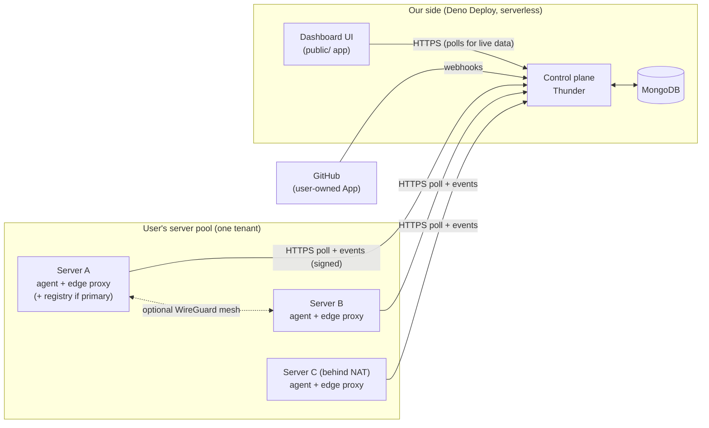
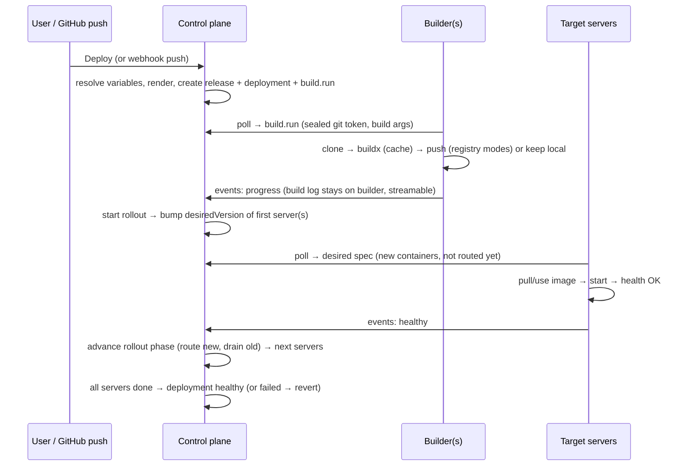

# Huruf Deploy — Product & Technical Plan

> Status: **v4.9 — Phases 0–13 and 15–19 are built** (status notes in §16; Phase 19, the market, §30, pending review); Phase 14 is the backlog, managed servers (D42, §24) are not built.
> Product: **Huruf Deploy**. Reference product: Dokploy (inspiration, not a clone).
> Every phase in §16 ends with a review checkpoint before the next one starts.

**v4.9:**
- **A market of machines** (D50, §30, Phase 19, built, pending review): anyone rents out a machine at hourly prices; customers find it in a market and pay monthly in advance; the owner earns after each month minus a commission set by their workspace plan, with a security per machine. Measurements it relies on are built (§29). AWS provisioning moves to Phase 20.

**v4.8:**
- **Rentals on any machine** (D49, §28, Phase 18): no pool machines; an admin gives any platform machine a class, and rentals are isolated one by one. Every partition's whole disk is capped at its size. Phase 18 addendum in §16 logs the review fixes (billing keys, admin suspend/resume/delete, deploy pruning, agent shutdown).

**v4.7:**
- **Partitions on every server** (D48, §27, Phase 17): every agent is a host and the customer sizes a partition after install, leaving the rest to other tools; uninstall no longer relies on a log of what the agent installed.

**v4.6:**
- **Shared resources** (D47, §26, Phase 16): customers rent partitions of Huruf's pool machines (Sysbox system containers running our agent, joining the customer's tenant); Huruf's remainder partition uses whatever isn't rented. Sizes or custom amounts from a per-class rate card, paid monthly upfront. Consent for platform-run capacity (D42) is given with it.

**v4.5:**
- **Managed servers** (D42, §24): optional future option, implemented only with the owner's explicit consent. The structural seams are prepared now.
- §20.3: safety limits are read through a cached `Settings` wrapper (the DB-backed env fallback is uncached).
- §20.2: the thunder-core `guard` hook must cost zero DB operations on agent polls (verified in Phase 1).

**v4.4:**
- Code quality and architecture (§23): layers, shared building blocks, strategy interfaces, no-duplication rules enforced in CI.
- Open questions in §18 accepted as proposed.

**v4.3:**
- Agent renamed to `huruf-deploy-agent`.
- **Usage plans and subscriptions** (§22): public and private plans, Free by default, wallet charging, a payment log that drives the automatic Free fallback.
- Limits split into **plan quotas**, **safety limits** and **agent defaults** (§20.3), with cheap atomic enforcement.
- **Bounded in-memory caches** with a memory budget (§20.4).
- Plans and billing get their own phase (Phase 10); domains move to Phase 11.

**v4.2:**
- Product name and agent naming (D35).
- Docker Hub + generic registry config (D36).
- Footprints and capacity history kept **only on agents** (D37). Platform-wide footprint averages dropped.
- Default limits as admin-configurable platform settings (D38, §20.3).
- 20 s offline-alert grace confirmed.

**v4.1:**
- Lease is 10 s with 5 s idle polls. Poll-hot fields moved to a tiny `serverLeases` document, so each poll is one database operation.
- No cron of any kind.
- Route sub-folders are organizational, so routes are grouped by nav group.
- SDK workflow: overwrite the same SDK version, then rebuild.
- The agent uses the same license.

**Changes since v3:**
- **Offline detection redesigned for scale (§3.4):**
  - Polls renew a lease instead of writing on every poll.
  - The sweep is sharded, and each Deno Deploy instance checks in memory whether a sweep is due, so it touches the DB only then.
  - Alerts go out through a separate outbox, so sending them never slows a poll.
- **Desired specs are precomputed and sealed when they change**, never computed on the poll path (§4.4).
- **Stop first** is a user-selectable deploy strategy (§10).
- **Frontend standards (§15):** thunder-ui rules, shadcn-first component policy, design and accessibility principles, the "essential now, heavy on demand" approach to detail pages, and frontend performance.
- **Backend engineering and performance budget (§20).**
- **Repository layout and contributor experience (§21):** a monorepo, the protocol as a generated contract, an agent simulator, and ADRs.

**Changes in v3:**
- The control plane is hosted on **Deno Deploy**.
- Polls carry a **sequence cursor** that acknowledges what the agent has already fetched.
- **The poll is the heartbeat.** No separate tick or cron. Dead servers are detected from `lastSeenAt`, and offline handling is piggybacked on other agents' polls.
- The **interactive terminal is in the MVP**, using a fast "terminal mode" poll.
- Image distribution has three modes. **Build on every server** is the fallback when there is no registry.
- Deploy strategies: **Rolling** or **All at once** (blue-green). Docker restarts crashed containers itself.
- Server selection is done by the user, **based on free resources** shown in the UI ("self-hosted AWS"). Automatic rescheduling to other servers is dropped.
- The private network is **optional per server**. Servers behind NAT work fine for apps that don't need it.

---

## 1. Goal

A free-to-use SaaS that deploys and operates apps on **the user's own machines** using Docker. It works like a self-hosted AWS: the user keeps adding servers to a pool as their apps and system grow, and places projects on them.

- We host the **control plane** (dashboard + API, Thunder on Deno Deploy).
- Users bring their own machines (VMs, EC2, bare metal — Ubuntu only for MVP) and run our **agent** on them.
- All builds and workloads run on the user's machines. We store as little as possible.

---

## 2. Decisions

| # | Decision |
|---|---|
| D1 | SaaS control plane: Thunder (Deno + MongoDB) on **Deno Deploy**, serverless. Only the agent is self-hosted. |
| D2 | **No gateway, no persistent connections.** Agents poll for work and push results/data to a webhook endpoint with a `request` reference and data type. |
| D3 | **The poll is the heartbeat.** Polls renew a server **lease** (`aliveUntil`), which decides online/offline. No separate heartbeat or cron. Dead servers are found by a sharded, throttled, piggybacked sweep designed for scale (§3.4). |
| D4 | **Cursor acknowledgement.** Every poll sends the agent's cursors (last command sequence, applied desired-state version). The control plane returns only newer items and marks older ones delivered (§3.3). |
| D5 | **Desired-state reconciliation.** The control plane stores *what should run where*; agents converge to it. Imperative commands only for one-off tasks. |
| D6 | **Adaptive polling:** idle / active / terminal modes (§3.2). |
| D7 | Manual install needs **only the tenant ID** (no API key). The user accepts or rejects in the dashboard. Identity is a keypair plus a pairing code (§4.2). |
| D8 | **SSH wizard install:** the user gives SSH access once, the deploy app installs the agent, then the credentials are discarded (§4.3). |
| D9 | **Store the minimum on our side** (§3.5). Logs and metrics stay on the agent machine, bounded, and are streamed read-only on request. Deployment status and metadata are stored with us. |
| D10 | Toolchains live inside Docker images, never on the host. BuildKit cache **with escape hatches**: "Clear build cache" and "Deploy without cache". |
| D11 | Templates: system (admin), tenant/custom (user), clone-and-extend, versioned. |
| D12 | Image distribution: user's registry → built-in registry → **build on every server** fallback (§8.4). |
| D13 | **No Docker Swarm.** Plain Docker managed by the agent. Docker's restart policy restarts crashed containers. The control plane orchestrates rollouts across servers. |
| D14 | Deploy strategies, selectable per project: **Rolling**, **All at once (blue-green)** and **Stop first** (§10). |
| D15 | **No cluster concept.** A tenant's servers form a pool. The user picks a project's servers from free-resource information (§7). |
| D16 | The private network (WireGuard mesh) is **optional per server**. A server that can't join it still runs apps. Fixing reachability for apps that need the private network is the user's job; we show clear status (§8.2). |
| D17 | **Interactive terminal is in the MVP**, over polling in terminal mode (§3.6). |
| D18 | macOS is out of scope for MVP. Ubuntu 22.04/24.04, amd64/arm64. |
| D19 | GitHub integration is a GitHub App created on the user's account/org (Manifest flow), optionally shared with the tenant. |
| D20 | Sources: GitHub + template, generic Git + template, Dockerfile, docker-compose (also covers "image from registry"). No Nixpacks/Railpack. |
| D21 | RBAC, tenants and the wallet come from thunder-core. Roles: `admin` (platform, `root`) and `user`. |
| D22 | No environments inside a project (staging = a separate project). Projects can be grouped. |
| D23 | Deploy on push is on by default (can be disabled). Manual deploy is always available. |
| D24 | Rollback uses the last N stored releases (N by plan). |
| D25 | One-click services are built-in service templates. Alerts are user-configurable. |
| D26 | Variable manager scopes: **global (the user, across all their tenants)**, tenant, project. Encrypted, and reachable externally via API/SDK. |
| D27 | Agent language: **Go**. |
| D28 | ~~Domains and public load balancing are deferred to a Cloudflare-based phase; the deploy app never hosts a load balancer.~~ **Superseded by D43.** MVP access is `server-ip:port`. |
| D29 | Built and reviewed phase by phase (§16). |
| D30 | **Backend performance is the top non-functional priority.** Every hot path has a budget, enforced by load tests (§20). |
| D31 | Backend follows the Thunder `llms.txt` and thunder-core conventions. Frontend follows the thunder-ui `llms.txt` (§15, §20). |
| D32 | UI component priority: **shadcn/ui first**, then shadcn-compatible registries, then justified third-party libraries, then custom (§15.3). Modern, minimal, accessible (WCAG 2.2 AA). |
| D33 | Open source: structured for outside contributors (§21). **Monorepo.** The agent uses the same license as the rest of the project. |
| D34 | **Lease = 10 s** with 5 s idle polls. Offline is detected in ~10–15 s. The `agentOffline` alert has a 20 s grace by default. **No cron at all** (no `Deno.cron`). |
| D35 | **Product name: Huruf Deploy.** Agent naming (`huruf-deploy-agent`): binary `huruf-deploy-agent`, systemd unit `huruf-deploy-agent.service`, config `/etc/huruf-deploy-agent/`, state `/var/lib/huruf-deploy-agent/`, Docker labels `deploy.huruf.*`, internal network `huruf-internal`. |
| D36 | **External registries:** Docker Hub, plus a generic third-party registry config (any registry URL + username + password/token), which covers GHCR, GitLab, Harbor, a self-hosted registry, etc. (§8.4). |
| D37 | **Footprints and capacity history stay on the agent nodes.** The control plane fetches them on demand and never stores them (§7.1). |
| D38 | **Limits are mandatory, to prevent abuse** (§20.3). **Plan quotas** are per tenant and raised by plans. **Safety limits** are platform-wide, admin-only, and stored in thunder-core's database-backed env. **Agent defaults** protect the user's disk. |
| D39 | **Usage plans** (admin CRUD, public or **private**). Every tenant is on **Free** by default. Paid plans are charged from the tenant's thunder-core wallet, and each paid period is logged in `subscriptionPeriods`. **No current paid period → automatic fallback to Free** (§22). |
| D40 | **Every in-memory cache is size-capped** (max entries + TTL + LRU), with a per-instance memory budget. Correctness never depends on a cache (§20.4). |
| D41 | **Code quality:** no duplication. Composable modules and classes in layers (routes → services → building blocks), strategy interfaces for variants, schemas as the single source of truth. Enforced in CI (§23). |
| D43 | **Built-in ingress (Phase 11):** Traefik ships in the control plane package (one per instance) and balances each project's custom domains evenly across its healthy servers. Routes come from the control plane (Traefik HTTP provider, no redeploys); certificates are Let's Encrypt via HTTP-01, issued once by the control plane, stored encrypted in MongoDB and synced to every instance. No AWS or Cloudflare dependency; instances are stateless, so more can be added behind any TCP load balancer. Custom domains only: user apps are never served under the platform's own domain (§14). |
| D44 | **Long polling, not WebSockets (Phase 13):** an agent's poll waits at the control plane until there's something for it (a command, a new spec, terminal input) or a time limit passes. This keeps the polling protocol, adds no dependency to the agent (Go's standard library has no WebSocket client) and keeps old agents working unchanged. WebSockets may come later between the browser and the control plane only, for terminals. |
| D45 | **AI template assistant (Phase 12):** the platform's own Anthropic key, offered as a plan feature with a monthly limit. It drafts templates (from a GitHub repo or a description) and fixes failed builds and rollouts; a person always reviews and saves. |
| D47 | ~~**Shared resources (Phase 16, §26):** Huruf's pool machines are split into partitions (Sysbox system containers, behind a `PartitionDriver`), each running our normal agent; a rented partition joins the customer's tenant as an ordinary server, and Huruf's own remainder partition holds everything not rented (CPU uncapped at lowest priority), so nothing sits idle. Sizes are plans and a rental is a subscription (existing mechanisms, refactored where needed), priced from a rate card per class and paid monthly upfront from the wallet. Admins approve requests for now; custom domains only.~~ **Superseded by D49** (pool machines and the remainder partition are gone; rentals, classes, sizes, approval and billing remain). |
| D48 | **Partitions on every server (Phase 17, §27):** every agent is a host; after install the customer creates a partition of the size they choose and leaves the rest of the machine to other tools. Partitions are servers and can be added, resized and removed later. Uninstall removes partitions and our own objects by label and name, never shared packages (Sysbox only on request), so the install log goes. |
| D49 | **Rentals on any machine (Phase 18, §28):** no pool machines. An admin adds machines like any customer and makes one available for rent by giving it a class; approving a request creates the customer's partition on the machine the admin picks. Rentals are isolated one by one, so the platform's own partitions and other tools share the machine. |
| D50 | **A market of machines (Phase 19, §30, owner 2026-10-28):** any machine's owner can rent it out; customers pick it in a market. The rental system is reshaped, not built alongside: prices move from classes and server plans onto the machine (hourly), the class is measured (§29), the owner accepts requests, and a rental's money becomes the owner's earnings after each month minus the commission of their workspace plan, with a security per machine capped at its whole-machine monthly price. Earnings are kept apart: claimed into the wallet (one way) to spend, or paid out (Stripe Connect, later); the wallet is never withdrawable. |
| D46 | **Payments through Stripe, saved cards first (Phase 15, §25):** customers save a card on a Billing page (Stripe Elements; card data never touches us) and are charged later, off session, when a renewal or payment is short, and on demand through "Add funds". Money always lands in the thunder-core wallet first (`Wallet.ensureBalance` / `addBalance` / `settleTopup`), and every charge still goes through `BillingService`. USD only for now. Gateways sit behind one `PaymentGateway` interface, so more can join the same Billing page later. |
| D42 | **Managed servers (optional, needs owner consent):** provision EC2 instances on the platform's AWS account and bill plan + metered usage from the wallet. The MVP only prepares the seams (§24). |

---

## 3. Architecture and transport



### 3.1 Components

| Component | Where | Responsibility |
|---|---|---|
| **Control plane** | This repo (`routes/`, `schemas/`, `hooks/`, `lib/`, `scripts/`) | Auth, tenants, RBAC, CRUD, GitHub webhooks, template rendering, releases, desired state per server, rollout orchestration (event-driven), variable encryption, agent poll/event endpoints, stream buffers, offline detection, alert delivery, SSH bootstrap. |
| **Agent** | `agent/` Go module in this monorepo (§21) | Host bootstrap, reconciliation, builds, image distribution, edge proxy config, optional mesh and DNS, bounded logs/metrics, terminal (PTY), local alert evaluation, autoscaling, backups, self-update. |
| **Dashboard UI** | `public/<app>` via `deno task generate:app` | Screens in §15. |

### 3.2 Poll modes

| Mode | Interval | When |
|---|---|---|
| **Idle** | 5 s | Nothing active on the server (must stay below half the 10 s lease) |
| **Active** | 1 s | A build or deploy targets the server, or someone is viewing its logs/metrics |
| **Terminal** | ≈ 150 ms | A terminal session is open on the server (ends as soon as the last terminal closes) |

- Every poll response includes `nextPollMs`, so the control plane decides the mode.
- **Agents hardcode no pacing (owner requirement).**
  - Poll intervals, jitter, the summary interval and the error backoff cap are control-plane settings (`AGENT_POLL_*`, `AGENT_SUMMARY_INTERVAL_MS`, `AGENT_MAX_BACKOFF_MS`, in `envs`). They are served by `POST /agents/api/config` and included in the `hello` response.
  - Every poll response carries a `configVersion`; the agent refetches the config when it changes.
  - The only value built into an agent is the retry delay for when the control plane is unreachable.
  - The lease is derived as 2 × the idle interval, so raising the idle interval can never make servers flap offline.
- Modes are driven by fields on the `servers` document (`fastPollUntil`, `terminalUntil`), which UI activity keeps extending.
- When the activity stops, the server drops back to idle automatically.
- **Request volume and cost per poll:** see the performance budget in §20.2. An idle poll where nothing changed costs exactly one `findOneAndUpdate` on a tiny document (lease renew + read of the hot fields). Fast modes cost more only while someone is actively using them.

### 3.3 Poll request/response and cursors

**Poll request** (`POST /agents/api/poll`):

```jsonc
{
  "commandCursor": 41,          // highest command seq the agent has durably received
  "appliedVersion": 17,         // desired-state version the agent has applied
  "streams": { "<session>": 9 },// per open stream: highest input seq received (terminal keystrokes)
  "summary": { "cpu": 0.31, "memFree": 2.1e9, "diskFree": 4.0e10, "containers": [/* id, project, state, health */] }
}
```

**Poll response:**

```jsonc
{
  "nextPollMs": 1000,
  "desired": { "version": 18, "spec": { /* only if version > appliedVersion */ } },
  "commands": [ { "seq": 42, "type": "logs.stream", "payload": "…sealed…" } ],
  "streamInput": { "<session>": [ { "seq": 10, "data": "ls -la\r" } ] },
  "closeStreams": ["<session>"]
}
```

**Why sequence numbers instead of timestamps:**
- Clock skew between the agent and Deno Deploy can make timestamps skip or repeat items.
- Two items written in the same millisecond can't be ordered by timestamp.
- So each server has an atomic counter (`servers.commandSeq`, `$inc` on insert) and each command stores its `seq`.

How acknowledgement works:
- A poll with `commandCursor = 41` means "I have everything up to 41". Commands ≤ 41 are marked delivered, and only commands > 41 are returned.
- If a response is lost, the agent sends the same cursor again and gets the same commands back, so nothing is missed.
- Executing twice is prevented by the agent's local record of completed seqs.
- The same pattern is used for terminal input (per-session `seq`) and stream output chunks.

**Events / webhook** (`POST /agents/api/events`): batched `{ id, type, request?, data }`. Types:
- command results
- deployment progress
- stream output chunks
- container state changes
- alerts

Each event id is unique (index), so retries never double-apply.

### 3.4 Heartbeat, leases and offline detection at scale

**Why the simple version breaks at scale:**
1. Writing `lastSeenAt` on every poll means 100k servers polling every 10 s cause **10k writes/s** for liveness alone.
2. A single global lock document that every poll tries to take becomes a **hot document** with constant write contention.
3. An unbounded sweep inside someone's request makes that request's latency unpredictable.
4. Sending alerts (SMTP, webhooks) inside a poll ties agent latency to third-party services.

**Design:**

1. **Short leases, one database operation per poll.**
   - **Lease = 10 s.** Idle polls run every **5 s**, so one lost or late poll (±20% jitter) never marks a healthy server offline.
   - A poll renews `aliveUntil = now + 10 s` whenever less than 6 s remain, which in practice is every idle poll. In fast modes, renewal happens at most every ~4 s, not on every poll.
   - **Hot/cold split:** all poll-hot fields live in a tiny `serverLeases` document: `aliveUntil`, `shard`, `status`, `desiredVersion`, `commandSeq`, `fastPollUntil`, `terminalUntil`, `offlineSince`.
     - The poll renews the lease *and* reads those fields in **one `findOneAndUpdate`**, filtered on `status: "active"`. One round trip, one write.
     - The large `servers` document (identity, inventory, labels, mesh) is never rewritten by polls.
   - **Signature verification without a DB read:** agent public keys are cached in each instance's memory by fingerprint. Revocation still takes effect immediately, because the `status: "active"` filter on the lease update rejects removed or rejected servers.
   - **Lease writes skip the journal** (`{ w: 1, j: false }`). Losing the last few hundred milliseconds of liveness timestamps in a database crash is harmless and noticeably cheaper.
   - Online means `aliveUntil > now`, computed for free in the UI and API.
   - **Detection latency: about 10–15 s** (lease plus sweep interval). The UI shows offline after that.
   - The `agentOffline` alert has a configurable grace period (`forSec`, default 20 s) so brief network blips don't send alerts.
2. **Sharded sweep state.**
   - Each server gets a fixed `shard = hash(_id) mod 64` at creation. There are 64 tiny `sweepShards` docs `{ _id: k, nextRunAt }`.
   - Spreading the work over 64 docs removes the hot-document problem.
3. **The due check happens in memory, so the DB is touched only when a sweep is due.**
   - Each Deno Deploy instance keeps the last known `nextRunAt` per shard in memory.
   - A request checks memory only. Only when a shard looks due does it run `findOneAndUpdate({ _id: k, nextRunAt: { $lte: now } }, { $set: { nextRunAt: now + 5s } })`.
   - One request wins; the others learn the new `nextRunAt` and go back to memory-only checks.
   - **The whole system's sweep coordination costs ≈ 64 tiny writes per 5 s (~13/s), independent of server count.**
4. **Which requests check which shards.**
   - Every agent poll checks its own shard plus one random shard, and dashboard API requests check one random shard.
   - With 5 s idle polls, every shard is swept within ~5–10 s as long as *any* agent or user is active anywhere. A shard containing a single dead server is still covered.
5. **Bounded sweep work.**
   - The winner runs one indexed query on `serverLeases`: `{ shard: k, status: "active", offlineSince: null, aliveUntil: { $lt: now } }`, limit 200, backed by a partial index.
   - It sets `offlineSince` with one `bulkWrite` and inserts `alertEvents` into an **outbox**. This is milliseconds of work, never unbounded.
6. **Alert delivery is outside the hot path (outbox).**
   - Outbox items are claimed with `findOneAndUpdate` plus a `claimedUntil` lease, piggybacked the same way (one item per request, at most a few per second system-wide).
   - Claims happen on **dashboard/API requests and event ingestion, not on agent polls**, with a strict per-item timeout. Failed items retry with backoff.
   - Email goes through an HTTP mail API (`Mailer.onSendMail`) rather than SMTP, to keep each send fast.
7. **Recovery is in-request and per server.** When a poll arrives from a server with `offlineSince` set, that same request clears the flag and queues a "resolved" alert.
8. **Total silence** (no agent and no user active anywhere): nothing sweeps. This is accepted, since there is nobody to alert in that state. There is **no cron of any kind**, including `Deno.cron`.

### 3.5 Data minimization

| Stored with us | Ephemeral with us (TTL) | Never stored with us |
|---|---|---|
| Accounts, tenants, servers (public keys, inventory summary, last resource summary), latest sealed spec per server, projects (desired spec), templates, releases (last N), deployment metadata (status, commit, timings, one-line error), encrypted variables, git credentials (encrypted), alert rules and fired-alert history, audit events | Commands (hours), stream sessions, stream chunks and terminal input (minutes), pairing requests (15 min), bootstrap progress (hours) | Container logs, build logs, metrics history, footprints and capacity history, terminal history, SSH credentials, plaintext secrets, image contents |

### 3.6 Streams and terminal over polling

**Read-only streams** (logs, build output, metrics, exec output):
1. The UI opens a `streamSessions` doc, which puts the server in active mode.
2. The agent picks the session up on its next poll and posts output chunks about every 500 ms through events.
3. The chunks land in `streamChunks` (TTL ≈ 2 min).
4. The UI polls `GET /streams/api/:id?after=<seq>` about every second.
5. If the UI stops polling for 30 s, the session closes.

**Terminal:**
- The agent opens a PTY: `docker exec` with a TTY into a container, or a host shell (a separate permission).
- The server switches to **terminal mode** (≈ 150 ms polls, `AGENT_POLL_TERMINAL_MS`; long polling, Phase 13, delivers input as soon as it arrives).
- Keystrokes are posted by the UI (`POST /streams/api/:id/input`), batched every ~50 ms, and delivered on the next agent poll.
- PTY output is batched every ~100 ms and posted as events. The UI polls output about every 300 ms. **xterm.js** renders it.
- Expected keystroke-to-echo time: ≈ 0.4–1 s. Fine for typing commands and reading output; full-screen tools (vim, top) work but feel laggy.
- Optional **line mode**: local echo and line editing in the browser, sending on Enter. It feels instant for normal shell use.
- Session audit (who, server/container, start, end) is deferred with audit logs (§17). The content is never stored with us.
- **Long polling (Phase 13, D44)** replaces the fast terminal polls, for near-instant streams within the same model.

---

## 4. Agent ↔ control plane protocol

### 4.1 Request authentication (no API key)

Every agent request carries:
- `X-Agent-Key`: fingerprint of the agent's Ed25519 public key
- `X-Agent-Timestamp`
- `X-Agent-Signature`: Ed25519 signature over `method ‖ path ‖ timestamp ‖ sha256(body)`

The control plane rejects requests with clock skew over 60 s, an unknown key, or an inactive server (except `hello`). The `agents` router is reachable by the RBAC `guest` role (added to the `public` policy), and the signature is verified inside the handlers.

### 4.2 Pairing

1. On first run, the agent generates an **Ed25519** key (signing) and an **X25519** key (receiving sealed secrets) in `/var/lib/huruf-deploy-agent/identity` with mode `0600`.
2. It sends `POST /agents/api/hello {tenant, signPublicKey, boxPublicKey, inventory, joinToken?}`.
3. If there is a valid one-time `joinToken` (SSH wizard), the server becomes **active** immediately.
4. Otherwise the server becomes **pending**:
   - `pairingCode = base32(sha256(signPublicKey))[0..6]`, expiring after 15 min.
   - The agent prints the same code in its terminal, and the user accepts only if the two codes match.
5. Abuse limits: at most 5 pending servers per tenant, a per-IP rate limit, and auto-expiry.
6. Secrets sent to an agent are **sealed with its X25519 public key**.

### 4.3 SSH wizard install (what "SSH install" means)

This is the onboarding flow from the original requirements: *"the user provides secure SSH access to his machine, and our app auto-installs the agent."* To install anything on the user's machine, the deploy app (on Deno Deploy) must open an SSH connection to it **once**:

1. The user enters host, port, user, and a key or password in the wizard (`POST /servers/api/bootstrap`). The credentials are used in memory only and never written to the DB.
2. The handler SSHes in, uploads the installer, starts it **detached** (`nohup … &`) with a one-time join token, then disconnects. This takes seconds, well within a serverless request.
3. The installer installs Docker and the agent. The agent registers with the join token (auto-accepted) and reports progress through events, which the wizard polls.

> **Spike (Phase 2):** confirm that an SSH client library (e.g. `npm:ssh2`) works on Deno Deploy with outbound TCP. If it doesn't, the wizard falls back to the one-line manual install command, which needs no SSH from our side.

### 4.4 Desired state

- Each server has a `desiredVersion`. It is incremented whenever anything affecting that server changes: project spec, active release, rollout phase, replicas, variables, mesh peers, DNS records, alert rules.
- The spec is **computed once when it changes** (at the moment `desiredVersion` is bumped), sealed to the agent's key, and stored in `serverSpecs` (latest version only).
  - The poll path only returns the stored blob. **No joins, rendering or decryption ever happen on a poll.**
  - Changes that touch many servers (e.g. a tenant variable) recompute specs in bounded batches inside the triggering request, or through the outbox when more than a batch limit is affected.
- It contains:
  - containers to run, with image, env (sealed), volumes, resources, health, and whether each is **routed** (receives traffic)
  - edge-proxy routes
  - mesh peers
  - internal DNS records
  - alert rules
  - autoscale rules
- The agent applies the spec and reports `appliedVersion` plus per-container state and health.

### 4.5 One-off command types

Built: `ping`, `docker.ensure`, `stream.open` / `stream.close` (logs, build output, metrics, exec, terminal, capacity), `build.run`, `cache.clear`, `agent.update`, `registry.delete`, `host.cleanup`, `pool.ensure`, `partition.create` / `resize` / `stop` / `start` / `remove` / `send` / `receive`. Not built: `volume.backup` / `volume.restore` (backups skipped, §11).

---

## 5. Core concepts

| Concept | Meaning |
|---|---|
| **Tenant** | thunder-core tenant. Owns a **server pool**. |
| **Server** | One machine with our agent. It reports capacity and free resources on every poll. Optionally joins the tenant's private network. |
| **Primary server** | The server hosting the built-in image registry (optional, §8.4). |
| **Project** | One deployable app or one-click service, running on the **servers the user selected**, with N replicas per server. |
| **Project group** | Organizational grouping of projects. |
| **Template** | A versioned recipe producing a Dockerfile (app) or a compose spec (service). |
| **Release** | Immutable rendered runtime spec + image reference + encrypted variable snapshot. |
| **Deployment** | One attempt to build and roll out a release (metadata only). |
| **Rollout** | The control-plane state machine of a deployment across servers (rolling or all at once). |
| **Variable** | An encrypted key/value at the global (user), tenant or project scope. |
| **Git integration** | A user-owned GitHub App plus its installations, optionally shared with the tenant. |

---

## 6. Data model (MongoDB)

Thunder naming rules apply: reference fields are named after the entity, never `…Id`. Tenant-owned collections carry `tenant` and are isolated through `createCRUD` `isolationFields`. Key fields only; exact Zod schemas are written in the phase that introduces them.

| Collection | Key fields |
|---|---|
| `networks` | tenant, cidr (e.g. `10.210.0.0/16`), nextSubnetIndex, primaryServer(server)?, registry {mode: `none`/`builtin`/`external`, meshAddress?, external(registry)?, usernameEnc?, passwordEnc?} (the built-in registry's credentials, or a reference to an external `registries` entry) |
| `servers` | tenant, name, status (`pending`/`active`/`rejected`/`removed`), identity {signPublicKey, boxPublicKey, fingerprint}, pairingCode, pairingExpiresAt, installMethod (`ssh`/`manual`, later `managed`), provider {kind: `machine`/`partition`/`rented`, host(server)?, partition?, meshPort?, subscription?} (§27, §28; a `managed` kind is future, §24), labels{}, inventory {hostname, os, arch, cpuCores, memory, disk, publicIp, privateIp, dockerVersion, agentVersion}, resources {cpuUsed, memFree, diskFree, reportedAt}, mesh {enabled, reachable, publicKey, meshIp, endpoint, containerSubnet}, appliedVersion, acceptedBy(user). **Cold document:** polls never write it. |
| `serverLeases` | _id = server, tenant, shard, status (mirrors `servers.status`), aliveUntil, offlineSince?, desiredVersion, commandSeq, fastPollUntil, terminalUntil. **Hot document:** one `findOneAndUpdate` per poll; partial index `{shard, aliveUntil}` where `status: "active", offlineSince: null`. |
| `sweepShards` | _id (shard 0–63), nextRunAt |
| `serverSpecs` | server, version, specSealed, createdAt. Only the latest version per server is kept. |
| `agentCommands` | tenant, server, seq, type, payloadSealed, status (`pending`/`delivered`/`done`/`failed`), result, error, createdBy(user), expiresAt (TTL). Unique index (server, seq). |
| `agentEvents` | server, eventId (unique), type, expiresAt (short TTL, idempotency only) |
| `streamSessions` | tenant, server, kind (`logs`/`build`/`metrics`/`exec`/`terminal`), params, inputSeq, createdBy, lastReadAt, expiresAt (TTL) |
| `streamChunks` | session, direction (`in`/`out`), seq, data, expiresAt (TTL ≈ 2 min) |
| `bootstrapSessions` | tenant, server?, status, steps[], oneTimeTokenHash, createdBy, expiresAt (SSH credentials never stored) |
| `gitIntegrations` | tenant, owner(user), provider, appId, appSlug, clientId, clientSecretEnc, privateKeyEnc, webhookSecretEnc, account {login, type}, installations[], sharedWithTenant |
| `templates` | scope (`system`/`tenant`), tenant?, kind (`app`/`service`), name, slug, description, icon, clonedFrom(template)?, latestVersion, isPublished |
| `templateVersions` | template, version, dockerfile or compose (Handlebars), inputs[{key, label, type, default, required, secret}], defaults {port, healthcheck, startCommand, buildCommand, resources}, cachePaths[], changelog, createdBy |
| `projectGroups` | tenant, name, description |
| `projects` | tenant, group?, name, slug, kind, source {type, gitIntegration?, repo, branch, gitUrl?, deployKeyEnc?, rootDir, dockerfile?, compose?}, template?, templateVersion?, templateInputs{}, runtime {port, healthcheck, resources {cpuLimit, memLimit, cpuReserve, memReserve}}, servers[server], replicasPerServer, needsPrivateNetwork, publicPort?, volumes[{name, mountPath, type: `local`/`s3`, s3Config?}], deployStrategy (`rolling`/`allAtOnce`/`stopFirst`), autoscale {enabled, min, max, cpuTarget, memTarget, cooldownSec}, autoDeploy, activeRelease(release), cacheEpoch, status |
| `releases` | tenant, project, number, runtimeSpec, imageRef, commit {sha, message, author}, variableSnapshotEnc, createdBy, createdAt. Last N kept per project. |
| `deployments` | tenant, project, release?, trigger (`manual`/`push`/`rollback`), strategy, distribution (`registry`/`perServer`), status (`queued`/`building`/`distributing`/`deploying`/`healthy`/`failed`/`cancelled`), buildServers[server], rollout {phase, servers[{server, state}]}, noCache, commit, startedAt, finishedAt, durationMs, errorSummary (one line), triggeredBy(user) |
| `variables` | scope (`global`/`tenant`/`project`), user? (global), tenant?, project?, key, valueEnc, isSecret, kind (`env`/`file`), stage (`build`/`runtime`/`both`), description, version, updatedBy |
| `keyring` | owner {kind: `user`/`tenant`, ref}, dataKeyEnc, keyVersion |
| `alertRules` | tenant, target {kind: `server`/`project`, ref}, metric, threshold, forSec, channels[{type: `email`/`webhook`/`slack`, target}], enabled |
| `alertEvents` | tenant, rule, firedAt, resolvedAt, value, deliveredChannels[], delivery {status, attempts, nextAttemptAt, claimedUntil} (outbox) |
| `auditEvents` | tenant, actor(user), action, target, metadata, createdAt |
| `registries` | tenant, name, kind (`dockerhub`/`generic`), url (generic only), username, secretEnc (password or token), isDefault, createdBy |

Indexes (including the TTL indexes) live in `scripts/syncDeployIndexes.ts` and are run by setup, never at startup.

---

## 7. Server pool and placement ("self-hosted AWS")

- **Adding capacity:** the user keeps adding servers to the tenant pool (SSH wizard or manual). Every server reports capacity and free CPU/RAM/disk on each poll.
- **The UI shows, per server:**
  - capacity and live usage bars
  - **reserved** resources: the sum of `cpuReserve`/`memReserve` of the projects placed on it
  - **free-to-allocate** = capacity − reserved
  - online status, and private network reachability
- **Project placement:** the user selects servers and sets `replicasPerServer`.
  - The wizard sorts servers by free-to-allocate, and **warns or blocks** if the project's reservation doesn't fit.
  - A "suggest servers" helper picks the emptiest ones. The user still confirms.
- **Moving a project:** change its servers and redeploy. The new servers come up and the old ones drain, following the chosen strategy.
- **No automatic rescheduling:** the user chose the servers explicitly, so a dead server raises an alert instead of silently moving workloads. "Standby servers" or auto-placement are backlog.
- **Labels** are kept for filtering and organization (e.g. `region=eu`, `builder=true`).

### 7.1 Capacity insights ("how many more apps fit, and when do I need another server?")

The pool is shown as one combined compute budget. The user also gets guidance based on **observed footprints** of what they actually run, not only on declared reservations.

**Footprints live only on the agent (D37):**
- Per container, the agent rolls up **p95 and peak** CPU and memory, plus disk (image + volumes + logs), over rolling **24 h and 7 d** windows. Each footprint is tagged with project and template.
- It also keeps **one row per day** of server peaks (memory, CPU p95, disk) for **90 days**. That's a few kilobytes in total, enough for growth forecasts.
- Both are stored in the agent's embedded store, and retention is adjustable in the agent config.
- Nothing is pushed to us. When the user opens the pool overview, a server page or the deploy wizard:
  1. The control plane sends a `capacity.report` command to the tenant's servers and puts them in fast-poll mode.
  2. Each agent replies with its footprints and trend summary within ~1–5 s, as a stream session (TTL'd, like logs).
  3. The UI combines the replies, and the result is cached only in the browser for the session.
- The only capacity data on our side is the **current** free-resource snapshot from the poll summary (overwritten, no history), used to sort servers instantly in the wizard.
- **Class footprints:** the typical footprint of a *kind* of app (all of the tenant's projects using the same template) is aggregated **in the browser** from the agents' replies, e.g. "a Thunder app here typically needs 180 MB / 0.08 CPU at p95".
  - New projects with no history use the class footprint.
  - With no class history either, they use the template default or the declared reservation.
- **Offline servers** show "capacity unavailable" with their last known snapshot.

**Fit calculation:**
- `room_r = capacity_r − safety headroom − max(reserved_r, observed p95 usage_r)` for each resource r (CPU, memory, disk).
- Safety headroom covers the OS, agent and Caddy (default 15%), plus **build headroom** on servers that build.
- `fits = min over resources of floor(room_r / footprint_r)`. **Memory is the hard limit** (exceeding it gets containers killed). CPU can be overcommitted, and the UI says so.
- Each project's footprint is multiplied by its replicas, and by **autoscale max** when autoscaling is on (worst case).
- **Fit is per server, not just a pool sum.** "5 servers with 4 GB free in total" doesn't fit a 2 GB app if each has only 800 MB. The UI shows both the pool total and the largest server slot.

**What the user sees:**
- **Pool overview:** combined CPU, memory and disk (capacity / reserved / actual) and "fits N more apps like X" for the user's most-used app classes.
- **Per server:** room in "app units" ("≈ 4 more Node apps, ≈ 1 more Postgres").
- **Deploy wizard:** the fit check uses footprints, suggests servers, and shows the impact ("after this, server A fits 2 more").
- **Growth forecast:** a linear trend over daily memory and disk peaks, giving "pool memory full in ~3 weeks" and catching slowly growing apps (memory leaks, growing volumes).
- **Recommendations** (advice only, never automatic):
  - "Add a server: ≥ 4 GB RAM covers your next ~6 apps."
  - "Server C is 10% used; consider placing new projects there."
  - "Project X reserves 1 GB but uses 150 MB; lower its reservation."
- **Capacity alert** (optional rule): a server's room below N app units or X% headroom, **evaluated by that server's agent** like other metric alerts.

---

## 8. Networking without Swarm

### 8.1 Default (no private network needed)

- Each server has a local Docker network `huruf-internal`. Projects **on the same server** reach each other by name through the agent's DNS server (`<project>.internal`).
- Public access goes through the server's edge proxy on `publicPort` (§14).
- This works everywhere, including servers behind NAT.

### 8.2 Private network (optional WireGuard mesh)

- A server joins the tenant's mesh when the user enables it (on by default if reachable). It gets a WireGuard keypair (only the public key goes to us), a mesh IP and a **unique container subnet** (`10.210.N.0/24`). Containers can then reach containers on other mesh servers directly.
- **Reachability:** the mesh needs UDP 51820 reachable between servers (public IP or same LAN/VPC).
  - The agent probes each peer and reports `mesh.reachable` per pair.
  - NAT'd servers simply aren't mesh-reachable and keep working for everything else.
- **Projects that need it:** a project can be marked `needsPrivateNetwork`, or that is inferred from references to other projects' `.internal` names or variables. If its servers can't reach the servers of its dependencies, the UI warns clearly with fix instructions (open UDP 51820, same VPC). **Fixing it is the user's responsibility.** We don't build relays in the MVP.

### 8.3 Service discovery

- The agent's embedded DNS server is bound on the bridge gateway, and containers use it as their resolver.
- `<project>.internal` returns the IPs of **healthy, routed** replicas: local ones, plus remote ones on mesh-reachable servers. Multiple A records, TTL 5 s.
- Works for HTTP and plain TCP (e.g. `postgres.internal:5432`).

### 8.4 Image distribution (D12)

Decided per deployment, in this order:

| Mode | When | How |
|---|---|---|
| **External registry** | The user connected a registry: **Docker Hub**, or a **generic** registry (URL + username + password/token, e.g. GHCR, GitLab, Harbor, self-hosted). Registries whose tokens expire, such as AWS ECR (12 h tokens), need provider-specific refresh and are backlog. | One auto-selected server builds and pushes; the others pull. |
| **Built-in registry** | No external registry, a primary server exists, and all target servers are mesh-reachable to it | The registry's own server builds and pushes locally (mesh-only, htpasswd); the others pull. |
| **Build on every server** (fallback) | Neither of the above, or the user prefers it | Each target server builds the same commit SHA itself. No registry needed. |

- The single builder: a target labeled `builder=true` if there is one; otherwise, with the built-in registry, the registry's server (its push stays local, and builds no longer move between servers); with an external registry, the least loaded online target.
- **Built-in registry upkeep:**
  - Its htpasswd uses bcrypt cost 10, not Caddy's default 14, which took seconds per request on small servers and stalled pulls.
  - Garbage collection runs with the registry stopped, in a one-off container on its volume, then starts it again: collecting while it serves raced pushes and left images whose layers failed to pull.
  - A failed pull is retried twice (after 3 s and 10 s), resuming from the layers already downloaded, before the rollout fails.
- With one target server, it just builds and runs locally, with no distribution step.
- Build-on-every-server costs N× build time, and images can differ slightly if base images or unpinned dependencies change between builds. Mitigations:
  - All servers build the **same commit**.
  - The first builder reports the base image digest, and the other servers pin to it.
  - The UI warns when the lockfile is missing.

### 8.5 Self-healing

- **Crashed containers** are restarted by Docker's restart policy (`unless-stopped`).
- **Reboots or deleted containers** are recreated by the reconciler from the desired state.
- **Dead servers** raise an alert through the offline sweep (§3.4). Workloads are not moved automatically (§7).

### 8.6 Why no Swarm (for the record)

| | Swarm | No Swarm (chosen) |
|---|---|---|
| Effort | Lower (built-in scheduling/overlay) | ~3–5 weeks more (reconciler, mesh, DNS, rollouts) |
| Mixed networks / NAT | Every node must reach every node | Servers work standalone; the private network is optional |
| Control and debuggability | Black box | Ours end to end |
| Blue-green / all at once | Not native | Natural (edge proxy + desired state) |
| Single source of truth | Swarm Raft + us | Us |

---

## 9. Build pipeline and templates

### 9.1 Templates

- **Scopes:** `system` (admin) and `tenant` (users). **Clone** copies the latest version into a tenant template and keeps `clonedFrom`.
- **Kinds:**
  - `app`: Handlebars Dockerfile plus inputs.
  - `service`: Handlebars compose plus inputs, for one-click services. Generated passwords become project secret variables.
- **Versioning:** every save creates an immutable version. Projects pin a version, and the UI offers "upgrade to vN" with a diff.
- **Rendering** happens on the control plane with the built-in `handlebarsRender`. The agent receives final files only.
- **Compose sources** are parsed on the control plane (`lib/deploy/compose.ts`, `@std/yaml`) into the same runtime spec, so they get the same reconciler, health checks, rollouts and DNS. Unsupported keys are reported when the template is rendered, before anything reaches a server.
- **Seed system templates** (data, not code): Thunder, React/Vite (static), Next.js, Node, Deno, plus one-click Postgres, MongoDB, Redis, MySQL, MinIO.
- **AI assistant:** drafts a template from a repo or a prompt (Phase 12).
- `cachePaths` is stored on template versions but not used by builds yet.

### 9.2 Cache, with escape hatches

How caching stays fast and correct:
- Layer cache is content-addressed, so changed files always invalidate correctly.
- Cache mounts (`--mount=type=cache,id=<project>-<cacheEpoch>-npm,…`) hold only **package-manager download stores**, never build outputs.
- Template guidelines require multi-stage builds, copying the lockfile before the source, and no outputs in cache mounts.

Escape hatches:
- **"Deploy without cache"** checkbox on any deploy (`--no-cache`, recorded on the deployment).
- **"Clear build cache"** per project: bumps `cacheEpoch` (new cache mount ids), the next build runs without the layer cache, and `cache.clear` goes to every server that built it (its current servers and those its deployments' builds ran on): `docker builder prune --filter type=exec.cachemount --filter description~=<project>-` drops the project's cache mounts, whose ids start with the project id. Other projects are unaffected; old layers age out by BuildKit's own GC.
- Not built: a server-level "Prune build cache and unused images" action and an automatic prune above a disk threshold.

### 9.3 Deploy flow



Rules:
- One active deployment per project. A newer push supersedes a queued one.
- Image tags: `huruf/<project-slug>-<6 hex of the project id>:<release>-<shortsha>`. The id part keeps a project deleted and created again with the same slug from sharing names (and registry cleanup) with the old one. The images of the last N releases are kept on the servers/registry; older ones are garbage-collected.
- Image-only sources skip the build.
- Private GitHub repos use an installation token (1 h) minted by the control plane and sealed to the builder(s). Generic Git uses a per-project deploy key.

---

## 10. Deploy strategies, rollback, scaling

The **control plane orchestrates rollouts across servers**. There is no background job: each agent event (`healthy`, `failed`) advances the rollout state machine inside the event request and bumps the next server's `desiredVersion`. The agent performs the per-server mechanics (start, health check, route switch in the proxy and DNS, drain).

| Strategy | How |
|---|---|
| **Rolling** (default) | One server at a time (and one replica at a time within a server): start new → healthy → route new → drain and remove old → next. Capacity never drops below N−1 replicas. |
| **All at once (blue-green)** | Phase 1: every target server starts the full new set **unrouted**, next to the old set. Phase 2: when *all* servers report healthy, every server switches routing to the new set in the same poll cycle. Phase 3: drain and remove the old set. If anything fails in phase 1, the new set is removed everywhere and the old set never stops serving. |

- **Stop first** (user-selectable): stop the old container → start the new one, per replica, server by server. There is brief downtime, shown in the UI before deploying.
  - It is the **default for projects with a `local` volume**, because two containers writing the same volume can corrupt data.
  - Choosing Rolling or All at once for such a project shows that warning and requires confirmation.
- **Failures:** a server that doesn't report healthy within the timeout fails the deployment. Servers already switched revert to the previous release.
- **Crash restarts** are handled by Docker. Rollouts are handled by us.
- **Rollback:** select a kept release → a new deployment (`trigger: rollback`) rolls it out with the project's strategy, without rebuilding while the image is still kept.
- **Manual scale:** `replicasPerServer`.
- **Autoscale (MVP):** agent-local, within min/max replicas per server, using CPU/memory targets with cooldown. Changes are reported as events. Adding servers stays manual (§7).

---

## 11. Volumes and storage

| Type | Use | Behavior |
|---|---|---|
| `local` | DBs, stateful apps | Docker named volume. The project is restricted to **one server**, with stop-first deploys (§10). |
| `s3` | Shared files across replicas and servers | rclone volume plugin, installed on demand. The UI warns it is **not for databases**. **Not working inside partitions yet:** the plugin needs `/dev/fuse` and mount propagation, which Sysbox partitions don't provide. |

- **Backups (not built; skipped by the owner for now):** per-volume schedule plus an S3 target (credentials as encrypted variables). Run by the agent on its own timer, with retention N. Restore on demand.
- One-click DB services default to a `local` volume plus a backup schedule.

---

## 12. Variables manager

- **Scopes:** `global` (owned by the user, usable in all their tenants), `tenant`, `project`. Precedence: **project > tenant > global**.
- A key is unique per scope owner: each user (global), each tenant, and **each project**. The first index left the project out, so two projects of one tenant couldn't share a name (e.g. two Redis with a generated `PASSWORD`); it's `uniqueKeyPerScopeOwner` now, and `setup:prod` drops the old one.
- **References:** e.g. `DATABASE_URL=${{tenant.MONGO_URL}}` or `${{shop-db.PASSWORD}}`, with cycle checks. References reach through chains of other projects, at most 20 referenced projects.
- **Encryption (envelope):**
  - Master key in env `DEPLOY_MASTER_KEY` (separate from `SECRET_KEY`).
  - A data key per user (global) and per tenant, stored encrypted in `keyring`.
  - AES-256-GCM via WebCrypto (no new dependency). A re-wrap script handles rotation.
- **Secrets:** masked in the UI. Reveals are **not audited yet** (audit logs are off by owner decision).
- **Delivery:** resolved at deploy time, snapshotted (encrypted) into the release, and sealed to each agent.
  - `env` variables become container env.
  - `file` variables are mounted read-only from tmpfs at `/run/secrets/<KEY>`.
  - `build` variables are passed as BuildKit secrets.
- **External access:** a `variables.resolve` endpoint authenticated with thunder-core **API keys** (`X-Api-Key` + `X-TENANT-ID`, narrowed by `resourceGrant`). Reads are not audited yet. The SDK comes from `generate:sdk`.

---

## 13. Observability and alerts

- **Container logs:** Docker `local` driver with caps (default 10 MB × 5 per container). Streamed on demand (§3.6) with tail N, since, follow, and per-replica filters.
- **Build logs:** files on the builder(s), last N per project, size-capped. Live during the build and readable afterwards while the file exists.
- **Metrics:** host CPU, memory, disk and network, plus per-container CPU, memory and restarts. Kept on the agent (24 h at 1-minute resolution), streamed for charts. The poll summary carries only current free resources (for placement).
- **Alerts:**
  - Metric rules are delivered in the desired state and evaluated on the agent, which pushes `alert.fired` / `alert.resolved` events.
  - `agentOffline` comes from the piggybacked sweep (§3.4). `deployFailed` comes from the rollout state machine.
  - Delivery happens inside those requests: email (thunder-core `Mailer`), generic webhook, Slack incoming webhook. Includes dedupe and resolve notices.

---

## 14. Public access and domains

**MVP:**
- A project can set a `publicPort`. The edge proxy (Caddy, configured by the agent through its admin API) on each of its servers listens on that port and forwards to the local routed replicas, so access is `http://<server-ip>:<port>`.
- Zero-downtime switches happen behind the proxy, so the port never moves.

**Phase 11: built-in ingress with custom domains** (D43, replaces the Cloudflare plan).

```
visitor ─► (later: any TCP load balancer) ─► control plane instance(s): API + Traefik + frps
                                                │ Host → project; even, weighted, health-aware
                                                ├─► tunnel to server A ◄══ opened by A's agent ══ A's Caddy ─► A's replicas
                                                ├─► tunnel to server B ◄══ opened by B's agent ══ B's Caddy ─► B's replicas
                                                └─► tunnel to server C ◄══ opened by C's agent ══ C's Caddy ─► C's replicas
```

- **Traefik in the control plane package.**
  - The Docker image (or Compose file) runs Traefik next to the control plane on each instance. Traefik listens on 80/443: the control plane's own hostname routes to the API and dashboard, and custom domains route to projects.
  - Instances are stateless, so more EC2s can be added behind any TCP load balancer.
  - Rejected alternatives:
    - **A proxy written in Deno:** it would mean rebuilding TLS, HTTP/2, WebSockets and retries ourselves.
    - **Cloudflare Tunnel:** it sends all traffic to the connector nearest the visitor, so one server proxies everything.
    - **AWS ALB with ACM certificates:** an AWS dependency and a monthly cost.
- **Routes without redeploys.**
  - Traefik's HTTP provider polls `GET /ingress/api/traefik` every 5 s. That internal endpoint, authenticated with a token, returns routers and services computed from MongoDB.
  - Adding, removing or changing a domain is a database write; every instance applies it on its next poll.
  - Deploys, rollbacks, scaling and servers going offline only change which upstreams are eligible.
  - Traefik itself is never restarted.
- **Even load balancing.**
  - Each project is a weighted service with one entry per server running its live release. An entry's weight is that server's healthy replicas, so every replica gets an equal share. Its URL is that server's tunnel on the control plane (`127.0.0.1:<server's tunnel port>`). That's one tunnel per server for all its projects: Traefik passes the original `Host`, and Caddy routes by host name to the right project's replicas.
  - The server's edge proxy then spreads requests across its local replicas, as today; zero-downtime switches stay there.
  - Per project:
    - **weighted round robin** (the default);
    - **sticky sessions, always on** (owner, 2026-10-27): Traefik's weighted service sets `huruf_server` (Secure, HttpOnly, SameSite=Lax) naming the server, which works across instances; the server's edge (Caddy) sets `huruf_replica` naming the replica, with round robin for new visitors and for those whose replica is gone.
- **Health.**
  - A server is eligible while the project is placed on it (`placedOn`), its lease is alive and it has a tunnel port; its weight is its replicas (configured or autoscaled). Replica health isn't checked here: projects with a health check path get Traefik's own health check per server. Offline servers drop out within the lease time.
  - Traefik retries a request on another server when it couldn't connect.
- **Network path: reverse tunnels.** Servers can be anywhere (any cloud, behind NAT), so the control plane never connects to them.
  - Each agent opens an **outbound** tunnel to the control plane with frp (`frpc` on the server, `frps` next to Traefik), just as it opens outbound polls. No port is opened on servers.
  - frps asks the control plane to approve each login (frp server plugin). The login is an HMAC of the server id with `INGRESS_CONFIG_TOKEN` (`lib/domains/tunnels.ts`, nothing stored per server), and only active servers get a tunnel. Each server's tunnel listens on `127.0.0.1` of the control plane, at a port stored on the server, so only the local Traefik can use it.
  - On the server, the tunnel ends at Caddy's ingress listener on `127.0.0.1`, which routes by host name to the projects' live replicas.
  - Several control plane instances: the agent opens one tunnel to each, from the list in its desired state, so every instance's Traefik reaches every server.
  - TLS ends at Traefik. The tunnel itself is TLS-encrypted by frp. Agents never receive certificates and have no database access.
  - Cost: app traffic passes through the control plane, so the host's outbound bandwidth applies (AWS: about $0.09/GB after the first 100 GB a month). Ingress instances can move to a host with bundled traffic later without design changes.
- **Certificates: Let's Encrypt with the HTTP challenge.**
  - The control plane is the ACME client (npm `acme-client`). The account key and every certificate key are stored encrypted with the platform keyring.
  - Traefik routes `/.well-known/acme-challenge/*` on port 80 for any host to the control plane. Tokens live in MongoDB, so whichever instance receives the challenge can answer it.
  - A certificate is issued once and shared by all instances. Traefik on HTTPS can't take certificates from the HTTP provider, only from files: on each Traefik config poll, the instance rewrites one `TRAEFIK_CERTS_DIR/certificates.yml` (PEMs inline, replaced atomically, only when a certificate changed), and Traefik's file provider watches it.
  - Renewal starts 30 days before expiry, through the piggyback scheduler, with one claim so only one instance renews.
- **Domain lifecycle**, shown step by step in the dashboard:
  1. **Ownership:** `_huruf.<domain> TXT huruf-verify=<token>`, checked with an ordinary DNS lookup (no third-party integration). Without it, a tenant could claim a domain that another customer later points at the platform. The token is derived, not random: an HMAC of tenant and domain with a platform secret made once (`platformSecrets`, sealed, never rotated). Re-adding a domain gives the record that's already in DNS, and another tenant gets a different one. Nothing about past verification is stored; adding a domain runs one check, so records already in place verify at once.
  2. **Waiting for DNS:** the domain must resolve to the ingress, either as a CNAME to `INGRESS_HOSTNAME` (subdomains) or as an A record to `INGRESS_IPV4` (apex). The user clicks **Check now** once the records are in place. The control plane then checks the ownership record and DNS right away, and every minute for up to 30 minutes while records propagate, then stops until the next click. It never checks unprompted, and it orders a certificate only after both pass, so a wrong record never spends Let's Encrypt attempts. A domain behind Cloudflare's proxy gets a specific explanation.
     - **Cloudflare (optional):** the workspace owner connects once by signing in on Cloudflare (OAuth: the platform's public OAuth app, `CLOUDFLARE_OAUTH_CLIENT_ID` / `_SECRET` / `_SCOPES`, redirect `<BASE_URL>/domains/api/cloudflare/callback`; tokens sealed under the workspace and refreshed before they expire, revoked on disconnect). Without that app (e.g. self-hosted), they paste an API token (Cloudflare's "Edit zone DNS" template) instead. A domain's **Create records in Cloudflare** finds its zone (the longest parent name the token reaches), creates the ownership TXT and the CNAME (A records at a zone's apex when the platform has IPs), DNS only, and starts the check. Records already pointing elsewhere at that name are listed, never touched, unless the owner confirms replacing them. Nothing else in the zone is read or changed, and removing a domain leaves its records in Cloudflare. Not a dependency: without a token, records are created by hand as before.
  3. **Issuing:** at most 3 orders per domain per hour (Let's Encrypt allows 5 failed validations per hour), with exponential backoff and the ACME error shown verbatim.
  4. **Verifying → Live:** the route and certificate are served at once; the control plane fetches `https://<domain>` (any HTTP answer over valid TLS) every 30 s for 10 minutes and marks the domain live once it answers, else failed with why. "Check now" verifies again without a new order.
  - **Certificate reuse:** a removed domain's valid certificate (removed alone or with its project) is kept by hostname (`certificateArchive`, gone when it expires). When the same tenant adds and verifies that hostname again, it gets the kept certificate instead of a new order (Let's Encrypt's rate limits). Only the same tenant: the key is sealed under its key.
  5. **Renewing / error:** each with its reason and what to do.
- **Not in this phase:**
  - platform subdomains: user apps are never served under the platform's domain, because of cookie scope and reputation;
  - DNS-01 or CNAME validation, ZeroSSL, and the private-network path;
  - per-domain rate limiting.

---

## 15. Frontend (thunder-ui)

### 15.1 Ground rules (from the thunder-ui `llms.txt`)

- **Location and ownership.** The app lives in `public/app/`, generated by `deno task generate:app`.
  - **Never edit `public/app/src/core/`.** `generate:app --forceSync` overwrites it without warning.
  - Our code goes in `src/pages/`, `src/components/`, `src/hooks/`, `src/lib/`, `src/locals/`, `src/overrides/*`, `src/index.css` and `src/App.tsx`.
- **SDK workflow:**
  - `deno task generate:app` generates the SDK the first time and links it into the app through npm (`thunder-sdk` → `file:` link to `public/www/sdk@<version>/npm`).
  - After that, every backend schema or route change is picked up by **overwriting that same SDK version** (`deno task generate:sdk -v 0.0.1 --overwrite`) and rebuilding the app (`npm run build` in `public/app`).
  - `generate:app --forceSync` is only for pulling thunder-ui core updates.
  - "SDK regenerated + app rebuilt" is a PR checklist item.
- **Schema-driven first.** Resource CRUD uses `createCRUD`, and the backend zod schemas carry the UI `.meta()` keys (`label`, `description`, `group`/`groupClassName`, `fieldHint`, `canFilter`, `ref`/`refLabel`/`refFilters`, `example`).
  - Generated list, form and detail screens are used wherever they are good enough.
  - Hand-built screens are registered through `src/overrides/` (`routes`, `cards`, `views`, `forms`, `icons`), never by changing core.
  - Remember that `canFilter` is opt-in, and that grouped fields must be declared consecutively.
- **Modules and navigation.**
  - The backend router function name is the UI module name *and* the permission scope.
  - `.group("Label")` is the nav group.
  - Order and visibility live in `overrides/routes.tsx`, with `display: () => ThunderSDK.isPermitted(...)`.
- **Card views** must call `fetcher()` with a projection from `zodToMongoProjection`, and virtualize with `react-virtuoso` (`customScrollParent`).
- **Detail views** take no props. They read the id from the route, fetch through `ThunderSDK.useCaching` + `use()`, and set the breadcrumb via navigate `state.name` or `useBreadcrumbTitle`.
- **i18n:** every string goes through `t()`, with keys in `src/locals/{en,ar}`. RTL is supported. `npm run i18n:check` runs in CI.
- **Theme:** only through tokens in `src/index.css` (OKLCH, light and dark). Keep the `@source inline(...)` block.
- **Layout: `navbar`** (decided): collapsible icon sidebar plus a header with breadcrumb and actions. It is the default when `VITE_APP_LAYOUT` is unset.
- **Serving:** the app is generated in `public/app/` and served at `/app` from its build output `public/app/www` (`routes/index.ts`, handler `app`). The API's own static files stay in `public/www`.

### 15.2 Navigation (from backend `.group()` labels)

| Nav group | Modules (router names) |
|---|---|
| *Overview* (built-in, replaced) | Pool dashboard: capacity, fit, forecast, recent deployments, alerts |
| **Infrastructure** | `servers`, `registries` |
| **Applications** | `projects`, `projectGroups` (deployments, releases and streams are deep links, not nav items) |
| **Build** | `templates`, `gitIntegrations` |
| **Configuration** | `variables` |
| **Monitoring** | `alertRules`, `alertEvents` |
| **Account** | Plan & usage (custom page), `subscriptionPeriods` (history) |
| **Administration** (admin only, permission-gated) | `systemTemplates`, `plans`, `subscriptions`, thunder-core `users`, `envs` (platform settings), `accessControl`, `accessControlPolicies` |

API keys, OAuth apps, tenants, members and invitations are served by the thunder-core auth app (`/auth`), so they are hidden from this dashboard.

### 15.3 Component priority (D32)

1. **shadcn/ui first.** The scaffold already uses shadcn (`base-luma` style on Base UI primitives, Tabler icons). Missing pieces are added with the shadcn CLI into `src/components/ui`: e.g. `chart` (Recharts), `tabs`, `sheet`, `command`, `progress`, `hover-card`, `toggle-group`, `sonner`.
2. **shadcn-compatible registries** already configured in `components.json` (`@reui`, `@coss`), for pieces shadcn lacks (e.g. a stepper for wizards), if they have a fitting component.
3. **Justified third-party libraries**, each lazy-loaded on its route:
   - **xterm.js** for the terminal (nothing comparable in shadcn).
   - **CodeMirror 6** for the Dockerfile/compose/Handlebars template editor, plus `@codemirror/merge` for version and release diffs.
   - A tiny ANSI parser for coloured logs.
   - Already-present dependencies are reused before adding anything: `react-virtuoso`, `@tanstack/react-table`, `react-hook-form`, `sonner`, `motion`, `date-fns`, `zod`.
4. **Custom** only when nothing above fits, and built from shadcn primitives: log viewer (virtuoso + ANSI), capacity bar (on `Progress`), status indicator, rollout timeline, pairing-code display.

Every new dependency is justified in its PR (the same rule as the backend's CLAUDE.md).

### 15.4 Design principles

- **Modern and minimal:**
  - Neutral palette with one accent, generous spacing, few borders, subtle card elevation.
  - Monospace with a copy button for ids, hashes and IPs.
  - Relative times with the absolute time in a tooltip.
  - Skeletons instead of spinners, and an empty state with the next action ("Add your first server").
- **Lists:**
  - **Cards** for things you scan by status: servers, projects, templates.
  - **Tables** for dense, bounded data: variables, releases, alert rules.
  - Collections that keep growing (deployments, alert events, audit) use **server-paginated** views, because the generated table loads the whole collection.
- **Detail pages: "everything essential at a glance, everything heavy on demand."**
  - **Header:** name, status (icon + text), primary actions (Deploy, Rollback, Terminal…), overflow menu.
  - **Summary:** one projected request, rendered as a dense grid of essentials:
    - *Project:* active release, commit, strategy, servers with per-server replica health, public port, last deployment and its status, resource reservation vs observed footprint, template version, auto-deploy.
    - *Server:* online state, IPs, OS, agent version, capacity, reserved and used, room in app units, projects on it, mesh reachability.
  - **Tabs load lazily on first open**, and their data never loads with the page:
    - logs, metrics and terminal (streams)
    - full build logs
    - release spec and diffs
    - deployment history (latest 5 in the summary, the rest paginated)
    - variables (values masked; a secret is revealed per click; auditing deferred, §17)
    - volumes (backups deferred, §11)
    - audit trail (deferred, §17)
  - **Drill-downs open in a `Sheet`** (e.g. a deployment's details from the project page), so the user keeps context.
- **Accessibility (WCAG 2.2 AA):**
  - Everything works by keyboard, with visible focus and labelled inputs.
  - `aria-live="polite"` announces deploy and rollout status changes.
  - Log tails can be paused and are not announced line by line.
  - Status is never shown by colour alone.
  - Contrast is checked in both themes.
  - `prefers-reduced-motion` is respected.
  - Logical CSS properties keep RTL correct.
  - Terminal **line mode** serves as the accessible alternative to raw PTY.
  - Touch targets are at least 24 px.

### 15.5 Frontend performance

- Projections on every list and detail request. Server pagination for growing collections. Virtualized long lists and logs.
- **Polling discipline:**
  - Poll only while the view is visible (`document.visibilityState`) and slow down when nothing is changing.
  - Stop immediately when a stream view closes, which also lets the server leave fast-poll mode sooner.
  - Reuse the SDK cache (`VITE_DEFAULT_CACHE_TTL`).
- Heavy libraries (xterm, CodeMirror, Recharts) are code-split per route. A per-route bundle budget is checked in CI.

### 15.6 Screens

1. **Onboarding wizard:** add first server (SSH or manual + pairing code) → connect GitHub (optional) → create first project.
2. **Server pool:** combined pool budget, "fits N more apps like X", growth forecast and recommendations (§7.1), per-server capacity, usage, reserved and free bars, room in app units, online status (lease), private network reachability matrix, labels, primary flag, accept/reject pending, remove, **terminal**, prune cache.
3. **Project create wizard:** source → template + inputs → **servers (sorted by free resources, fit check)** + replicas per server → resources → volumes → strategy (rolling / all at once / stop first) and autoscale → public port → **create (does not deploy)**.
4. **Project page:** overview, deployments (history, live build log, rollout progress per server, rollback, deploy without cache), logs, metrics, **container terminal**, variables, volumes and backups, settings (auto-deploy, template upgrade, clear build cache, move servers).
5. **Project groups.**
6. **Templates:** gallery (system + tenant), clone, editor with versions and diff. The admin can edit system templates.
7. **Variables:** global (account), tenant, API keys for external access.
8. **Integrations:** GitHub Apps; external registry. Later: Cloudflare.
9. **Alerts:** rules, channels, history.
10. **Admin:** system templates, users, tenants (thunder-core).

---

## 16. Phases

Each phase ends with a **review checkpoint** (demo + code review + approval). Phases 0–10 are the MVP. Phases 0–13 and 15–18 are built (each has its status below); Phase 14 is the backlog.

### Phase 0 — Foundations
- Built in reviewable sub-phases:
  - **0a:** backend foundations (building blocks, encryption, plans and entitlements, setup via `deno task setup:dev` / `setup:prod`).
  - **0b:** dashboard scaffold.
  - **0c:** repository, CI, docs/ADRs.
  - Moved out of Phase 0:
    - The agent simulator, load-test harness and PROTOCOL.md move to Phase 1, since they need the protocol.
    - The first deploy waits on the owner's Deno Deploy project.
    - CODEOWNERS waits on the maintainers' GitHub handles.
- **Repository:** monorepo layout (§21), `deno.json` excludes for `agent/` and `public/app/`, CI pipeline, PR/issue templates, CODEOWNERS.
- **Docs:** ARCHITECTURE.md, PROTOCOL.md (skeleton), first ADRs (no gateway, no Swarm, polling with leases, shadcn-first), contributor guide updates.
- Install and set up thunder-core.
- RBAC seed script: a `deploy` policy attached to `user`, `agents` added to `public`, system-template permissions limited to `root`.
- Envelope encryption library and `keyring`.
- Index script (including TTL and partial indexes).
- **Dashboard scaffold:**
  - App already generated in `public/app` (navbar layout). Theme tokens (light/dark), nav groups and route overrides, replaced overview placeholder.
  - Baseline shadcn components, and en/ar locale files.
- **Limits and plans foundation:**
  - `plans` schema plus a seeded **Free** plan.
  - Entitlements service (effective plan = current paid period, else Free).
  - `tenantUsage` conditional counters and `rateCounters`.
  - Safety-limit settings, the `BoundedCache` utility, and the cache inventory test.
  - Every later phase enforces its own quotas from day one.
- **Architecture skeleton (§23):**
  - Layer folders and the composition root (`lib/services.ts`).
  - The first building blocks: `BoundedCache`, `Keyring`, `Settings`, `QuotaGuard`, `RateLimiter`, `Entitlements`.
  - `TenantResource` and `PiggybackScheduler` are built with their first consumers in Phase 1 (servers, offline sweep), so their shape comes from real use.
  - Duplication, complexity and dependency-direction checks in CI.
- **Tooling:** agent simulator skeleton (`tools/agent-sim`) and the load-test harness.
- First deployment of the control plane to Deno Deploy, in the region closest to the database.
- **Done when:**
  - Sign up → tenant → empty, themed dashboard on Deno Deploy (light/dark, en/ar).
  - The encryption round-trip test passes.
  - CI is green on every check in §21.

### Phase 1 — Agent core and polling protocol
- Built in two sub-phases:
  - **1a:** the control plane and the agent simulator.
    - Protocol schemas, signed `hello`/`poll`/`events`/`config`, pairing with a typed code, accept/reject, leases, the piggybacked sweep and exactly-once commands (a `ping` command).
    - Servers UI, plus `deno task dev:agents` running simulated agents.
  - **1b:** the Go agent (built in Docker), the install script, signed releases and self-update, plus the 10k-agent load test.
    - **Done:**
      - Go agent: standard library only, with types generated from the protocol schemas and checked for freshness in CI. Cross-language signing test vectors.
      - systemd unit, and an installer that verifies the binary's SHA-256.
      - Release workflow (tag `agent-v*`) and `deno task agent:test`.
      - `deno task load:agents`.
      - Verified end to end: a real Linux agent paired, ran a command and went offline.
    - **Load test:**
      - 1k agents met the budgets (p95 8.6 ms client-side, offline flagged in 14.2 s).
      - 10k on a single dev machine saturated the machine itself (load clients, server and MongoDB on 12 threads). It must be re-run with load clients on separate machines against Deno Deploy and Atlas.
    - **Open (owner):**
      - A signing key for release signatures (minisign or cosign). Until then only the checksum is verified, and self-update waits on this.
      - The `get.<domain>` installer URL.
- The `ServerProvisioner` interface (§24) waits for a second provisioner. Server removal already happens in one place (`releaseServer`), which is where `deprovision()` will be called.
- Go agent: identity keys, signed requests, `hello` / `poll` / `events`, cursors, poll modes, local completed-seq store, inventory and resource summary, systemd unit, install script, signed releases, self-update.
- Control plane: agent routes, pairing (code, expiry, limits), accept/reject, computed online status, piggybacked offline sweep.
- `servers.provider` field and the `ServerProvisioner` interface (`ManualProvisioner`; server removal goes through `deprovision()`), so managed servers (§24) can be added later without a migration.
- UI: server pool list, pending → accept/reject.
- **Done when:**
  - A manual install appears as pending with a matching code, and accepting it marks it online.
  - Commands are delivered exactly once, even when a poll response is dropped (tested).
  - An unplugged server shows offline within about 15 s and raises an offline event after the grace period.
  - A forged request is rejected.
  - **Load test:** 10k simulated agents meet the §20.2 budgets (poll p95, exactly one DB op per idle poll, lease writes/s, sweep writes/s). A killed batch of 100 simulated agents is flagged offline within 15 s with zero effect on poll p95.

### Phase 2 — SSH wizard and host setup
- **Spike first:** SSH client on Deno Deploy.
- SSH bootstrap (detached installer, join token, progress via events, credentials discarded).
- `docker.ensure` (idempotent), daemon config, preflight checks, Caddy edge container, labels.
- **Done when:** an SSH wizard install on a fresh VM ends with an online server and Docker installed, and running bootstrap again changes nothing.
- **2a (done):**
  - **Spike:** `npm:ssh2` works on Deno: connect, exec, upload over stdin, detached launch in 76 ms locally. Outbound TCP to port 22 from Deno Deploy itself is confirmed at first deploy; the manual install is the fallback.
  - **Wizard:**
    - Root, or sudo with a password or key.
    - Preflight checks: Linux, curl, systemd.
    - A one-time join token (hashed, single use) activates the server without pairing.
    - Progress comes from the session state rather than agent events.
  - **SSRF guard:** private, loopback, link-local, CGNAT and metadata ranges are blocked. The target is resolved once and that IP is used, which prevents DNS rebinding. `SAFETY_SSH_ALLOW_PRIVATE_TARGETS` exists for development only.
  - **Installer:** the control plane serves it at `/agents/api/install.sh`. It is the same file the wizard uploads.
  - **Dev tooling:** a systemd test VM (`deno task dev:vm`), and `agent:build` / `agent:serve` standing in for releases.
  - **Verified on the VM:** online 2.2 s after the wizard returned; a re-run kept the same server and quota; credentials were never written to disk.
- **2b (done):** `docker.ensure` is issued automatically when a server activates (accept or join token), re-issued when an agent restarts mid-setup, and retryable from the card.
  - **Agent steps** (each checks before acting):
    - preflight checks (OS, memory, disk, cgroup v2), reported as warnings only;
    - Docker via get.docker.com, only if missing;
    - `daemon.json` merged without dropping the user's keys: log driver `local` with control-plane limits, `live-restore`. Docker restarts only if nothing is running;
    - the `huruf-internal` network;
    - the Caddy edge (`huruf-edge`, host network, admin API on 127.0.0.1:2019, `deploy.huruf.*` labels).
  - **Background commands:** the agent runs commands in the background, so long setup never stops polling. Commands are at-most-once; idempotent work is re-issued instead.
  - **Settings:** `AGENT_CONTAINER_LOG_MAX_SIZE`, `AGENT_CONTAINER_LOG_MAX_FILE`, `AGENT_EDGE_IMAGE`.
  - **Verified on a fresh VM:** online in 3 s, and host ready in about 2 min (Docker 29 installed) without ever going offline. A re-run finished in 5 s and changed nothing.
- **Phase 2 complete** except confirming outbound SSH from Deno Deploy at first deploy.

### Phase 3 — Streams and terminal
- Stream sessions and chunk buffer (TTL), log tailing, metrics store and charts, `exec.run`.
- **Terminal:** host and container PTY, terminal poll mode, input/output cursors, xterm.js, line mode, RBAC and audit.
- **Done when:**
  - Live logs show ≤ 3 s lag.
  - The terminal echoes within about 1 s and runs `htop`.
  - Nothing remains in Mongo minutes after the views close.
  - Disk stays within caps.
- **3a (done):** streams for logs, metrics and exec.
  - **Transport:**
    - Opening and closing a stream are commands (`stream.open` / `stream.close`), so the poll path is unchanged.
    - Output travels as `stream.chunk` events, sent by the agent every 500 ms independently of polling.
    - Chunks expire after 2 min. A closed session expires 2 min after closing.
  - **Idle and silent views:**
    - Unwatched sessions close when chunks arrive (`SAFETY_STREAM_IDLE_SEC`).
    - Silent streams send a 15 s keepalive (not stored), so abandoned views of quiet containers close too.
  - **Agent limits:**
    - output batched every 500 ms or 32 KB, capped at `SAFETY_STREAM_BYTES_PER_SEC` with a visible truncation marker;
    - at most 16 sessions.
  - **Metrics:** the agent keeps 24 h at 1-minute resolution in a ring, plus live 2 s samples with per-container stats.
  - **Permissions:** separate handlers per kind (`openLogs`, `openMetrics`, `openExec`), so RBAC can withhold exec. The default `deploy` policy grants all of them for now.
  - **UI:** a server detail page (stat tiles, CPU and memory charts, a containers table) and a logs sheet (virtualized, 10k lines, follow).
  - **Verified on a real VM:**
    - log lag 2.1 s;
    - exec output and exit codes;
    - real container stats;
    - idle close;
    - session and chunks gone about 3 min after closing.
- **3b (done):** the terminal.
  - **Host and container shells:** a PTY on the agent using the standard library (`/dev/ptmx`). A container shell is `docker exec -it` inside that PTY. They are separate handlers (`openTerminal`, `openHostTerminal`), so RBAC can grant container shells without root host access.
  - **Input:**
    - The browser batches keystrokes every 50 ms, one insert each.
    - Agents send input cursors only while a terminal is open, and the poll returns `streamInput`. Idle polls are unchanged.
    - Inputs carry their server, so an agent can never read another server's keystrokes.
  - **Output:** flushed every 30 ms and sent urgently, without waiting for the 500 ms sender cycle. The browser reads every 300 ms, and the server polls at terminal pace (`terminalUntil`, kept alive by typing).
  - **Limits:** `concurrentTerminals`, `SAFETY_TERMINAL_IDLE_MIN` (no keystrokes), `SAFETY_TERMINAL_MAX_HOURS`.
  - **Who gets shells (RBAC, owner's decision):** `openExec`, `openTerminal` and `openHostTerminal` are in their own `shell` policy, not `deploy`. Members get the intersection of their inviter's policies and their role's, so the owner decides by the role they invite with: `operator` (deploy + shell) or `deployer` (deploy only). `tests/rbac_test.ts` checks both.
  - **Container shells are cleaned up:** tagged with `HURUF_TERMINAL=<session>` and hung up on close, because killing the `docker exec` client leaves the shell running.
  - **`--init`:** the edge runs with `--init`, so killed processes are reaped. **Phase 6: run every project container with `--init`.**
  - **UI:** xterm.js in a lazy chunk (85 kB gzipped), resize, and line mode for instant, screen-reader-friendly input.
  - **Verified on a real VM:**
    - keystroke echo 232–439 ms;
    - `htop` renders;
    - root host shell, and `exit` ends the session;
    - container shell;
    - idle close;
    - no shell left in the container after closing.
- **Phase 3 complete.**

### Phase 4 — Variables manager
- Scopes (global per user), precedence, references, secrets, reveal auditing, `file`/`build` kinds, external `resolve` with API keys, SDK.
- **Done when:** an external script reads resolved variables with an API key, and there is no plaintext in Mongo.
- **Status (done, pending review):**
  - **Scopes:** `global` (the user) and `tenant`, tenant wins. **Project scope arrives with projects in Phase 6**; the resolver takes scope layers, so it is one more layer.
  - **Encryption:** values are AES-256-GCM under the owner's data key, with the variable's `_id` in the AAD, so a ciphertext copied onto another variable fails. Non-secret values are encrypted too. Master key rotation: `scripts/rewrapKeyring.ts` (re-runnable).
  - **References:** `${{KEY}}` (merged set) and `${{global.KEY}}` / `${{tenant.KEY}}`. Saves that would create a cycle are rejected; missing references fail at resolve time.
  - **Secrets:** left out of lists, read one at a time with `reveal`. **Reveals are not audited**: audit logs are off by the owner's decision.
  - **Kinds:** `env`/`file` and `build`/`runtime`/`both` are stored and returned by `resolve` (`env` and `files`). Delivery to containers is Phase 6.
  - **External access:** `GET /variables/api/resolve` with `X-Api-Key` + `X-TENANT-ID`, rate-limited by `variableApiReadsPerMinute`. A key with the `variableApi` scope can only resolve.
  - **Quota:** `variablesPerScope`, a count bounded by the limit on the unique `(scope, user, tenant, key)` index.
  - **UI:** Configuration → Variables (workspace and account tabs, masked secrets with reveal, add/edit dialog, a curl snippet for scripts).
  - **Owner decision:** a workspace resolves with its **owner's** account variables, whoever deploys or calls `resolve`. Members who need different values add project variables (Phase 6).
  - **Verified:** `tests/variables_test.ts` runs the "done when" end to end (API-key-only resolve, no plaintext in Mongo, cycle rejected, key limited to resolve).

### Phase 5 — GitHub App and templates
- Manifest flow (user or org), installations, repo/branch browsing, share toggle, webhook with signature verification.
- Templates: CRUD, scopes, versions, clone, inputs, rendering preview, seed system templates.
- **Done when:** GitHub is connected in ≤ 3 clicks, private repos are listed, and the Thunder template is cloned and edited into a tenant template.
- **Status (done, pending review):**
  - **GitHub App (manifest flow):** "Connect GitHub" (user or org) posts the manifest; GitHub's "Create" and "Install" are the other two clicks. The redirects (`githubHooks`, open to guests) are authorized by a signed 1-hour `state`, not the session: browsers coming back from github.com don't carry the tenant header, and in production the Strict cookie isn't sent either. App credentials (private key, client secret, webhook secret) are encrypted with the tenant's data key, bound to the integration id.
  - **Installations:** recorded on the install redirect, kept in sync by `installation` webhooks, and refreshable from the dashboard. A local control plane can't receive webhooks, so the manifest disables them when `BASE_URL` is local.
  - **Repos and branches:** listed with installation tokens minted from the App JWT (RS256 via `node:crypto`, which reads GitHub's PKCS#1 key) and cached for 50 minutes.
  - **Share toggle and removal:** owner only. Removing forgets the App here; the user deletes it on GitHub (linked).
  - **Webhooks:** `POST /githubHooks/api/webhook/:integration`, HMAC-SHA256 verified with that integration's secret. `push` is accepted and ignored until deploy on push (Phase 6c).
  - **Templates:** system (seeded from `scripts/data/systemTemplates.ts` by setup; a new version only when content changes) and tenant. Every save is an immutable version. Clone keeps `clonedFrom`. Rendering uses Handlebars without HTML escaping and in strict mode; templates see `inputs.*` and `build.cacheKey`; empty `generate: password` inputs are generated. Quota `templates`.
  - **Not yet:** an admin UI for system templates (`systemTemplates`; they are edited as data for now), a form-based inputs editor (JSON for now), and the "projects pin this template" delete guard (built since: a template used by projects can't be deleted).
  - **Verified:** `tests/github_test.ts` runs the three-step connect against a fake GitHub that checks the App JWT signature, lists a private repo, and checks webhook signatures; `tests/templates_test.ts` renders all ten seeds and clones and edits Thunder. In the browser: clone Thunder, edit, save v2, preview.

### Phase 6 — Deployments (split for review)
- **6a — Single-server build and deploy:** project wizard (GitHub + template), releases, desired state and reconciler, `build.run` with cache, rolling switch via Caddy, public port, deployment status and live build logs, "deploy without cache", "clear build cache".
- **6b — Sources and runtime:** generic Git, Dockerfile, compose (compose-go) and image-only, resources, replicas, local volumes (stop-first), project groups, same-server `<project>.internal` DNS.
- **6c — Multi-server placement and lifecycle:**
  - server selection with free-resource fit checks
  - **build on every server** distribution and the external registry mode
  - rollout state machine for **rolling** and **all at once** across servers
  - deploy on push, supersede, release history N, rollback, auto-revert
- **Done when:**
  - A Thunder app and a React app deploy on push to 2 servers with zero failed requests, under both strategies.
  - The second build is visibly faster, and clearing the cache forces a clean install.
  - Rollback needs no rebuild.
- **Status (done, pending review):**
  - **Agent:** `build.run` (clone in a throwaway `alpine/git` container, BuildKit build, optional push; build-stage variables only as the `huruf-env` secret; the log stays on the builder and streams on demand), a reconciler (rolling / all at once / stop-first per server; a release that never becomes healthy leaves the old one serving), Caddy routes through its admin API (`/load`, retries on another replica), an embedded DNS server for `<project>.internal`, image cleanup keeping kept releases, the spec persisted for reboots, self-healing every `AGENT_RECONCILE_INTERVAL_MS`. Payloads with secrets are sealed (X25519 → HKDF → AES-GCM; Go and TS interop-tested).
  - **Control plane:** projects (GitHub, generic Git with deploy keys for SSH URLs, image, one-click template services), releases with encrypted specs (variables snapshotted), deployments (queued, superseded, one active per project by a unique partial index), builds per server or once through a registry, desired state precomputed and sealed per server and read once per poll when newer, the rollout state machine driven by `workload.status` events, auto-revert, deadlines checked on reads, rollback without rebuild, clear build cache, deploy on push, placement fit checks, project variables (with `${{other-project.KEY}}` references), registries.
  - **UI:** projects list, the new-project wizard (source → build → servers), the project page (deploy / without cache, deployments with a live build log per builder, releases with rollback, logs and shells per container, project variables, settings and danger zone), registries.
  - **Verified on two real servers** (Docker-in-Docker VMs, installed through the SSH wizard), with a load loop counting failed requests:
    - Thunder app: rolling 2,632 requests / 0 failed; all at once 1,640 / 0 failed.
    - React (Vite) app: rolling 2,973 / 0 failed; all at once 1,960 / 0 failed; build-stage `VITE_*` variables reach the bundle; SPA routes fall back to `index.html`.
    - Second build: Thunder 36 s → 3 s, React 28 s → 6 s. After "clear build cache", `npm ci` runs from scratch (27 s) with a new cache id.
    - Rollback to release 1: no build, 940 requests / 0 failed.
    - A release that crashes on start fails the deploy ("crashes on start", with its output) while the old release keeps serving (3,392 / 0 failed).
    - Registry mode: one build pushed to a password-protected registry, the other server pulled it.
    - One-click Postgres: healthy through its compose `healthcheck`, a named volume, reachable as `db.internal` from another project.
    - Agent restart keeps workloads; a deleted container is recreated within one reconcile interval.
  - **Deploy on push** is verified against a fake GitHub (`tests/github_test.ts`); a local control plane can't receive GitHub webhooks, so a real push needs a public `BASE_URL`.
  - **Deviations from the plan:**
    - Compose files are parsed on the control plane with `@std/yaml` (not `compose-go` on the agent): no new Go dependency, and unsupported keys fail before anything reaches a server. Compose services must use images; `build:` in compose isn't supported. Compose from a repository needs a GitHub source.
    - **Added (owner request): a pasted compose file as a source.** Stored encrypted (`composeEnc`), editable in Settings. Every compose source gets compose's own interpolation from the project's resolved variables (`${VAR}`, `${VAR:-default}`, `$$`), so secrets stay in Variables; a missing variable fails the deploy with its name. Host ports in `ports:` are ignored: the project's public port routes to the first service with a port.
    - Generic Git: the builder resolves the branch, so the commit is known after the build.
    - Per-server builds don't pin the first builder's base-image digest yet.
    - One build at a time per server.

### Phase 7 — Private network
- Optional WireGuard mesh (keys via desired state, reachability probe and matrix), routed container subnets, cross-server DNS.
- Built-in registry on the primary server (single build + pull for mesh-reachable targets).
- `needsPrivateNetwork` warnings.
- **Done when:**
  - An app on server A reaches `db.internal` on server B.
  - A NAT'd server keeps running its apps and is shown as not mesh-reachable.
  - A 3-server deploy builds once through the built-in registry.
- **Status (done, pending review):**
  - **Addresses:** each server gets an index in its tenant's network on first host setup: mesh address `10.209.0.N`, container subnet `10.210.N.0/24` (the project network is created with it), so container IPs are unique in the tenant and routable. At most 254 servers per tenant; indexes aren't reused.
  - **Agent:** a WireGuard interface (`wg`/`ip`, installed by host setup with `wireguard-tools iproute2`), a peer and route per server (allowed IPs: its mesh address and container subnet, keepalive 25 s), Docker's forwarding filter opened for the mesh (`DOCKER-USER`, and `trusted_host_interfaces=wg0` on the project network for Docker 28's routed-traffic filter), reachability from handshakes (fresh within 3 min), retried setup, and the built-in registry (`registry:2`, bound to the primary's mesh address, basic auth hashed with the edge's `caddy hash-password`).
  - **DNS:** `<project>.internal` returns this server's replicas plus those of reachable peers, asked over the mesh (peers answer from their own records only); unreachable peers aren't asked. AAAA for `.internal` is an empty NOERROR (musl gives up on a name otherwise).
  - **Endpoints:** a server's public address is the source address of its `hello` when public, else the private address the agent reports, else an override set on the page.
  - **Control plane:** peers and the registry in each server's spec (refreshed when a key arrives or settings change), the reachability matrix, the built-in registry used when no external registry is connected and every target reaches the primary, and per-project warnings from `${{slug.KEY}}` / `slug.internal` in its variables and the `needsPrivateNetwork` flag.
  - **UI:** Infrastructure → Private network (servers, endpoints, membership, registry host, matrix); warnings on the project page; the flag in project settings.
  - **Verified on three servers** (Docker-in-Docker VMs over the SSH wizard): the app on A resolved `db.internal` to Postgres on B and ran a query over the mesh; with WireGuard firewalled between B and C, the matrix showed B↔C unreachable within 3 minutes while both kept serving and lookups stayed instant; a 3-server deploy built once on C, pushed to the registry on A, and A and B pulled it.

### Phase 8 — Production features and capacity insights
- Agent-local autoscaling, alert rules, channels and delivery (metric alerts, offline, deploy failed).
- **Capacity insights (§7.1):** footprint rollups and 90-day daily peaks stored on the agent, the on-demand `capacity.report` command, class footprints per template (aggregated in the browser), per-server and pool fit, footprint-based fit check in the deploy wizard, daily trends, growth forecast, recommendations, capacity alert.
  - Phase 6c already ships the simple reservation-based fit check. This upgrades it to observed usage.
- **Done when:**
  - Autoscaling stays within bounds under load.
  - Offline, deploy-failed and CPU alerts arrive by email and Slack with resolve notices.
  - After a week of running sample Node apps on 3 servers, "fits N more" is within ±1 of what actually fits when tested.
  - The forecast flags a deliberately leaking test app.
- **Status (done, pending review):**
  - **Agent monitor:** every `AGENT_MONITOR_INTERVAL_MS` (15 s) it reads `docker stats` and the host, then:
    - evaluates the metric rules in its spec (CPU, memory, disk, room; per server, or per project replica against its limit, else its reservation) and sends `alert.fired` / `alert.resolved` once the condition has held for `forSec`; firing state survives restarts;
    - autoscales: proportional to the average of the last 4 samples, 10% tolerance, within min..max, at most once per cooldown, never during a rollout; changes go to the reconciler (`Scale`) and out as `autoscale.changed`;
    - rolls usage into hourly buckets (p95/peak per replica and for the host, 7 days) and daily peaks (`CAPACITY_RETENTION_DAYS`, 90), stored in `capacity.json` next to the state.
  - **Capacity report:** a `capacity` stream answers with one JSON chunk (footprints for 24 h and 7 d, disk from `docker system df -v`, daily peaks, headroom). The dashboard asks the online servers (3 at a time) and keeps the answers in the browser only.
  - **Control plane:** alert rules (server or project, one or all) with email (workspace members only), Slack and webhook channels (https, public addresses only, URLs encrypted and shown masked). Episodes (`alertEvents`) are deduped by a unique open key. The outbox claims one notice at a time with a lease and retries failed channels with backoff (8 attempts, delivered channels skipped). It runs in the background of dashboard requests and event ingestion, never on polls. `agentOffline` comes from the sweep and waits out its grace (`ALERT_AGENT_OFFLINE_GRACE_SEC`, 20 s); a server back sooner drops it silently. `deployFailed` comes from `fail()` and resolves on the next successful deploy. Removing or disabling a rule closes its episodes quietly.
  - **Fit:** placement reserves for the autoscale max. Autoscaling is refused for projects with local volumes.
  - **UI:**
    - the Overview is the pool dashboard: capacity, reserved and p95 use; "fits ≈ N more" per app class (median p95 per template, never below the reservation; CPU-only limit shown); a per-server table; a linear forecast; growing apps; recommendations; open alerts;
    - Monitoring → Alert rules and Alert history;
    - project autoscale settings, with the latest count per server;
    - the wizard shows the room left after the new project.
  - **Verified on two servers:**
    - a CPU-burning app scaled 1 → 3 (its max) within a minute, then 3 → 2 → 1 after it went idle;
    - the CPU rule fired on both servers and resolved when load stopped;
    - stopping B's agent fired "B is down" after the grace, which resolved when it came back;
    - a crashing app raised "Deploy failed";
    - capacity reports answered in about 0.5–1 s.
    - Email arrival is covered by the automated test (the dev `.env` points SMTP at a placeholder host, so the VM run showed the outbox retrying). Slack needs a real workspace webhook.
  - **Not checked yet:** "fits N more within ±1 after a week" needs a week of real running. The forecast's leak detection is tested with a synthetic 10-day series (`tests/capacity_test.ts`).

### Phase 9 — Storage and one-click services
- S3 volumes (rclone), volume backups and restore, one-click service templates with generated secrets and default backups.
- **Done when:** a one-click Postgres is reached by an app via `postgres.internal`, backed up to S3, and restored.
- **Status (done, pending review):**
  - **Scope set by the owner:** backups and restore are skipped for now. S3 credentials live in storage connections.
  - **Storage connections:** Infrastructure → Storage. Provider (AWS, Cloudflare R2, MinIO, other), endpoint, region, bucket and access key, with the secret encrypted. Replacing keys refreshes the specs of the servers that mount it; a connection in use can't be deleted.
  - **Volumes:** local on the server by default, or a folder of a connected bucket (`<slug>/<volume>` unless set). Only local volumes pin a project to one server and default to stop-first. S3 volumes work across servers, replicas and autoscaling; the UI says they aren't for databases. Volume changes apply on the next deploy. Releases keep only the connection reference; credentials are resolved into the sealed spec.
  - **Agent:** installs the rclone volume plugin (`rclone/docker-volume-rclone:<arch>`, alias `rclone`) on first use. Credentials go into the plugin's own `rclone.conf` as a named remote, never onto a command line. Volume names carry a hash of the settings and mount options, so changes make a new volume. Writes upload 1 s after close; listings refresh every 10 s.
  - **UI:** the Storage page, and a volumes editor in the new-project wizard and project settings (hidden for compose and one-click services, which declare their own).
  - **Verified on two servers** against an S3 server: 4 replicas (2 per server) wrote to one bucket folder and each listed the others' files. A client app on B ran queries against a one-click Postgres on A through `postgres.internal`, its password referenced as `${{postgres.PASSWORD}}`.
  - **Known limits:** servers need FUSE (`/dev/fuse`) for the plugin. Volumes from old settings stay on the server unused, and their remotes stay in `rclone.conf`.

### Phase 10 — Plans, subscriptions and billing
- Plans CRUD (public/private) and admin screens.
- Every charge goes through one `BillingService` (plan periods now; a slot for usage meters, §24).
- Subscribe, upgrade and cancel with wallet charge plus a period log in one transaction.
- Lazy renewal, `pastDue` and Free fallback, complimentary periods.
- Over-limit grace and slow-poll enforcement.
- Plan & usage page.
- Wallet top-up is decided separately.
- **Done when:**
  - A tenant upgrades and its quotas rise immediately.
  - A renewal with an empty wallet falls back to Free with no manual step.
  - A private plan is visible only to its allowed tenant.
  - Concurrent renewal attempts charge exactly once (tested).
- **Status (done, pending review):**
  - **BillingService** (`lib/billing/billing.ts`) does every charge. Each one is a thunder-core `Wallet.transfer` to `PLATFORM_TENANT` plus its `subscriptionPeriods` entry, in one transaction. Usage meters (§24) get their own method there later.
  - **Subscribe:**
    - new plans and upgrades start now with a full period, and the period being replaced ends now (no proration; the dialog says so);
    - a cheaper plan waits for the period end (`nextPlan`);
    - Free and cancel end at the period end (`cancelAtPeriodEnd`);
    - choosing the current plan again resumes a canceled one.
    - The idempotency key names the change (`sub:<id>:to:<plan>:from:<period>`), so a double click charges once.
  - **Lazy renewal:** this runs when entitlements are resolved (on a cache miss, about once a minute per instance). It does one indexed read unless a period has ended. The key names the ended period, and the subscription moves forward only while it still points at that period, so concurrent attempts charge once (tested with 5 in parallel). With an empty wallet the subscription becomes `pastDue`, the workspace falls back to Free, and a retry happens at most hourly.
  - **Complimentary periods:** granted by an admin (plan, days, reason). They apply at once with no ledger entry.
  - **Over limit:** nothing is deleted. Creating things past a quota is refused, as before. The grace starts on the usage doc (`overLimitSince`). After `PLAN_OVERLIMIT_GRACE_DAYS` (3), the newest servers beyond the quota get `throttled` on their lease: the poll answers them every 60 s with a 120 s lease (same single update) and deploys to them are refused. Being back within the quota clears it.
  - **Routes and permissions:**
    - `billing`: everyone sees plan & usage; only the owner subscribes or cancels;
    - `plans`: generated CRUD, admin only; the seeded Free plan can't be set or deleted;
    - `billingAdmin`: subscriptions and grants, admin only.
    - Alert rules now follow the plan's `alertRules` quota.
  - **UI:**
    - Configuration → Plan & usage: usage bars, the current period, past-due and over-limit banners, plan cards (private plans marked "For you"), a confirm dialog, history;
    - Admin → Plans and Admin → Billing.
  - **Past due:** a banner on the Plan page, plus one email to the workspace owner when the renewal first fails (hourly retries stay quiet).
  - **Not done:** wallet top-up (decided separately).

### Phase 11 — Custom domains and built-in ingress (done, D43, §14)
- **Live since 2026-10-25:** Traefik and frps replaced nginx on the control plane's EC2; custom domains get Let's Encrypt certificates and reach projects through agents' tunnels. Not yet run live: acceptance 3 (needs a second instance) and 4 (even split over 3 servers).
- **Package:** Traefik and frps in `deploy.docker-compose.yml`, behind the `ingress` profile (`COMPOSE_PROFILES=ingress`), so a host is unchanged until it opts in. Traefik is configured by flags; on each of its polls the control plane writes Traefik's certificate file (PEMs inline) and frps' config, certificate and key into shared volumes. The control plane serves `GET /ingress/api/traefik` (routes, with the `X-Ingress-Token` header), `/ingress/api/acme-challenge/*` (Traefik rewrites `/.well-known/acme-challenge/*` there) and `POST /ingress/api/frp` (frps' login plugin). The platform's own hostname gets its certificate from Traefik's `platform` resolver (TLS-ALPN, so it never competes with the HTTP challenges on port 80).
- **Domains:**
  - A `domains` collection: domain unique across the platform, tenant, project, ownership token, status, certificate metadata, and the last error.
  - Project → Domains in the dashboard: add a domain, the exact DNS records to create, a step-by-step status, and remove. The project's "Reach it" card lists its domains (live ones as `https://` links).
  - A `domains` plan limit (Free: 3).
- **Agent:** an ingress listener on Caddy at `127.0.0.1:7480`, routing on `X-Huruf-Project` (set by Traefik, so domain changes never touch agents) to each project's live replicas, and one `frpc` container per control plane instance keeping an outbound tunnel. frps' TLS is checked against a self-signed certificate the control plane makes once and shares through MongoDB. Each server logs in with a token derived from its id (HMAC with `INGRESS_CONFIG_TOKEN`) and may open only its own tunnel port. No port is opened on the server.
- **ACME:** Let's Encrypt HTTP-01 with checks before ordering, backoff, renewal through the piggyback scheduler, keys encrypted with the keyring.
- **Settings:**
  - `INGRESS_HOSTNAME` (CNAME target) and `INGRESS_IPV4` (A records, comma-separated): what users point their domains at.
  - `ACME_EMAIL`, and `ACME_DIRECTORY` (Let's Encrypt production by default; staging or Pebble for tests).
  - `INGRESS_CONFIG_TOKEN`: authorizes Traefik's polls and keys the tunnel logins.
  - `INGRESS_TUNNEL_ADDRS`: each instance's frps address for agents, e.g. `ingress.huruftech.com:7000,…` (a hostname works). Agents get no tunnels until it's set; a server picks up a change on its next desired state (e.g. a deploy).
  - `INGRESS_TUNNEL_PORT` (Compose): publishes frps on another host port than 7000; it must match the port in `INGRESS_TUNNEL_ADDRS`, and the security group must allow it from anywhere.
  - `INGRESS_SERVE_PLATFORM`: Traefik also serves the dashboard's own hostname (off by default, so a proxy already in front, like nginx, keeps it). `INGRESS_HTTP_PORT` / `INGRESS_HTTPS_PORT` (Compose) move Traefik behind such a proxy; setup steps in [INGRESS.md](INGRESS.md).
  - Set by the Compose file: `TRAEFIK_CERTS_DIR`, `FRPS_DIR`. Defaults that fit it: `INGRESS_PLATFORM_URL` (`http://web:8000`), `INGRESS_TUNNEL_HOST` (`frps`).
- **Acceptance:**
  1. A domain added to a running project serves traffic without a redeploy, within 10 s of its certificate being issued.
  2. A wrong DNS record shows "waiting for DNS" and spends no Let's Encrypt attempts. Every failure names its step and the fix.
  3. With 2 instances, a certificate is issued once, both serve it, and either one answers the challenge.
  4. 3 servers with equal replicas each get 33% ± 5% of 3,000 requests. A server that goes offline gets none within the lease time.
  5. A certificate within 30 days of expiry renews automatically, with no restarts.
  6. A domain verified by another tenant can't be added.

### Phase 12 — AI template assistant (done, D45)
- **Built with the Vercel AI SDK** (`generateText` with structured output). Checked with scripted models in tests and against a fake OpenAI-compatible model in the browser; not yet against a real provider.
- **Entitlement:**
  - A plan feature `aiAssistant` and a limit `aiRequestsPerMonth`, set in the plan form; a monthly usage counter per tenant.
  - Platform settings:
    - `AI_MODEL`: `provider/model`, e.g. `anthropic/claude-sonnet-5-5` (the default) or `openai/<model>`.
    - `AI_SECRET`: that provider's API key.
    - `AI_BASE_URL` (optional): makes `openai/<model>` use any OpenAI-compatible endpoint (OpenRouter, Groq, Ollama…).
  - Counted per calendar month (UTC) before each call, and refunded when the provider fails.
- **Create a template with AI:**
  - **From a GitHub repo:** through the GitHub App, the assistant reads the file list and a bounded set of key files (`package.json`, `go.mod`, `requirements.txt`, an existing `Dockerfile` or compose file…), and writes an **app** template.
  - **From a description**, with no repo (e.g. "Redis with a password, 512 MB, AOF persistence"): a **service** template (compose).
  - **Existing templates first:** the model sees the tenant's and the built-in templates with their inputs. It picks one when it fits (filling its inputs from the request and repository) and writes a new template only when none does.
  - The answer is a small deployment plan: the template (existing or new), the project name, replicas ("single instance" = 1) and any custom domains the request names.
  - The output is validated against the template schema (Dockerfile or compose, inputs, port, health check, cache paths), or for an existing template against its inputs, and shown with a short explanation. Nothing deploys without the user.
  - **Overview prompt:** "What do you want to deploy?" turns the plan into a project in one step: inputs, servers (the online one with the most free CPU preselected), replicas and domains to review, then Create project saves a new template if there is one, creates the project and adds the domains. It isn't deployed: the project opens on its Variables tab, because the AI can't know the app's variables, and the user deploys it.
- **Guardrails:** the model only plans deployments and fixes failed ones. The request, repository files and logs are data, never instructions; out-of-scope requests and attempts to change its rules get a refusal (shown to the user, and counted against the monthly limit). It never reveals its instructions, never puts secrets into templates, and never adds anything the request doesn't need (no privileged mode, host networking or host paths; bind mounts are rejected by the compose parser anyway).
- **API:** `POST /projects/api` takes `deployNow` (default false) to start the first deploy on creation; it returns the deployment, or `deployError` when the deploy couldn't start. It's separate from `autoDeploy` (deploy on every push).
  - The assistant explains what replicas mean here: identical copies behind the edge proxy. Stateful software that needs roles (e.g. Redis replication with Sentinel) is offered as a different setup, never faked with replicas.
- **Fix with AI** on a failed build or rollout:
  - It sends the build log, or the failing container's last logs and the health check error, with the template version.
  - It proposes a corrected version as a diff, with the reason. Accepting it saves a new version of the project's template (or, for a built-in one, a copy in the tenant that the project switches to) and redeploys.
  - The dashboard sends the build log it shows, because the control plane doesn't keep build logs.
  - A project can switch to another visible template of the same kind (`template` on project update); applying a fix to a built-in template uses this.
- **Validation:** every draft and fix is checked before the user sees it: schema, Handlebars, rendering with defaults, and the platform's compose parser for services. A failing answer goes back to the model with the problem, at most twice.
- **Privacy:** the dialog says the description, repo files and logs go to the AI provider. Only the resulting template and the usage counter are stored.
- **Acceptance:**
  1. A Node, a Go and a Python sample repo each get a template that builds and passes its health check without edits.
  2. "Redis with a password" gives a working service template; asking for 3 Redis replicas explains replication instead of silently making 3 copies.
  3. A build broken on purpose (wrong start command) is fixed by "Fix with AI" in one proposal.
  4. A tenant over its monthly limit, or on a plan without the feature, is refused before any provider call.

### Phase 13 — Long polling (done, D44)
- **Built:** agents that send `wait` (from this agent version on) are held up to `AGENT_LONG_POLL_MS` (25 s; 0 turns it off). A held poll answers on a new command, desired state or terminal input; after an empty hold `nextPollMs` is 0, after a delivery it's the safety minimum (100 ms), since the next poll waits anyway. Browser stream reads take `wait=true` (held up to 15 s), and the dashboard reads on as soon as one returns.
- **Wakes:** same-instance writes wake directly, after the document is written; one change stream per instance (commands, specs, terminal input, stream output — the documents, not the lease counters bumped before them) wakes polls held on other instances. Without change streams, only cross-instance wakes fall back to the timeout.
- **Trade-off:** a held poll extends the lease by the hold, so a dead long-polling server is flagged offline after up to ~35 s instead of ~10 s. Traefik's health checks still take it out of routing within seconds.
- **Measured** (tests, one machine): terminal echo 22–58 ms through held polls and reads; a command or a write from another instance wakes a held poll in ~150 ms.
- **Agent polls:**
  - A poll with nothing to deliver waits at the control plane, up to `AGENT_LONG_POLL_MS` (≈ 25 s, below the AWS load balancer's 60 s idle timeout). It answers the moment a command, a new desired spec or terminal input arrives for that server.
  - **The lease covers the wait:** the poll renews `aliveUntil` for the wait plus the usual lease, so a waiting server is never flagged offline.
  - Terminal mode's fast polls are no longer needed while a terminal is open. They stay as the fallback, together with plain short polling (a setting), and for older agents, which keep working unchanged.
- **Waking across instances:** one MongoDB change stream per instance, on the hot collections (commands, leases' `desiredVersion`, terminal input), wakes the waiting polls it holds, whichever instance wrote. There's no per-poll database work while waiting.
- **Browser reads:** stream output (logs, build, terminal) is read the same way: `GET /streams/api/:id?after=` waits until new chunks land.
- **Budgets (§20):** a waiting poll holds no database cursor of its own. Deploys of the control plane end waiting polls early, and agents reconnect with jitter.
- **Acceptance:**
  1. Terminal echo ≤ 300 ms (p95) through a remote server; vim and htop are usable.
  2. "Update agent" and deploy commands reach an idle server within 1 s.
  3. An idle server's requests drop by at least 5× compared to 5 s polling.
  4. With 2 instances, a command written on one wakes a poll held by the other.
  5. An agent from before this phase keeps working.

### Fixes after going live (October 2026)
Found while using the platform; each is in the section it belongs to, and listed here so none is lost:
- **Deploys:** the single build of a multi-server deploy moved between servers; it now runs on the built-in registry's server (§8.4). Image names carry the project id (§9). Pulls retry before a rollout fails; the registry's password hash is cheaper (bcrypt 10) and its garbage collection runs with it stopped (§8.4).
- **Variables:** projects of one tenant can share a variable name (§12). **Needs `deno task setup:prod`.**
- **Ingress:**
  - Traefik's config poll is authorized by `X-Ingress-Token`, because the auth layer takes any `Authorization: Bearer` for an API key.
  - The `ingress` routes are public in access control: until `setup:prod` ran after the deploy, Traefik got 403 and served only its default certificate and 404s.
  - Certificates reach Traefik inline (one file), so paths don't depend on where volumes are mounted; frps reads its files relative to its working directory.
  - Running beside or instead of nginx: `INGRESS_SERVE_PLATFORM`, `INGRESS_HTTP_PORT`/`INGRESS_HTTPS_PORT`, `INGRESS_TUNNEL_PORT` ([INGRESS.md](INGRESS.md)).
- **Domains:** the TXT record is derived from tenant and domain, so re-adding a domain needs no DNS change; "Reach it" lists domains.
- **Dashboard:**
  - Admin cards (plans, roles, policies) and the plan form led to `/app/app/…` 404s through core's `<id>` redirect; cards now open `form/<id>` directly, and the plan form returns to its list.
  - Server selection updates agents with one "Update selected servers" button, without counts.
  - Project tabs scroll on narrow screens.
- **Long polling:** wakes fire after the command or spec document is written, never on the lease counters bumped before it (a poll woken early would have waited out the full hold).
- **Operations:** every deploy that changes access control or indexes needs `deno task setup:prod` afterwards.
- **Server metrics** (agent v0.0.20, rolled out by the owner 2026-10-26): besides the 24-hour history at 1-minute resolution, the agent keeps the last 15 minutes at 5-second resolution (180 samples) and sends both when a metrics stream opens, so the server chart starts with recent detail instead of empty. Needs the updated agent ("Update agent"); older agents still send the minute history only. Both buffers live in agent memory, so an agent restart starts them over.

### Phase 15 — Payments: Stripe, saved cards and Add funds (done, D46, §25)
Owner's decisions recorded (§25.10). 15a–15d built; the owner tested the payments flows, 3-D Secure included, on 2026-10-26.
- **15a status (built, pending review):**
  - `lib/payments/`: `PaymentGateway` (`gateway.ts`), `StripeGateway` (`stripe.ts`, `npm:stripe` v23 on the 2026-09-30 API, fetch client, 8 s timeout, keys read per call from settings), `PaymentService` (`payments.ts`).
  - Wired in `lib/services.ts`: `Wallet.onInsufficientBalance` → `payments.coverShortfall`, so every short wallet (renewals, Add funds, `ensureBalance`) charges the default card. Off session it needs autoPay; on session (`payments.onSession`) 3-D Secure returns a client secret for the browser.
  - **Authentication needed off session** keeps the top-up `pending` (not failed) and flags the account (`actionRequired`): the owner confirms that same charge later and the webhook credits it. No further off-session charge is tried until then; any final outcome clears the flag.
  - Collections `billingAccounts`, `paymentCards`, `paymentEvents` (`schemas/billing/payment.ts`) with indexes; cards hold Stripe ids, brand, last 4 and expiry only.
  - Routes `payments` (`routes/billing/payments.ts`): config, cards (list, setup, finish, default, remove), account (autoPay), owner only (shared `lib/billing/owner.ts`); `POST /payments/api/webhook/stripe` public, signature-verified, dedupes by event id. Removing the last card is refused while servers run.
  - Tests (`tests/payments_test.ts`, fake gateway, real wallet): saving and refusing cards, Add funds once under repeats, shortfall-only renewal top-up, autoPay off, 3-D Secure on session then webhook, authentication off session then credited, forged webhooks, the last-card rule, route permissions.
  - **Verified against Stripe test mode** (`tests/payments_stripe_test.ts`, runs only with an `sk_test_` key in `.env.test`): a SetupIntent saving Visa 4242; Add funds $20 charged and credited once under a repeat; an off-session renewal charging only the shortfall; a declined card crediting nothing; an authentication-required card off session (pending, flagged) and on session (a client secret for the browser); webhooks signed with the endpoint secret settling once, a wrong signature refused.
  - **Not yet seen:** Stripe delivering a real webhook to a deployed URL (the dashboard endpoint), and the browser side of 3-D Secure (Phase 15b).
- **15b status (built, pending review):**
  - Configuration → **Billing** (`public/app/src/pages/billing/Payments.tsx`) replaces core's Wallet entry: balance, default card and autoPay at a glance; a "no card" banner ("We won't charge you…"); a "Confirm payment" banner when the bank wants the owner; saved cards (Stripe's Payment Element, cards only, Link off; make default, remove); the autoPay switch; Add funds ($10–$100 presets or any $5–$1,000, 3-D Secure through Stripe's own window, then waiting for the webhook); transactions (wallet ledger, 10 then "Show more"). Members see the balance and that only the owner manages payments.
  - Backend: `GET /payments/api/summary` (everyone), `statement`, `add-funds` (min/max and daily cap from settings, 5 attempts an hour, a valid card required, the bank's decline reason passed on), `topups/:id`, `flagged` (the charge to confirm, with its client secret and card).
  - The same physical card (Stripe fingerprint) is saved once per tenant; a repeat is detached at Stripe.
  - Admin → Subscriptions moved to `admin/subscriptions` so Configuration → Billing owns the `billing` breadcrumb segment.
  - **Verified in the browser against Stripe test mode:** adding Visa 4242 in the Payment Element, then Add funds $20 (charged, credited, listed); light, dark, phone and Arabic.
  - **Not yet seen end to end:** a 3-D Secure Add funds or "Confirm payment" settling, which needs Stripe's webhook to reach the server (deployed, or `stripe listen` locally).
  - **Setup:** `deno task setup:prod` (permissions, indexes); settings `STRIPE_SECRET_KEY`, `STRIPE_PUBLISHABLE_KEY`, `STRIPE_WEBHOOK_SECRET`, `WALLET_TOPUP_TENANT` (a separate settlement tenant), `DEFAULT_CURRENCY=usd`, `AVAILABLE_CURRENCIES=usd`.
- **15c status (built, pending review):**
  - **Card gate** (§25.10, 4): `payments.requireCard` answers 402 `card_required` ("We won't charge you…") on subscribe, server accept/bootstrap and project create. Exempt: payments not configured, `PLATFORM_TENANT`, `WALLET_TOPUP_TENANT`, a current complimentary period. `summary.cardRequired` drives a one-line banner on every page (the Billing page keeps its own notice); members are told to ask the owner.
  - **Subscribe/upgrade** funds the shortfall first (`payments.fundNow`, key `fund:sub:…:to:…:from:…`) outside the transaction. A bank confirmation returns `pending` with the client secret: the Plan dialog runs Stripe's 3-D Secure window, waits for the webhook, then subscribes again with the same key (charged once).
  - **Lazy renewal** funds off session (`fundRenewal`, key `renew:<subscription>:<period end>:<hour>`); pending or short makes it past due, with the email pointing at the Billing page. The webhook wakes the renewal (clears `nextRenewalAttemptAt`) when its top-up settles.
  - Tests: `tests/payments_test.ts` (13 steps: gate and exemptions, subscribe with a card on and off session, renewal woken by the webhook). `tests/_session.ts` gives test tenants a stand-in card (`{ card: false }` to opt out).
  - **Verified in the browser:** the banner for an owner (light) and a member (dark, phone), its link to Billing. **Not yet seen:** the Plan dialog's 3-D Secure path against Stripe, which needs the webhook to reach the server.
- **15d status (built, pending review):**
  - **Admin → Payments** (`public/app/src/pages/billing/PaymentsAdmin.tsx`, router `paymentsAdmin`, root only): every tenant's top-ups, filterable by status or **Stuck** (`initiated`/`pending` over 15 minutes, `paid`, `processing` past the 5-minute claim timeout), with what each paid for (Add funds, plan change, renewal).
  - **Settle** asks Stripe what really happened: by the PaymentIntent id, or, for a row whose call never returned one, by Stripe Search on `metadata.topup`; then `Wallet.settleTopup` to match (credited once, renewal woken, the owner's flag cleared). It reports "no charge", "still processing" and "waiting for the owner" (a 3-D Secure renewal) without changing anything; a Stripe error comes back as a 400 in Stripe's words.
  - **Abandon** only an `initiated` row Stripe has no live charge for: `Wallet.abandonTopup` marks it failed and frees its key.
  - **Refunds and disputes** from the webhook are kept (`kept: true`, no TTL) and listed until an admin marks them handled (`handledAt`, `handledBy`); acting on them happens in the Stripe dashboard. No push or email notification yet (none exists for admins).
  - **Fix from 15c:** a declined plan payment held its idempotency key, so retrying the same change with another card returned the old decline forever. `fundNow` now releases a failed key (`Wallet.abandonTopup`), so a retry charges afresh.
  - Indexes: `walletTopups` `{ status, createdAt }`, `paymentEvents` `keptEvents` (partial). Tests: recovery step in `tests/payments_test.ts` (stuck vs fresh, Settle finding a lost charge and crediting once, Abandon refused for a live charge, a paid row re-credited, the released key, a refund kept and handled, the route root only).
  - **Verified in the browser** (local test DB, Stripe test mode): the list and Stuck filter, Settle on a lost row (Stripe Search: no charge), Abandon, Settle on an unknown PaymentIntent (Stripe's message), Mark handled; phone width.
- **Phone layout:** `PageHeader` and the notice banners no longer squeeze their text beside actions (DESIGN §11); every sidebar page checked at 390 px.
- **15a Foundations:** the `PaymentGateway` interface and `StripeGateway`; `billingAccounts` (Stripe customer per tenant, saved cards); settings and the webhook route; wallets switched to USD; thunder-core hooks (`onInsufficientBalance`, top-up settlement) wired to the gateway.
- **15b Billing page:** Configuration → Billing (replaces the core Wallet entry in the sidebar): balance, saved cards (add with the Payment Element, set default, remove), "Pay automatically when the balance is short" switch, Add funds, and a transactions list (top-ups, plan charges, receipts).
- **15c Charging:** subscribe/upgrade and lazy renewal call `Wallet.ensureBalance` outside their transaction; 3-D Secure handled on session ("Confirm payment") and off session (past-due banner, email, a link to authenticate); the webhook settles top-ups and wakes the renewal.
- **15d Operations:** Admin → Payments (top-ups by status, stuck `initiated`/`paid`/`processing` rows with Settle and Abandon), refunds and disputes recorded from webhooks for the admin to act on.
- **Done when:**
  1. A customer saves a card (including one that needs 3-D Secure) without leaving the dashboard and without being charged, and removes it again (refused while it's the last card and servers exist).
  1b. A new tenant without a card can browse but can't add a server, create a project or subscribe (refused server side, with a link to Add card); an existing tenant keeps everything running and sees a banner; a tenant on Unlimited or another granted plan is exempt.
  2. Add funds $20 credits the wallet once, even with a double click, a slow webhook or a duplicated webhook.
  3. A renewal with an empty wallet and a saved card charges exactly the shortfall once (5 concurrent attempts tested) and the period starts; with a declined card the tenant goes past due and is emailed.
  4. A renewal card that needs authentication leaves the tenant past due with a "Confirm payment" action that completes it on session.
  5. Killing the process between "charged" and "credited" loses nothing: the webhook or an admin's Settle finishes it.
  6. No card number, CVC or full card data is ever sent to or stored by the control plane (only Stripe ids, brand, last 4, expiry).
  7. Everything works against Stripe test mode with `stripe listen` forwarding webhooks locally.

### Phase 16 — Shared resources: rent partitions of Huruf's machines (built, D47, §26; pool machines superseded by D49)
16a–16f are built. Each stage ended with a review. Built on the existing mechanisms, refactoring them where needed (§26.6). **Phase 18 (D49) removed the pool machines** described below: no `pool` mode of `pool.ensure`, Docker data-root on the XFS volume, `--storage-opt` system-file cap, remainder partition, block-device volumes, `makePoolMachine`, `POOL_ALLOW_IPS`, `POOL_SPARE_PERCENT` or `server.prune`. The status notes below record what was built then.
- **16f status: built (pending review).** Operations.
  - **Moving a partition** between pool machines of its class (§26.10): from the pool machine's Partitions panel ("Move to another machine": targets with room on the private network, the expected downtime), with "Cancel move" for a move that stops reporting. A resize waiting for a move is refused until it's done.
  - **Draining:** "Takes new rentals" off; a pool machine with live (or incoming) rentals can't be deleted or uninstalled.
  - **Capacity** on Admin → Rentals: per class, machines and those taking rentals, rented memory, the spare share against `POOL_SPARE_PERCENT` (removed in Phase 18), revenue against cost.
  - **Uptime:** downtime per period from leases (§26.11); the customer's Rental panel and the admin's Partitions panel show this period's uptime.
  - **Agent:** `partition.send` and `partition.receive`; command errors are capped at the protocol's 500 characters (keeping the start and the end), since a longer one was refused and held back every later event.
  - **Verified locally** on two Sysbox pool machines over WireGuard: a rented partition moved there and back (14 s and 17 s down), its system files and Docker data intact, the same server with its agent and containers; a failed move and a canceled one each left it running on the source.
  - **Needs the next agent release** on pool machines before moves work there.
- **16e status: built (pending review).** The screens for 16d.
  - **Customer:**
    - "Rent a server" next to "Add server": class, then a size or custom amounts, a live price (traffic allowance, overage rate, the partition overhead noted), then the request funded in the dialog.
    - "Rented servers on the way" above the servers list: requests (with Withdraw), approved ones still being set up, and refusals with their reason for two weeks.
    - The rented server's page: a Rental panel (size, resources bought, price, renewal or end date, a pending resize) with Resize (the same dialog) and Cancel; Remove is hidden. The list shows what they bought, not the partition with its overhead.
    - `publicPort` is refused on projects placed on a rented server (custom domains only), and the project forms disable the field with the reason.
    - Billing history marks a rental's lines "Rented server".
  - **Admin:**
    - Admin → Rentals: the queue (requests and resizes), approve with placement (pool machines of the class, room, the remainder's memory warning), reject with a reason.
    - A pool machine's Pool panel: make a pool machine, allocatable vs rented, earns vs costs a month, class, cost and accepting, Huruf's partition, and partitions with their usage.
    - Admin → Server classes (rate card), and the plan form's Kind: a server size with its class, resources, traffic and the rate card's suggested price. Custom plans (`custom: true`) stay out of the catalog.
- **16d status: built (pending review).** Rentals on the backend; the screens are 16e.
  - **Classes and sizes:** `serverClasses` (rate card, included traffic per vCPU, CPU overcommit, maximum per rental; root CRUD `serverClasses`). Sizes are server plans with a `class`. `deno task setup` seeds the launch classes and sizes (§26.8), never overwriting edits. `priceOf` (rate card + the partition overhead at the memory rate, rounded up to whole dollars) prices seeds and custom requests.
  - **Requests** (`rentals` router, members see, the owner rents, a saved card required):
    - `catalog`, `quote` (custom amounts within the class's maximum and steps), `request` (a size or custom; custom becomes a private plan for the tenant), `withdraw`, `resize`, `cancel`, and the tenant's rentals.
    - A request is a `requested` server subscription with its partition size (resources + `PARTITION_OVERHEAD_MB`).
    - The first month is funded on session (`fundNow`, 3-D Secure in the browser) but not charged; a decline leaves no request behind.
  - **Approval** (`rentalsAdmin`, root only):
    - The queue (requests and resizes) and placement: pool machines of the class with room, fullest first; memory and disk hard, CPU up to the class's overcommit; flagged when Huruf's partition would have to give back memory it uses.
    - `approve` charges the first month (`BillingService.activate`, the card off session if the wallet was spent) and creates the partition, then emails the owner. `reject` records a reason and emails.
    - Plus: re-create a partition, prepare a pool machine, set its class, accepting flag and cost, and add Huruf's remainder partition.
  - **The rented server:**
    - The partition's join token carries the rental, so its agent creates a `rented` server ("Huruf · Small") linked to its pool machine and subscription, without a plan quota slot.
    - Deleting it from the servers list is refused (cancel the rental), and releasing it gives no quota back.
  - **Billing hooks** (`TRentalHooks`, implemented by `RentalService`; billing knows nothing of partitions):
    - **Renewal** charges the month plus the ended period's traffic overage (whole GB beyond the allowance × the class's rate, snapshotted at approval).
    - **Unpaid:**
      1. Past due (`pastDueSince`).
      2. After `SHARED_GRACE_DAYS` (3): suspended (`partition.stop`) with an email.
      3. Warnings 7 days and 1 day before release.
      4. After `SHARED_RETENTION_DAYS` (14): released (`partition.remove`, the server record deleted) with an email.
      
      A suspended rental keeps retrying hourly; paying resumes the partition.
    - **Resize:** larger is prorated and applied live; smaller applies at the period end.
    - **Cancel:** the partition is removed at the period end.
  - **Traffic:** each pool machine's summary turns per-partition counters into each rental's current period (`usage.trafficBytes`). The first reading is a baseline, so the install isn't billed, and a smaller value is a counter reset. A rental due for renewal renews there too, so an idle customer still renews.
  - **Fixes on the way:**
    - The pool setup result no longer overwrites the admin's class and cost.
    - The unique index for rented servers only applies once a server is linked, so pending requests don't collide.
    - A failed retry no longer turns a suspended rental back into "past due".
  - **Tests:** `tests/rentals_test.ts` covers:
    - price, overage and counter arithmetic;
    - catalog and custom quotes;
    - a funded, uncharged request (the admin queue refused to a customer);
    - approval charging, sealing the partition's size and token, and the joining agent becoming a rented server without quota (and not deletable);
    - traffic with a baseline and a reset;
    - renewal with 6 GB of overage;
    - a prorated resize applied live;
    - past due → suspended → paid and resumed;
    - suspended → warned → released, server deleted;
    - withdrawal and rejection.
  - **Verified on the spike pool machine through the real routes:**
    1. The machine's class was set.
    2. A Nano was requested and the request funded.
    3. The queue and placement showed the machine with room.
    4. On approval, the partition was created and its agent joined the customer's tenant as "Huruf · Nano" (0.5 vCPU, 1,152 MB), rented and linked.
    5. Downloads inside it reached the rental's period as traffic.
- **16c status: built (pending review).** The agent's host role, and the control plane functions 16d's approval will call.
  - **Agent (`agent/internal/pool`):**
    - `Driver` interface (the `PartitionDriver`), with a `Sysbox` implementation ported from the 16a spike scripts (`tools/pool-spike` removed); the partition image is embedded in the agent (`partition.Dockerfile`).
    - `Manager` serializes partition changes (commands run concurrently) and keeps sizes in `<state-dir>/pool.json`.
    - The remainder always holds allocatable minus everything rented: memory and disk are taken from it before a rental is created or grown, and given back after one shrinks or is removed. CPU stays uncapped at the lowest weight; a rental's weight is 1024 per vCPU.
    - It refuses to shrink any partition below its real memory or disk use, instead of letting the kernel kill a process.
  - **Commands** (existing command channel):
    - `pool.ensure` (the `pool` mode, removed in Phase 18) installs Sysbox, mounts the XFS volume (a device formatted only when empty, or a loop file), moves Docker onto it (overlay2, Sysbox runtime), runs the usual `docker.ensure` inside, builds the partition image and applies the network rules. It refuses a machine running anything but our own containers.
    - `partition.create` is sealed, since it carries a join token minted by the same `createJoinToken` the SSH wizard now uses. It creates the partition and installs our agent inside, which joins its tenant.
    - `partition.resize` (live), `partition.stop`, `partition.start`, `partition.remove`.
  - **Network:**
    - The nftables table `huruf_pool` is written to `/etc/huruf-pool.nft` and included by `nftables.service`, so isolation is back at boot before Docker restarts partitions.
    - Per-partition traffic counters are restored by the agent at start, and start at 0 again after a reboot (16d treats a smaller value as a reset).
    - `POOL_ALLOW_IPS` let partitions reach a control plane on a private address (removed in Phase 18).
  - **Reports:**
    - Each partition's state, size, CPU time, memory in use, disk and traffic ride on the poll summary (`resources.partitions`); nothing new is stored.
    - A partition's agent says hello again when its limits change, so its server shows the new size.
  - **Control plane (`lib/pool/pool.ts`):** `makePoolMachine` (removed in Phase 18; platform servers only; reserve from `POOL_RESERVE_CPUS` 0.25, `POOL_RESERVE_MEM_MB` 512, `POOL_RESERVE_DISK_GB` 10), `recordPoolSetup` (`servers.pool`: status, allocatable, Sysbox version, notes), `createPartition`, `resizePartition`, `stopPartition`, `startPartition`, `removePartition`, `partitionName` (`p` + 11 hex). `hostSetupPayload` was split out of `prepareHost` so `pool.ensure` carries the usual host setup.
  - **Tests:** `agent/internal/pool` (fake driver: remainder sizing, carving, too big, remainder in use, resize up and down, removal, install-script quoting, state kept across restarts) and `tests/pool_test.ts` (platform-only pool machines, waiting for ready, the sealed create opening to a live join token for the customer's tenant, resize and remove payloads, partitions in the summary schema).
  - **Verified end to end on a fresh spike machine:**
    1. Our agent installed as a platform server; `pool.ensure` from the control plane installed Sysbox, formatted the loop volume, moved Docker and reported 11.75 vCPU / 15,355 MB / 19 GB allocatable.
    2. Huruf's remainder partition and Salha's rental (1 vCPU / 2.25 GB / 10 GB) were created; each agent joined its own tenant and the remainder was carved live.
    3. Usage and traffic arrived in the summary.
    4. A live resize to 2 vCPU / 4 GB / 15 GB changed both partitions without restarts; an impossible size was refused.
    5. Stop and start worked; removal returned everything to the remainder.
    6. The remainder's server updated to its new size after a carve.
    7. After a reboot the volume, rules, counters and partitions all came back, with the host still blocked and the internet reachable from a partition.
  - **Found on the way:** `.env.test` didn't blank `INGRESS_TUNNEL_ADDRS`, so a local agent tried production's tunnel address (refused before connecting). Add `INGRESS_TUNNEL_ADDRS=` to `.env.test` when testing agents locally.
- **16b status: built (pending review).** Refactors only; behaviour unchanged except proration, which now applies to every upgrade.
  - **Subscriptions per subject:** `subscriptions.kind` (`workspace`/`server`) and `server`. The unique index is now one workspace subscription per tenant plus one per rented server. Existing rows are migrated by `syncDeployIndexes` (`deno task setup:prod`), and the workspace queries also match rows not migrated yet.
  - **Periods:** `subscriptionPeriods.scope`; `resourcesSnapshot`; `proratedCredit`. The tenant's plan and the card gate read workspace periods only. The entitlements' copy of the period query now calls `billing.currentPeriod`.
  - **`BillingService` per subscription:** `subscribe`, `cancel` and `quote` take a subject (the workspace by default). `renewIfDue` renews every due subscription of the tenant, each on its own key. `grantComplimentary` is workspace only.
  - **Proration:** the replaced period's unused value (what it cost, including any credit it got) is taken off the new price. Credit beyond the price goes back to the wallet in the same transaction, never blocked by the platform's balance. `GET /billing/api/quote?plan=` returns it, and the plan dialog shows price, credit, due now, any refund and the wallet balance.
  - **Plans:** `kind` (`workspace`/`server`) and `resources`. `available()` lists workspace plans unless asked for server sizes. `limits.managedServers` and `features.managedServers` are removed, as is the plan form's row for them.
  - **Servers:** `provider.kind: "rented"` (replaces the unused `managed`) with `host` and `subscription`. The over-limit throttle doesn't count rented servers.
  - **Fit function:** `public/app/src/lib/capacity.ts` is already pure and imported by Deno tests, so 16d placement imports it as is; nothing moved.
  - **Emails:** `lib/billing/notify.ts` `notifyOwner(tenant, {subject, text})`; the past-due email uses it.
  - **Agent:**
    - A new `cgroup` package reads the partition's own limits and usage.
    - Inventory, the poll summary, the metrics charts, container CPU shares and capacity reports use the partition's CPU, memory and disk (`host.Cores()`, `Memory()`, `MemoryFree()`, `DataDisk()`, which also counts a separate Docker data disk).
    - Containers get a default memory limit when the agent itself runs under one.
    - `cpuCores` is a number in the protocol, so 0.5 vCPU fits; old agents' whole numbers stay valid.
  - **Tests:**
    - `tests/billing_subjects_test.ts`: the proration function; an upgrade halfway charged the difference, matching the quote; a yearly-to-monthly upgrade refunding the rest; a server subscription beside the workspace plan, not changing the tenant's plan; renewal of each due subscription once under 5 concurrent attempts; cancel leaving the rented server alone.
    - `agent/internal/cgroup` tests.
    - All existing tests pass (apart from the known `router.test.ts`).
  - **Verified:**
    - On the spike pool machine, the new agent in Salha's partition reported 1 vCPU, 2.25 GB and 10 GB (v0.0.20 reported 12 CPUs, 15.5 GB and 1 TB). After a live resize it reported 0.5 vCPU, accepted by the control plane.
    - In the browser (light, dark at phone width, Arabic): the dialog halfway through a $19.50 plan showed −$9.75 and $40.25 due for a $50 plan, and confirming charged exactly $40.25.
  - **To roll out:** `deno task setup:prod` (the subscription migration and indexes), then an agent release for the cgroup-aware agent.
- **16a status: done, recommendation GO** (details §26.13; scripts in `tools/pool-spike/`: `setup-host.sh`, `partition.sh`, `network.sh`, `partition/Dockerfile`).
- **16a Spike (go/no-go):** one pool machine (Ubuntu 24.04) with Sysbox.
  - A partition image with systemd, Docker and our agent; our agent inside, joining a tenant through `/bootstrap`.
  - Inside the partition: a deploy, a BuildKit build, self-update, the ingress tunnel, WireGuard.
  - Live resize of CPU, memory and the disk quota; the remainder partition yielding CPU under load.
  - Isolation: the metadata endpoint, port 25, and partitions reaching each other or the host.
  - Traffic counters.
  - **Measure:** idle memory, CPU and disk overhead per partition, start time, and image duplication.
  - Report before 16b.
- **16b Refactors (no new feature yet):**
  - Subscriptions per subject (`kind`, partial unique indexes, migration of existing rows), with `BillingService` per subscription and per-tenant wrappers.
  - Proration in `chargePeriod`.
  - `plans.kind`; `provider.kind: "rented"` with `host` and `subscription`.
  - The fit function shared by the browser and the server.
  - `notifyOwner`.
  - Agent inventory from cgroup limits and the disk quota.
  - Removal of the unused `managedServers` limit and feature.
  - Existing tests stay green, plus tests for the new shapes.
- **16c Host role in the agent:**
  - `PartitionDriver` with the Sysbox implementation.
  - `partition.create/resize/stop/start/remove` commands.
  - The remainder partition recomputed on every change.
  - Per-partition limits, network isolation and the metadata/port 25 block.
  - Usage and traffic in `summary`.
- **16d Rentals:**
  - `serverClasses`; server plans and custom requests.
  - `requested` subscriptions funded on session.
  - Approval with placement (Admin → Subscriptions → Requests) creating the partition and its join token.
  - Renewal with traffic overage.
  - Past due → suspended → released.
  - Resize up and down; cancel.
- **16e Screens:**
  - "Rent a server" (class → size or custom → price → request), and pending requests.
  - The rented server's page: period, Resize and Cancel in place of Uninstall; `publicPort` hidden with a reason.
  - Billing lines.
  - The Partitions panel on pool machines.
  - Emails.
- **16f Operations:** moving a partition between machines, draining, cost vs revenue, spare capacity per class, measured uptime per rented server.
- **Done when:**
  1. **Renting:** Salha (on Free) requests 1 vCPU / 2 GB / 25 GB and funds it in the dashboard (3-D Secure included). An admin approves it on a 2 vCPU / 8 GB pool machine. "Huruf · Small" appears in her servers and her developer deploys a website with a custom domain.
  2. **No idle capacity:** before Salha's rental, Huruf's remainder partition could use all 8 GB and both vCPUs. After it, the remainder has 8 GB minus Salha's 2 GB minus the reserve, and still uses Salha's idle CPU. Under load Salha gets her full vCPU.
  3. **Isolation:**
     - Salha's partition can't use more than it paid for.
     - It can't reach other partitions, the host, the metadata endpoint or port 25.
     - A second customer is unaffected by her load (stress test).
  4. **Billing:**
     - Renewal charges the month plus traffic overage once (5 concurrent attempts).
     - An unpaid rental is suspended after 3 days and released after 14 more, with the emails; paying before release resumes it.
  5. **Resize:** an approved resize up applies in place without a restart and charges with proration once. One that doesn't fit is moved by an admin, and her server, projects and domains stay the same.
  6. **Nothing else changes:** workspace plans, BYO servers and existing billing behave as before (existing tests green).
- **Phase 20 (later):** pool machines provisioned and retired on AWS automatically (`ServerProvisioner`, §24), and automatic approval when a class has room.

### Phase 17 — Partitions on every server (built, pending review, D48, §27)
The owner said go for all stages (2026-10-27). Every agent is a host; after install the customer creates a partition of the size they choose, and projects run in partitions. Uninstall no longer needs the install log.
- **17b–17d status: built (pending review).**
  - **Agent:**
    - Every agent is a host. `pool.ensure` (payload `{reserve}` only since Phase 18, which removed the `pool` mode): Docker installed if missing, Sysbox installed without restarting Docker (17a), a sparse partition volume (always a loop file), counters only.
    - Forwards come with the machine's desired state (`forwards`): a `huruf_forward` nftables table plus the `DOCKER-USER` accept rule. They're re-applied when a partition starts and after a reboot, and stale connection tracking is cleared for added ports only.
    - The partition image moves its own Docker to `10.212.0.1/24` and pools in `10.213.0.0/16`.
    - Uninstall (`cleanup`) follows one fixed rule; `ledger` is gone, and the installer no longer starts it.
  - **Control plane:**
    - A server's `provider.kind` is `machine`, `partition` or `rented` (`byo`, from before partitions, was removed in Phase 18).
    - An agent joining without a partition claim is a machine: host setup runs, and it takes no plan slot. Pairing makes machines too.
    - A partition's join token names its machine and partition. It joins with a plan slot (rentals without), its machine's next UDP port (`provider.meshPort`, from 51821) and `mesh.endpoint` at the machine's address.
    - Projects can't target machines. A public port must be free across a machine's partitions.
    - Spec refreshes include the partitions' machines. `POST/PATCH/DELETE /servers/api/:id/partitions[/:name]` let the machine's tenant create, resize and remove partitions. Deleting a partition removes it from its machine; deleting a machine deletes its partitions' servers.
  - **Dashboard:**
    - A machine's page shows its Partitions panel: setup, free capacity, partitions with Resize and Remove, and "Create a partition" while it has none.
    - Cards and the table say "N partitions" or "Setting up for partitions". A partition links to its machine and is removed with a confirmation.
    - Removing a machine shows the agent's plan with one Sysbox checkbox.
  - **Found and fixed in the end-to-end run:**
    - Forwards matched every packet to the port, so a partition's own connection to another machine's forwarded 51821 was sent back into itself. They now match only traffic for the machine (`fib daddr type local`).
    - On a machine, a partition's data quota is its whole disk size, and its agent reports that size, not the host's disk. (Phase 18 caps its system files too: §28.)
    - The Partitions panel's lookup needed a typed ObjectId filter.
  - **Verified locally** on a machine whose other tool's container was never restarted:
    - The machine joined and set itself up (908 GB sparse volume, 455 MB on disk; Docker's data untouched).
    - A partition was created from the dashboard and joined as a server.
    - A project with public port 8080 deployed and answered another machine (HTTP 200).
    - The private network handshaked with a rented partition on another (pool) machine through forwards on both.
    - A live resize to 3 vCPU and 3 GB applied without a restart, and the project kept serving.
    - "Remove" uninstalled everything of ours and Sysbox, and deleted the machine's and partition's records; the other tool kept running. A running Docker keeps listing the removed Sysbox runtime until its next restart; it's harmless, and restarting Docker would stop other tools.
  - **Needs the next agent release** before machines can be added this way. Partitions created before 17 keep their own Docker's old `172.17.0.0/16` range.
- **17a status: done, GO (2026-10-27).** On a test machine whose Docker ran another tool's container, which was never restarted:
  1. **Sysbox beside a busy Docker:** Sysbox's installer refuses (it wants to restart Docker for its network keys) unless `daemon.json` already has `bip` and `default-address-pools`. Writing them with the values Docker uses now (`docker0`'s address, Docker's built-in pools) makes it only reload Docker. The real package is installed with `apt`. **Never extract a package onto `/`**: `dpkg-deb -x` replaced the `/lib` symlink with a directory.
  2. **Disk:** a 100 GB sparse XFS file took 65 MB on disk; a partition's 5 GB quota held. Docker's data stayed where it was.
  3. **Private network:** WireGuard ran inside a partition through a forwarded UDP port, once three things were in place:
     - the host accepts traffic it forwarded to partition bridges in `DOCKER-USER` (Docker 29 drops routed traffic to ports it didn't publish);
     - stale connection tracking for the port is cleared when a forward is added;
     - the partition's own Docker uses `10.212.0.1/24` and pools in `10.213.0.0/16`, since its default `172.17.0.0/16` swallowed replies to peers there (AWS's default VPC, 172.31.0.0/16, is in Docker's default pools too).
  4. **Public port:** a host port forwarded to a partition reached a project's container (HTTP 200 from another machine).
  5. **Uninstall:** removing partitions, forwards, the volume and the image left the other tool running. `apt-get remove sysbox-ce` didn't restart Docker but left the runtime in `daemon.json`, so removing Sysbox removes that entry too.
- **17a Spike** (local test machines; go/no-go):
  1. Sysbox added to a Docker that runs other containers: runtimes reloaded with `SIGHUP`, nothing restarted, Docker's data where it was.
  2. A partition with its data on a sparse XFS file and a quota, its system files in the host's Docker.
  3. WireGuard inside a partition through a forwarded UDP port, meshing with another server.
  4. A `publicPort` forwarded from the host to a partition's edge proxy.
  5. Uninstall leaves another tool's containers running.
- **17b Agent:** host setup on every machine (the pool-only steps behind the pool flag); port forwarding for public ports and the mesh; the new uninstall; `ledger` and the old cleanup rules removed.
- **17c Control plane:** install registers the machine and runs its host setup; partitions created, resized and removed by the machine's tenant (not only admins); quota on partitions; forwarded ports in specs.
- **17d Dashboard:** after install, "Create a partition" with the machine's free capacity; the machine page with its partitions (the Partitions panel, opened to its owner); Remove machine with the Sysbox checkbox.
- **Done when:**
  1. A fresh Ubuntu machine is added with the wizard; the customer creates a partition; a project deploys to it with a custom domain, a public port and the private network.
  2. On a machine that also runs Dokploy, the customer gives us part of it; Dokploy keeps running, and removing ours later leaves it running.
  3. A second partition is added and the first resized live.
  4. Rentals behave as before (Phase 16 tests green; pool machines were removed later by Phase 18).

### Phase 18 — Rentals on any machine (built, pending review, D49, §28)
The owner's decision (2026-10-27): no pool machines. An admin adds machines like any customer; a machine is for rent once the admin gives it a class; approving a request creates the customer's partition on the machine the admin picks, beside the platform's own partitions and other tools.
- **Status: built (pending review).**
  - **Agent:**
    - Rentals are isolated one by one (`isolated` on `partition.create` and `partition.receive`; table `inet huruf_isolate`, a set of rented bridges, also loaded at boot from `/etc/huruf-isolate.nft`): no reaching the machine, other partitions (nor being reached from them), the metadata endpoint, mail ports or any private range.
    - The platform's own partitions stay unrestricted. The machine-wide pool rules are now the traffic counters only.
    - Sysbox is pinned to v0.7.1: asking GitHub for the latest failed under its rate limit and broke host setup.
    - The partition image is built again when another tool's cleanup removed it.
  - **Control plane:**
    - `makePoolMachine` and the remainder route are gone. `PATCH /rentalsAdmin/api/pool/:id` sets a platform machine's class (`null`: not for rent), whether it takes new rentals, and its cost.
    - Placement: the platform's machines of the rental's class taking rentals. A machine's free room is what it offers minus every partition it reports (its own and rentals) and rentals approved but not reported yet.
    - Capacity: per machine (rented, own, free memory; rentals; revenue against cost). The per-class spare share is gone.
    - **Disk:** a partition's whole disk is capped at its size: a new one gets its own copy of the partition image's files (about 450 MB, part of its size) in its quota folder, its system folders (`/usr`, `/etc`, `/var`, `/home`, …) mounted from there. Only new entries right under `/` escape it (blocking them breaks Sysbox: a read-only root stops systemd; a locked layer stops restarts). An older partition gets its own copy when it moves. A rental using more than its size is still flagged (`rental.overDisk`, shown on its machine's Rentals panel) and its owner told once.
    - **Verified locally:** a 3 GB partition stopped at 3 GB, packages and `/home` included; resize, restart and a move kept its files.
    - A machine's partition list marks rentals ("Rented: workspace · size"), which change through their rental, not the panel.
  - **Dashboard:**
    - Every machine shows its Partitions panel.
    - A platform machine shows "Rentals (admins)": class (or not for rent), takes new rentals, monthly cost, and the rentals on it with uptime, Move and the disk flag.
    - Admin → Rentals shows capacity per machine.
  - **Verified locally** on a fresh machine with one of the platform's partitions and a rental:
    - the platform's partition reached the machine, a private address and the internet, but not the rental;
    - the rental reached only the internet;
    - the rules survived an agent restart.
- **Addendum: built after review (2026-10-27).**
  - **Pool machines removed (D49):** no `pool` mode, Docker data-root on the XFS volume, `--storage-opt` cap, remainder partition or block-device volumes (always a sparse loop file); provider kinds `machine`/`partition`/`rented` (no `byo`); no `POOL_ALLOW_IPS` (isolated rentals reach no private range), `POOL_SPARE_PERCENT`, `server.prune` or `makePoolMachine`. `pool.ensure`'s payload is `{reserve, isolated}`: `isolated` names the machine's live rentals, and the agent isolates them whatever its own records say (rentals made by an agent older than the isolation flag included; it never un-isolates).
  - **Disk cap:** every new partition has its own copy of the partition image's files under its quota folder, so its whole disk is capped at its size (§28).
  - **Admin actions on a rental** (`rentalsAdmin` `/:id/suspend`, `/:id/resume`, `/:id/terminate`): suspend holds it (stopped, not renewed until resumed), resume starts it again, delete removes it now with its data (nothing refunded). A customer's pending rentals refresh while waiting for approval.
  - **Billing (§22.3):** the subscribe key follows the subscription's last period, and a replayed charge is refused by its ledger reference; a plan with `active: false` is no longer offered, but its subscribers keep renewing; renewals wait (no `pastDue`) while `PLATFORM_TENANT` isn't set; an admin-approved resize charges the card off session like a renewal; proration credits the price only, not overage; an upgrade mid-period charges the cut period's traffic overage; traffic while a renewal waits counts in the period it follows; month ends clamp (Jan 31 → Feb 28); only partitions take a plan slot (QuotaGuard, over-limit enforcement, usage bar, §27.2); a rental due on its machine's poll renews just that rental.
  - **Deploys:** a claimed deployment gets a 10-minute deadline at once; cancelling no longer alerts; deployments beyond the newest 100 per project are pruned; resolved alert events expire after 90 days (TTL); a template used by projects can't be deleted; variable references reach through chains of other projects (at most 20).
  - **Performance:** `refreshSpecs` batches its reads and computes 8 servers at a time; the agent collects partition usage with 3 commands per summary; new indexes: `servers` `provider.host` + `provider.meshPort` (unique: two partitions joining a machine at once, or a move, take the next port), `bootstrapSessions` `partition.host`, `subscriptionPeriods` `ledgerReference`.
  - **Agent:** shutdown waits up to 2 + 1 minutes for running commands (`TimeoutStopSec=240` in the unit, new installs); a move gives up after 15 minutes without bytes; the uninstall marker gives up after 10 minutes; partition names and file variable keys are validated.
  - **Local tasks:** `setup:dev` and `load:agents` run with `ENV_TYPE=test` (`.env.test`), like `test`.
- **Second addendum (owner, 2026-10-27): built.**
  - **Moves without a private network or an open port** (§26.10 "Transport"): encrypted, straight between machines on TCP 51830 when the target reaches the source, else through the tunnel server. Verified locally with no direct route at all (the data went only through frps).
  - **Overview for admins:** rental requests and resizes waiting, and approved rentals that need attention, with a link to Admin → Rentals.
  - **Clear build caches** (Servers page): every server of the workspace drops its whole build cache and dangling images (`cache.clear {all}`); tagged images stay, so rollbacks still work. Certificates aren't on servers (TLS ends at Traefik; kept certificates live in the database and expire on their own), so there's nothing to clear there.
  - **Rentals that didn't arrive:** Admin → Rentals lists approved rentals still without a server and why (`GET /rentalsAdmin/api/waiting`: the machine's create error, or "its agent never joined"); "Try again" creates the partition again there or on another machine of its class with room (`POST /:id/partition {host?}`; the half-made one and its join token go); "Refund" gives the running period's charge back to the wallet and removes the rental (`POST /:id/refund`; the period ends then and records `refunded`; a second refund gives nothing).
  - **Template details:** a tenant's template can be renamed, described and given another icon.
  - **Image distribution** is chosen per project in the dashboard (auto, build on each server, or a registry), when creating it and in its settings.
  - **`cache.clear`** (§9.2), **sticky sessions** and the **HTTPS check before Live** with **certificate reuse** (§14).
- **Open:**
  - S3 volumes inside partitions don't work yet: in a Sysbox partition a FUSE mount can't be handed to a container (the Docker plugin, a bind at start and a bind after start all fail); mounting the bucket inside each project container is the likely way, to be designed.
  - Not built elsewhere in the plan: audited variable reveals and resolve reads (§12), template `cachePaths` (stored, unused).

### Phase 19 — A market of machines (built, pending review, D50, §30)
The owner's idea (2026-10-27/28): anyone with a spare machine installs the agent, sets prices and rents it out; customers find machines in a market. Breaking changes and data migrations are fine (nothing is public yet). The measurements it needs are built (§29). One stage at a time, each with the owner's review; nothing starts before the owner says go.
- **19a Pricing on the machine** (§30.3): hourly prices on the machine; server plans for rentals and the classes' rate cards go; the class comes from the rating; region from the IP address.
- **19b The market** (§30.4): listing, filters, New arrivals, the community warning, a price calculator.
- **19c Requests and the contract** (§30.5): the customer picks sizes and a committed term; escrow as today; the owner accepts (or auto-accept).
- **19d Earnings and security** (§30.7): commission per workspace plan, maturity, the security cap with its 50 % fill, the earnings balance apart from card credit.
- **19e Downtime, leaving and agreed moves** (§30.6, §30.8): hourly downtime refunds, the 72-hour rule, forfeits, owner-proposed moves with the customer's consent.
- **19f Disputes** (§30.9) and **19g Trust and safety** (§30.10).
- **Later:** payouts out of the platform (Stripe Connect or another method), longer-term discounts, fraud monitoring of New arrivals (the data for it is recorded from 19b).
- **Status: built (pending review), the owner said go for the whole phase (2026-10-28).**
  - **Control plane:**
    - `lib/market/`: `pricing.ts` (hourly prices, monthly ×730, refunds to the minute, shares, the security fill), `earnings.ts` (`EarningsService`: maturity, security and its cap, release, forfeit, claims and reverts, dispute payments), `market.ts` (the listing, `linked`, ratings, abuse reports, `DisputeService`), `region.ts` (country of a machine's address).
    - `RentalService` reshaped: requests on a machine (`rental.host`, `owner`, `term`, `whole`), the owner's acceptance (or auto-accept), expiry after 72 hours, resizes accepted by the owner, `end` (stop renting it out), agreed moves (`propose`, `acceptProposal`, `declineProposal`; the split recorded on the period), a machine that left (`beforeRenew`: down over 72 hours ends the rental without a charge).
    - Billing hooks: `periodFields` (the period's `market`: owner, machine, commission) and `beforeRenew`; renewals, unpaid renewals and endings mature the ended period.
    - Routes: `market` (machines, quote), `rentals` (request, resize, cancel, proposals, dispute, rate, report), `hosting` (a machine's prices and switches, requests, accept/decline, resizes, end, move targets, propose, capacity), `earnings` (summary, claim, revert), `rentalsAdmin` (oversight: disputes, reverts, reports; the request queue, approval and class routes are gone).
    - Removed: `serverClasses` (schema, routes, seeding), server size plans (made per rental now), `pool.class`.
    - Migration (`syncDeployIndexes`): a class's rate card becomes its machines' hourly prices (rentals on, auto-accept off); size plans become private; existing rentals belong to the platform; requests made before the market are declined (nothing was charged). New indexes for earnings, disputes, ratings, reports, reverts and market periods.
    - Settings: `RENTAL_REQUEST_HOURS` (72), `RENTAL_TRAFFIC_PER_VCPU_GB` (100), `GEOIP_URL` (`https://ipinfo.io/{ip}/country`; `off` disables it).
    - Fixed on the way: a deleted or refunded rental's join token kept its machine's room taken.
  - **Tests:** `tests/market_test.ts` (prices and shares; maturity with a refund, commission, security and the 14-day hold; claim, revert at once, revert decided by an admin; a dispute freezing and paying; ratings; an agreed move's split; a broken term's forfeit; linked workspaces) and `tests/rentals_test.ts` reshaped for the market (owner's acceptance, own machine refused, waiver required, expiry, auto-accept, the owner ending a rental, a machine that left).
  - **Decisions made while building (owner to confirm):**
    - **No CPU overcommit:** cores sold never exceed the machine's (memory and disk as before); this answers §30.3's open point.
    - **A rental's price lives on its own private plan** (made at request, resize and agreed move), not on the subscription: billing, proration and renewals stay as they were. These plans are kept in their own collection (`rentalPlans`), so Admin → Plans shows workspace plans only; the migration moves older ones there.
    - **Disputes pay** from the machine's earnings still in their 14 days, then from its security; while a dispute is open, none of that machine's money can be claimed.
    - **The security is released** 14 days after the last period of a machine with no rental left and rentals switched off, or when it's above the cap (14 days after it was noticed).
    - **A machine down over 72 hours** is detected at renewal (no charge, the rental ends) and at maturity (the month earns nothing). A rental's data isn't deleted before its renewal, in case the machine comes back.
    - **Official machines** (the platform tenant's) earn nothing as an owner: their money is Huruf's; their renters still get downtime refunds.
    - **The withdrawal waiver** is asked of every customer, not only EU consumers (we can't tell them apart).
    - **Region** is looked up by the control plane from the machine's public address through `GEOIP_URL` (an outside service, five lookups per market load, kept a month).
  - **Dashboard:** Market (filters, sort, the community warning), the request dialog (size or whole machine, live price, term, the withdrawal waiver, 3-D Secure), the rented server's page (term, move proposals, dispute, rating, abuse report), "Rent it out" on a machine (prices, switches, security, rentals with stop and propose-move, the requests inbox), Earnings (balances, claim behind its warning, take back), Admin → Rentals (disputes, claims to take back, abuse reports, any machine's rentals, didn't arrive, capacity), commission on plans. Server classes, the request queue and the rate-card dialogs are gone. Built and type-checked; not yet clicked through in a browser (light, dark, phone, Arabic).
  - **Open:** size plans made per rental still show in Admin → Plans (core's generated list; they're private and never offered); fraud monitoring of New arrivals and payouts out of the platform (later, as planned); a dispute's evidence is a snapshot at opening, not updated.
- **Done when:**
  1. Ali adds his spare computer, sets hourly prices and switches rentals on; it appears under New arrivals with its measured rating, class, disk, region, latency and uptime, and the community warning.
  2. Salha picks it, chooses 2 vCPU / 4 GB / 40 GB and a 6-month term, pays into escrow and Ali accepts; her server joins her workspace as rentals do today.
  3. After month 1 matures, half of Ali's earnings fill the machine's security and half reach his earnings balance 14 days later; 3 hours of downtime are refunded to Salha's wallet first.
  4. Ali shutting the machine down mid-month: Salha gets the downtime refund, Ali gets nothing for the month, the rest goes to Huruf, and the security goes to Salha (term broken).
  5. Workspace plans, the customer's own machines and existing billing behave as before (existing tests green).

### Phase 14 — Backlog (after MVP)
- Ability to upgrade already installed agent along with its deps — **done (pending review):**
  - Agents report the SHA-256 of their binary. The control plane compares it with the `SHA256SUMS` the installer uses (`AGENT_DOWNLOAD_BASE`; optional `AGENT_CHECKSUMS_BASE` when the control plane reaches that host under another address), cached 5 minutes.
  - "Update agent" on the server page sends `agent.update`; selecting servers in the list offers "Update selected servers", which updates those online with an older binary. The agent downloads the binary, verifies the checksum and renames it into place, then exits after its result is sent, and systemd starts the new one.
  - A `hello` with a changed binary re-runs host setup, so dependencies (Docker settings, WireGuard tools…) come from the new agent.
  - **Verified on a VM:** two consecutive updates, each restarting as the new version, with host setup after the restart.
- **Standby servers and auto-placement** (owner likes it; plan as its own phase): the control plane picks servers by free capacity and labels, and spare servers take over a dead server's projects. Projects with local volumes can't move.
- Mesh relay for NAT'd servers
- More payment gateways on the Billing page (after Phase 15's Stripe)
- **Proration on upgrade** (owner: always; built with Phase 16b, §26.6 B): the unused part of the current period is credited against the new plan, as a wallet ledger entry shown in the confirm dialog. Downgrades switch at the period's end, so they need none.
- AWS ECR registry (token refresh)
- **GitHub Actions as builder, including Android builds of Thunder apps** (the owner's next target after Phase 12): builds that don't run on the servers, with Android signing keys.
- GitLab/Bitbucket (consent needed)
- PR preview deployments (consent needed)
- macOS agent (consent needed)
- **More roles** (owner agrees): viewer (read-only), developer (projects and variables only), billing manager, and per-project access.
- Managed servers on our AWS account (D42, §24): now Phase 20, after the market (D50, §30)

---

## 17. Security checklist

- TLS everywhere. Agents sign every request (Ed25519) within a timestamp window. Sequence cursors plus unique event ids make delivery idempotent.
- Secrets in poll responses are sealed with the agent's X25519 key.
- SSH credentials stay in handler memory only for the bootstrap request.
- Join tokens are one-time and short-lived. Pending agents are capped and expire, and pairing codes must match.
- The agent executes only a fixed allowlist. The terminal and exec need their own permissions (the `shell` policy), and their content is never stored with us. Auditing them waits for the audit log below.
- WireGuard encrypts all mesh traffic. The built-in registry listens on the mesh only and requires auth.
- Every route is protected by thunder-core RBAC, with tenant isolation on all resources.
- GitHub webhook HMAC is verified per integration.
- Envelope encryption with a rotation script. `DEPLOY_MASTER_KEY` is separate from `SECRET_KEY`.
- **Audit log (deferred by the owner):** later, for accept/reject agent, terminal, run command, deploy, rollback, variable reveal and API reads.
- Agent binaries are signed, and the installer verifies checksums.
- **Abuse protection** (§20.3):
  - plan quotas enforced server-side with atomic counters
  - platform safety limits
  - a cap on tenants owned per user
  - verified email before the first server
  - rate limits on registration, SSH bootstrap, deploys and external API reads
  - over-limit slow-poll enforcement (§22.5)
- Every in-memory cache is bounded (§20.4).

---

## 18. Open questions

None. The proposed Free quotas (all features on), no proration on upgrade, and the 3-day over-limit grace are accepted. All of them are admin-adjustable later.

---

## 19. Risks

| Risk | Mitigation |
|---|---|
| We own orchestration (reconciler, rollouts, DNS) | Narrow scope (user-chosen placement, no general scheduler). The desired-state design converges after any failure. Integration tests on real VMs per phase. |
| Polling cost in terminal/active modes | Modes are time-boxed and server-driven. Batching. Long-poll spike in the backlog. |
| SSH client may not run on Deno Deploy | Spike in Phase 2. Fallback: manual one-liner install. |
| Offline sweep depends on other agents polling | Fine at any real scale. Worst case (whole system down) is acceptable. |
| Build-on-every-server image drift | Same commit, pinned base digest, lockfile warning. Registry modes preferred when available. |
| Mesh unreachable (NAT, firewalls) | Optional by design. Reachability matrix plus clear warnings. Relay in the backlog. |
| Builds affect running apps | Build CPU/memory limits, `builder=true` preference, one build at a time per server. |
| Disk exhaustion on user machines | Log caps, image GC per release N, disk alert rules, partition disk quotas. Auto-prune of the build cache isn't built. |
| Latency between Deno Deploy and the database | Run Deploy in the region closest to the database cluster. Reuse one Mongo client per instance. Minimal round trips per request (§20.2). |
| Poll volume at very large scale | Server-controlled `nextPollMs` and a global load-shedding setting, jittered intervals, stateless poll tier. Database sharding by tenant/server when needed. |

---

## 20. Backend engineering and performance

### 20.1 Conventions (Thunder `llms.txt`, thunder-core, CLAUDE.md)

- **Routes:** one router per resource. **Sub-folders in `routes/` are only for organization:** `routes/infrastructure/servers.ts` is routed exactly like `routes/servers.ts` (the filename gives the URL prefix).
  - Route files are grouped in folders named after their nav group (§15.2), e.g. `routes/applications/projects.ts`.
  - Route **filenames must be unique across all sub-folders**, since the folder is not part of the path.
  - Named functions only.
  - The router function name = permission scope = UI module name. Unique handler names.
  - `.group()` sets the UI navigation group.
- **CRUD:** `createCRUD` for resource CRUD, with `isolationFields` from `withTenant` (tenant isolation, `createdBy`).
  - `insertSchema`/`updateSchema` keep server-set fields out of forms.
  - Unused operations are disabled, which also removes their UI.
  - Custom actions (accept, deploy, rollback, reveal) are extra handlers in the same router.
- **Validation:** zod schemas in the prepare phase, with full `shape()` (`params`, `query`, `body`, `return`) so OpenAPI and the SDK stay exact.
  - `.strictParse` on inserts. `$objectId.meta({ ref })`, never `…Id` field names. UI `.meta()` on schemas.
- **Built-ins before dependencies:** `Env`, `Logger`, `cache`/`memoize`, `createHash`, `handlebarsRender`, `Response` helpers, thunder-core utilities (`withTenant`, `withAuthGuard`, `ACManager`, `Mailer`, `OAuth2.signJWT`, API keys).
  - New dependencies are justified (e.g. an SSH client after the Phase 2 spike).
- **Thin handlers:** parse → authorize → call a **domain service in `lib/<domain>/`** → shape the response.
  - Services are plain functions that can be tested without HTTP.
- **Indexes, seeds and migrations** are scripts run by setup, never at startup. Never edit `core/` or `plugins/`.
- **Domain grouping** mirrors the route folders in `schemas/<domain>/` and `lib/<domain>/`.

### 20.2 Performance budget (hot paths)

Server-side time, excluding network. Enforced by the load-test harness. A release is blocked if a budget regresses.

| Endpoint | p95 target | DB operations |
|---|---|---|
| `agents.poll`, nothing changed (most polls) | ≤ 15 ms | **1** `findOneAndUpdate` on `serverLeases` by `_id` (lease renew + hot fields). Signature check uses the in-memory key cache. |
| `agents.poll`, something changed | ≤ 40 ms | + 1 `serverSpecs` read + 1 indexed command range read + 1 `updateMany` (mark delivered) |
| `agents.events` (batched) | ≤ 50 ms | 1 `bulkWrite` (+ 1 `insertMany` for stream chunks) |
| `streams.read` / `streams.input` | ≤ 20 ms | 1 indexed range read / 1 insert |
| Dashboard list/detail | ≤ 100 ms | projected, paginated, index-covered |

**Rules:**
- **Nothing expensive on the poll path:** specs are precomputed and sealed when they change (§4.4); decryption, rendering and joins never happen per poll.
  - thunder-core's `guard` hook runs on **every** request, agent polls included (`withAuthGuard` → guest role, policies cached 30 s). Phase 1 asserts it costs zero DB operations for credential-less agent requests; otherwise the agent routes need a cheaper path before the budget can be met.
- **Every query is index-covered and bounded** (`limit` everywhere). Query plans are asserted in tests for the hot paths. Partial indexes are used for sparse states (`offlineSince: null`, pending outbox).
- **Hot/cold split:** poll-hot fields live in the tiny `serverLeases` document. Identity, inventory and capacity history live in cold documents that polls never write. Sweep coordination is sharded (§3.4).
- **Coalesced writes:**
  - lease renewals ~every 5 s (unjournaled)
  - resource summaries every 60 s or on a >10% change
  - events batched by the agent (flush every 500 ms or 64 events)
- **Load control:**
  - Agents add ±20% jitter to intervals and use exponential backoff with full jitter after errors.
  - The server can slow everyone down through `nextPollMs` (a global load-shedding setting).
  - A per-agent rate limit stops runaway agents.
- **Infrastructure:** one Mongo client reused per instance. Deno Deploy region co-located with the database. Compressed responses.
- **Our own observability:** sampled per-route latency and DB-operation counts, plus a slow-query log, so budget regressions are visible.

**Back-of-envelope at 100k servers (all idle):**
- ~20k polls/s, which are stateless and scale horizontally on Deploy.
- ~20k single-operation lease updates/s on tiny, unjournaled documents.
  - Spread across many documents with no shared hot spot, so it scales linearly by **sharding `serverLeases` on `_id`**. That step is planned well before this scale.
- ~13 sweep-coordination writes/s.
- **Cost note:** on serverless, request pricing grows with servers × poll frequency. 5 s idle polls (needed for the 10 s lease) mean 2× the requests of 10 s polls and 6× those of 30 s polls, for a free product. We estimate cost per 1k servers before launch.
  - The interval is server-controlled (`nextPollMs`), so it can be tuned later without updating agents.

### 20.3 Limits and abuse protection (D38, D39)

There are three kinds of limit. All are enforced **server-side in the domain services**, never only in the UI.

**A. Plan quotas** — per tenant, taken from the tenant's **effective plan** (§22). Upgrading raises them. The values below are the proposed **Free** plan.

| Quota (`plan.limits.*`) | Free | Protects |
|---|---|---|
| `servers` | 5 | Our poll/request budget (§20.2) |
| `projects` | 20 | DB size, spec recomputation fan-out |
| `members` | 3 | Tenant sprawl |
| `releasesKept` | 5 | Rollback depth vs. image disk on user servers |
| `variablesPerScope` | 200 | Spec size, deploy-time encryption work |
| `deploysPerHour` | 30 | Webhook storms → command/DB load |
| `concurrentTerminals` | 1 | Terminal-mode poll cost |
| `concurrentStreams` | 3 | Fast-poll cost (logs/metrics views) |
| `variableApiReadsPerMinute` | 60 | External `variables.resolve` load |
| `templates`, `alertRules`, `gitIntegrations`, `registries` | 10 each | DB size |
| `features.*` | e.g. `blueGreen`, `autoscale`, `privateNetwork`, `backups` | Gating paid features (all **on** for Free in MVP unless we decide otherwise) |

**B. Safety limits** — platform-wide, **not raised by plans** (admin only). Stored in thunder-core's database-backed env (`envs`), so the admin can change them without a redeploy.
- `Env.get` falls back to an **uncached** `envs.findOne` on every call for keys missing from the process env. So these settings are read only through one cached `Settings` building block (core `cache`, 60 s), never with a raw `Env.*` call on a request path.
- They must **not** be set in `.env`: process env wins over the DB, which would silently block admin changes.

| Setting | Default | Protects |
|---|---|---|
| `SAFETY_TENANTS_OWNED_PER_USER` | 3 | Multiplying free quotas by creating many tenants |
| `SAFETY_ALLOW_UNVERIFIED_EMAIL` | false (verification required) | Throwaway accounts adding servers. Flags default to off, so they are named so that off is safe. |
| `SAFETY_PENDING_SERVERS_PER_TENANT` | 5 | Pairing abuse (§4.2) |
| `SAFETY_HELLO_PER_IP_PER_MIN` / `SAFETY_SSH_BOOTSTRAPS_PER_TENANT_PER_HOUR` | 10 / 10 | Registration and SSH abuse |
| `SAFETY_MIN_POLL_INTERVAL_MS` | 100 | Agents polling faster than allowed get `429` + `nextPollMs` |
| `SAFETY_EVENT_BATCH_MAX_KB` / `SAFETY_STREAM_BYTES_PER_SEC` | 256 / 64 KB | Event and stream flooding |
| `SAFETY_PENDING_COMMANDS_PER_SERVER` | 100 | Command flooding |
| `SAFETY_API_REQUESTS_PER_USER_PER_MIN` | 600 | General API abuse |
| `SAFETY_TERMINAL_IDLE_MIN` / `SAFETY_TERMINAL_MAX_HOURS` | 15 / 4 | Forgotten terminals |
| `SAFETY_STREAM_IDLE_SEC` | 30 | Forgotten log views |
| `DEPLOY_BUILD_TIMEOUT_SEC` | 1800 | Stuck builds (the deadline adds 2 minutes) |
| `ALERT_AGENT_OFFLINE_GRACE_SEC` | 20 | Alert flapping |

**C. Agent defaults** — protect the user's own disk. Delivered in the desired spec, so a change reaches every server on its next poll.

| Setting | Default |
|---|---|
| `AGENT_CONTAINER_LOG_MAX_SIZE` / `AGENT_CONTAINER_LOG_MAX_FILE` | `10m` / 5 files per container (sent with host setup) |
| `CAPACITY_RETENTION_DAYS` | 90 (daily peaks, 7–366) |
| Build logs kept | 50 per builder (fixed in the agent) |
| Concurrent builds | 1 per server (fixed in the agent) |

**D. Other settings** (also in `envs`; read through the cached `Settings`):

| Setting | Default | What |
|---|---|---|
| `AGENT_CONTROL_PLANE_URL` | `BASE_URL` | Where installed agents reach the control plane |
| `AGENT_DRAIN_MS` | 3000 | How long a replaced replica keeps serving before it's removed |
| `AGENT_GIT_IMAGE` | `alpine/git:latest` | The image builds clone in |
| `AGENT_REGISTRY_IMAGE` | `registry:2` | The built-in registry's image (§8.4) |
| `PAYMENTS_ADD_FUNDS_MIN` / `PAYMENTS_ADD_FUNDS_MAX` / `PAYMENTS_DAILY_CAP` | 500 / 100,000 / 200,000 cents | Add funds bounds (§25.5) |
| `DEPLOY_MASTER_KEY_PREVIOUS` | none (process env) | The old master key while `scripts/rewrapKeyring.ts` re-wraps the keyring to `DEPLOY_MASTER_KEY` (§12) |

**How enforcement stays cheap:**
- **Count quotas** (servers, projects, members…) use a per-tenant `tenantUsage` document with an **atomic conditional increment**: `updateOne({ tenant, servers: { $lt: limit } }, { $inc: { servers: 1 } })`.
  - Zero modified documents means the limit is reached. There are no race conditions and no `countDocuments` scans.
  - Deleting a resource decrements the counter. A repair script recounts.
- **Rate quotas** (deploys/hour, API reads/minute, per-user API rate) use fixed-window counters in `rateCounters` (`$inc` with upsert, TTL-expired).
  - They are only touched by the counted actions, **never by agent polls**.
- **Agent poll rate** uses a bounded in-memory token bucket per instance (§20.4), as a first line of defence that costs no DB writes. `SAFETY_MIN_POLL_INTERVAL_MS` is enforced the same way.
- **Entitlements** (effective plan and limits) are resolved only on mutations and dashboard loads, never on polls, and cached in a bounded cache for 60 s (§20.4).

### 20.4 Bounded in-memory caches (no memory leaks)

Instances on Deno Deploy are long-lived, so any unbounded module-level `Map`, `Set` or array keyed by agent, tenant, user or IP is a memory leak.

**Rules:**
1. Every in-memory structure keyed by an unbounded identity goes through **one `BoundedCache`** utility (`lib/core/boundedCache.ts`): **max entries + TTL + LRU eviction**, with size and hit-rate counters.
   - It is built on `Map` insertion order, with no dependency.
   - The core `cache()`/`memoize` are TTL-based but **not size-capped**, so they're used only for small, fixed-cardinality keys (platform settings, plan list).
2. **Correctness never depends on a cache.** A miss or eviction just means a DB read. Revocations (server removed, plan downgraded) are enforced by DB filters, so a stale cache entry can't grant access.
3. Request-scoped data uses thunder-core's `withCachedOnRequest` (WeakMap), which is freed with the request.

**Inventory (per instance):**

| Cache | Key | Max entries | TTL | ≈ Max memory |
|---|---|---|---|---|
| Agent public keys (signature verification, §3.4) | fingerprint | 20,000 | 10 min | ~4 MB |
| Keyring data keys (unwrapped) | owner | 5,000 | 10 min | ~1 MB |
| Sweep shard `nextRunAt` | shard | 64 (fixed array) | — | < 1 KB |
| Entitlements (effective plan and limits) | tenant | 5,000 | 60 s | ~5 MB |
| Poll / IP rate-limit buckets | server / IP | 50,000 | 2 min idle | ~5 MB |
| Agent config (resolved + version) | — | 1 (fixed) | 5 s | tiny (core `cache`) |
| Env settings (`envs`), plan list | key | ~100 (fixed) | 60 s | tiny (core `cache`) |

The total cache budget is **≤ 32 MB per instance**. Adding a new cache requires adding a row to this table in the same PR.

**Verified by tests:**
- A unit test overfills each cache and asserts the cap.
- A 1-hour soak test with 10k simulated agents rotating keys asserts flat instance memory.

**The same rule applies outside the control plane:**
- **Agent:** every buffer is bounded.
  - Event queue: 10k events or 5 MB, then drop oldest and send a `dropped` counter event.
  - Per-stream output buffer: 1 MB.
  - Metrics: fixed ring buffers.
  - Completed-command dedupe: a window of the last 10k seqs.
- **Browser:** the log viewer and terminal keep at most N lines (default 10k) in memory.

---

## 21. Repository and contributor experience

### 21.1 Monorepo layout

```
/                       Thunder control plane (Deno)
├── routes/<group>/     one file per resource router, folders = nav groups (organizational only)
├── schemas/<domain>/   zod models + UI .meta(); schemas/protocol/ = agent protocol (source of truth)
├── lib/<domain>/       services: agents, specs, rollout, deploy, templates, variables, crypto,
│                       capacity, alerts, github, sweep
├── hooks/              request hooks
├── scripts/            setup, indexes, RBAC seed, key rotation, maintenance
├── tests/              Deno unit + API tests
├── tools/agent-sim/    simulated agents for local development and load tests
├── protocol/           generated JSON Schemas + fixtures (from schemas/protocol)
├── agent/              Go agent: go.mod, cmd/agent, internal/<area>, install script
├── public/app/         thunder-ui dashboard (src/core untouched)
├── docs/               PLAN, ARCHITECTURE, PROTOCOL, adr/, guides/
└── .github/            CI workflows, issue/PR templates, CODEOWNERS
```

### 21.2 The protocol as a contract

- The zod schemas in `schemas/protocol/` are the single source of truth. They generate JSON Schemas in `protocol/`, which generate the Go types in `agent/`.
- CI fails if generated files are stale, so the control plane and agent can't drift.
- Every agent request carries `X-Agent-Protocol`. The control plane supports the current and previous protocol versions, so agents can update gradually.

### 21.3 Developer experience

- **UI/backend work without VMs:** `deno task dev` plus `deno task dev:agents` (the simulator registers fake servers that poll, report resources, and simulate deploys and logs).
- **Real agent locally:** run it in a Multipass/LXD VM or a privileged Docker-in-Docker container. Documented as `deno task dev:agent-vm`.
- **Recipes in `docs/guides/`:** "add an agent command", "add a template", "add a resource module (schema → createCRUD → SDK → UI)", "add a translation".
- **ADRs in `docs/adr/`** record why key decisions were made (no gateway, no Swarm, polling with leases, desired state, shadcn-first), so newcomers don't reopen settled questions without context.

### 21.4 Quality gates (CI)

- **Backend:** fmt + lint (excluding `core/`, `plugins/`, `public/`), `deno check`, `deno task check:layers`, `deno task test` against a MongoDB service, and protocol freshness (from Phase 1).
  - There is **no SDK freshness gate.** `generate:sdk` embeds its run time into every `.default(() => new Date())` field, so its output is never byte-identical. The committed `public/app/www` isn't diff-checked either, because builds aren't reproducible across operating systems; CI builds the app instead.
  - The same generator behaviour makes generated forms pre-fill such fields with the SDK's build time. Keep server-set dates (`createdAt`) out of every `insertSchema`/`updateSchema`.
- **Agent:** `go vet`, `staticcheck`, `go test`, cross-compile (linux amd64/arm64).
- **UI:** `npm run lint`, `typecheck`, `i18n:check`, `build`, bundle budget.
- **Code quality (§23.6):** duplication detection (`jscpd`, `dupl`), complexity limits, dependency direction, coverage targets.
- **Performance:** load-test smoke (1k simulated agents) on every PR touching the agent, sweep or hot paths. A full 10k–100k run before each release.
- **Nightly:** end-to-end on real VMs (bootstrap → deploy → rollback → offline alert).

### 21.5 Collaboration conventions

- Conventional commits (the existing `.githooks`). Small PRs, one phase or sub-phase at a time.
- **PR template checklist:**
  - SDK regenerated
  - en + ar translation keys
  - indexes added to the script
  - permissions seeded
  - docs and ADR updated
  - new dependency justified
- CODEOWNERS and labels by area (`area:api`, `area:agent`, `area:ui`, `area:protocol`, `area:docs`), plus `good first issue` curation.

---

## 22. Plans and subscriptions (D39)

### 22.1 Model

| Collection | Key fields |
|---|---|
| `plans` (admin CRUD) | name, slug, description, visibility (`public`/`private`), allowedTenants[tenant] (private only), price {amount (cents), currency, interval (`month`/`year`)}, limits {…§20.3 A}, features {…}, isFree (exactly one: the Free plan, price 0, public), active, sortOrder |
| `subscriptions` | tenant (one per tenant), plan, status (`active`/`pastDue`/`canceled`), autoRenew, cancelAtPeriodEnd, nextRenewalAttemptAt, startedAt, createdBy(user) |
| `subscriptionPeriods` (**the payment log**) | tenant, subscription, plan, periodStart, periodEnd, amount, currency, ledgerReference (wallet transaction), limitsSnapshot, featuresSnapshot, kind (`paid`/`complimentary`), paidAt. Unique (subscription, periodStart). Index (tenant, periodEnd). |
| `tenantUsage` | tenant, servers, projects, members, templates, alertRules, gitIntegrations, registries (counters for §20.3) |
| `rateCounters` | key (e.g. `deploys:<tenant>:<hour>`), count, expiresAt (TTL) |

Subscriptions are **per tenant**, because thunder-core wallets are per `{tenant, currency}` and all quotas are per tenant.

### 22.2 The effective plan (fallback to Free)

- When the system is used, **the effective plan = the `subscriptionPeriods` entry for the tenant where `periodStart ≤ now < periodEnd`.** Its `limitsSnapshot` and `featuresSnapshot` apply.
- **No current entry means the Free plan.** Every tenant is on Free by default with no document needed, and an unpaid renewal falls back to Free automatically.
- **Snapshots** mean editing a plan's price or limits never changes what a tenant already paid for. Changes apply from the tenant's next period.

### 22.3 Charging and renewal (no cron)

- **Subscribe / upgrade** (tenant owner only):
  - `Wallet.transfer({ fromTenant: tenant, toTenant: PLATFORM_TENANT, amount, currency, idempotencyKey: "sub:<subscription>:to:<plan>:from:<last period id or \"none\">", foreignRefType: "subscriptionPeriod", purpose: "subscription" })`.
  - The key names the period the change follows, so a double click charges once and a lapsed subscription can't be resubscribed for free under an old key. A replayed charge is also refused: a period already recorded for its ledger reference (indexed `subscriptionPeriods.ledgerReference`) stops it.
  - The new `subscriptionPeriods` entry is inserted **in the same Mongo transaction** (`databaseSession`), so a charge always has its log entry and vice versa.
  - Plans with `active: false` are no longer offered; existing subscribers keep renewing on them.
  - **Upgrade:** the new plan starts immediately with a fresh period. No proration in the MVP; the UI states this before confirming. **Changing:** proration is always required (owner, 2026-10-26), added in Phase 16b for plans and rentals alike.
  - **Downgrade or cancel:** takes effect at the period end (`cancelAtPeriodEnd`).
- **Lazy renewal.** When entitlements are resolved (on a mutation or dashboard load), the tenant has `autoRenew` and the last period has ended:
  1. The same request attempts the renewal charge (key `sub:<subscription>:renew:<ended period end>`). The idempotency key prevents double charges under concurrency. While `PLATFORM_TENANT` isn't set, renewals wait (nobody goes `pastDue`).
  2. **Success:** a new period starts **now**, not backdated, so an unused tenant isn't charged for time it wasn't there. Month ends clamp (Jan 31 → Feb 28).
  3. **Insufficient balance:** status `pastDue`, the tenant falls back to Free, a notification goes to the outbox, and the attempt is retried at most hourly (`nextRenewalAttemptAt`).
- **Wallet top-up** comes with Phase 15 (Stripe, §25): saved cards charged when a payment is short, and "Add funds". Until then the admin credits wallets through thunder-core.

### 22.4 Private plans and complimentary access

- **Private plans:** `visibility: "private"` plans are listed only to tenants in `allowedTenants`. The admin creates tailored plans for specific customers.
- **Built-in Unlimited plan:** seeded beside Free (`deno task setup:prod`), private with no tenants, so only admins see it; every quota is `UNLIMITED` (1,000,000, shown as "Unlimited"), kept releases stay at 20 and managed servers off. Admins grant it from Admin > Subscriptions ("Grant a plan") or by adding tenants to it.
- **Complimentary periods:** the admin can also grant any plan directly as a `complimentary` period (amount 0, no ledger entry, with a reason), for partners, trials or support cases.

### 22.5 When a tenant is over its limits (after a fallback or downgrade)

1. **Nothing is deleted, and workloads keep running** (they run on the user's machines).
2. Creating anything beyond the quota is blocked, with a clear banner and an upgrade link.
3. After `PLAN_OVERLIMIT_GRACE_DAYS` (default 3), the servers beyond the quota (newest first; only partitions count, never machines or rented servers, §27.2) switch to **slow polling (60 s)** and stop receiving new deploys. This protects our request budget. Upgrading restores them immediately.

### 22.6 Permissions and UI

**Permissions:**
- `plans` CRUD → `root` (admin) only.
- `plans.available` (public plans + private plans allowed for the tenant) → `user`.
- `subscriptions.subscribe` / `cancel` / `get` → tenant **owner** only, checked through `withTenant().owner`.
- `subscriptionPeriods` → read-only, tenant-isolated.

**UI:**
- **Users:** a **Plan & usage** page with usage bars against every quota, the current period, plan cards (public and allowed private) and an upgrade dialog, plus period history.
- **Admin:** plans (generated `createCRUD` screens shaped by `.meta()`), subscriptions, and complimentary grants.
- The thunder-ui wallet page (`VITE_ENABLE_WALLET`) is enabled once top-up exists.

---

## 23. Code quality and architecture (D41)

**Goal:** every concept is implemented **once**, as a composable module or class, and features are assembled from those building blocks.

### 23.1 Layers (control plane)

```
routes/<group>/*.ts      HTTP adapters only: shape() + parse → authorize → call a service → respond
        │
lib/<domain>/            Domain services (classes): business rules, composed from building blocks
        │
lib/core/                Shared building blocks (below), domain-agnostic
        │
schemas/<domain>/        zod schemas + models (single source of truth for types, validation, UI meta, protocol)
```

- **Dependencies point downward only.** Routes never touch models directly for business logic. Services never import routes. Building blocks never import domains.
- **Composition root:** `lib/services.ts` builds service instances once at module load (the prepare phase, which fits serverless) and passes their dependencies in through constructors.
  - No DI framework.
  - Tests construct services with fakes the same way.
- Thunder rules still apply at the edges: routers and handlers are named functions, and handlers stay thin. Classes are used for services and building blocks, following thunder-core's own style (`Wallet`, `OAuth2`, `ACManager`).

### 23.2 Shared building blocks (implemented once, reused everywhere)

| Building block | One implementation, used by |
|---|---|
| `TenantResource` | Wraps `createCRUD` with tenant `isolationFields`, quota counters (`tenantUsage`), audit events and standard `.meta()`. **Every** tenant-owned resource router uses it, so isolation, quotas and audit logic are never copied per resource. |
| `PiggybackScheduler` | The pattern "check in memory whether due → claim atomically in the DB → do bounded work" is written once and used by the **offline sweep**, **outbox drain** and **lazy subscription renewal** (§3.4, §22.3). |
| `Outbox` | Alert delivery, notifications and large spec-recompute fan-out. Claims with a lease and retries with backoff. |
| `StreamChannel` | One mechanism (session, seq cursors, TTL'd chunks, idle close) for **logs, build output, metrics, exec, terminal and capacity reports**. |
| `SeqCursor` | Per-server command sequences, stream input/output sequences, ack/mark-delivered. |
| `Sealer` / `Keyring` | All encryption: envelope encryption at rest, sealing to agent keys. |
| `QuotaGuard` / `RateLimiter` | Plan quotas (atomic counters) and rate windows (§20.3). |
| `Entitlements` | Effective plan resolution (§22.2), cached through `BoundedCache`. |
| `BoundedCache` | Every in-memory cache (§20.4). |
| `AuditLog` (deferred) | Every audited action, once audit logging is added. |
| `AgentAuth` | Signature verification, key cache, protocol version check. |

### 23.3 Variation through interfaces (strategy pattern), not branching

Each axis of variation is an interface with one class per variant. Adding a variant means adding a class, not editing `if`/`switch` blocks scattered across the code.

| Interface | Variants |
|---|---|
| `RolloutStrategy` | `RollingRollout`, `AllAtOnceRollout`, `StopFirstRollout` |
| `ImageDistribution` | `ExternalRegistryDistribution`, `BuiltinRegistryDistribution`, `PerServerBuildDistribution` |
| `RegistryProvider` | `DockerHubRegistry`, `GenericRegistry` (later `EcrRegistry`) |
| `SourceProvider` | `GitHubSource`, `GitSource`, `DockerfileSource`, `ComposeSource` |
| `AlertChannel` | `EmailChannel`, `WebhookChannel`, `SlackChannel` |
| `ServerProvisioner` | `ManualProvisioner`, `SshProvisioner` (later `AwsManagedProvisioner`, §24) |
| `IngressProvider` (Phase 11) | `PortIngress` (MVP), `TraefikIngress` (D43). Later, perhaps `CloudflareTunnelIngress` |
| `AgentCommand` | One definition per command type: zod payload/result schema (→ protocol generation) + control-plane issuer + agent handler |

### 23.4 Agent (Go)

- `internal/<area>` packages: `transport`, `auth`, `reconcile`, `build`, `proxy`, `dns`, `mesh`, `streams`, `metrics`, `alerts`, `backup`, `update`.
- Each package exposes a small interface. `cmd/huruf-deploy-agent` wires them together, which is the composition root.
- **Command registry:** each command type registers a handler. The dispatcher, idempotency and result reporting are written once.
- **Reconciler driven by interfaces:** it depends on `ContainerRuntime`, `Proxy`, `Resolver`, `Mesh`. Real implementations use Docker, Caddy, the embedded DNS and WireGuard; fakes are used in tests.
- Protocol types are **generated** from the control plane's zod schemas (§21.2), never hand-written twice.

### 23.5 UI (thunder-ui)

- **Shared hooks:**
  - `usePolling` (visibility-aware, backoff)
  - `useStream` (`StreamChannel` client)
  - `useEntitlements` (quota-aware enabling and disabling of actions)
- **Shared components** in `src/components/` (built on shadcn):
  - `StatusBadge`, `ResourceBar`, `CapacityCard`
  - `DetailLayout` (header + summary + lazily loaded tabs), `LazyTab`
  - `StreamViewer` (one viewer for logs, build output and exec)
  - `TerminalView`, `CodeEditor`, `DiffView`, `QuotaGate`, `EmptyState`
- Types come from the generated SDK and zod schemas, never re-declared.

### 23.6 Rules and enforcement

- **No duplication:** the second time logic appears, it is extracted into a building block or shared component. Copy-paste across domains is a review blocker.
- **Single source of truth:**
  - zod schemas drive types, validation, OpenAPI/SDK, UI forms and the agent protocol.
  - Constants and limits are defined in one place.
- **Small, focused units:** single-responsibility modules, pure functions for logic, side effects at the edges.
  - Strict TypeScript, no `any`.
  - Comments only where the *why* isn't obvious.
- **CI checks:**
  - Duplication detection: `jscpd` for TS/TSX, `dupl` via `golangci-lint` for Go, with a threshold that fails the build.
  - Lint complexity limits.
  - A dependency-direction check (routes → lib → lib/core, never upward).
  - Coverage targets for `lib/` and agent `internal/` (added once there is enough code for a meaningful baseline).
- **Review checklist** (PR template): reuses existing building blocks, no new duplication, new variants added as strategy classes, types derived from schemas.

---

## 24. Managed servers (optional, D42)

> **Folded into shared resources (D47, §26).** The owner consented to platform-run capacity with Phase 16: machines are added manually there (since Phase 18 like any customer's machine, §28), and the AWS provisioning below becomes Phase 20 (was 19; the market took 19). Per-hour billing (§24.2) is replaced by monthly upfront allocations (§26.7); hourly blocks remain a later option.

**Idea:** the user provisions an EC2 instance from the dashboard on the platform's AWS account. The tenant pays the plan subscription plus metered machine usage per hour.

### 24.1 Seams prepared in the MVP
- `servers.provider` (Phase 1); its kinds are now `machine`/`partition`/`rented` (§27, §28), and a `managed` kind with cloud, region, instanceId and instanceType would be added by this phase.
- `ServerProvisioner` strategy (§23.3): `provision()`, `deprovision()`, `describe()`. Server removal always calls `deprovision()`, so a managed instance can never outlive its record.
- Managed instances install through cloud-init user-data carrying the one-time join token. This is the same join path as the SSH wizard (§4.2/§4.3), so no SSH is needed.
- `BillingService` (Phase 10) owns every charge: plan periods now, usage meters later.
- ~~Plan entries `limits.managedServers` and `features.managedServers`~~ (removed in Phase 16b).

### 24.2 Proposed design (to confirm before implementing)
- **Prepaid blocks:** charge the wallet for a block of hours ahead, refund unused time on stop. An empty wallet stops the instance, which is terminated after a grace period. No post-paid debt.
- **Metering covers the full cost:** instance-hours, EBS (billed even while stopped), public IPv4 and egress.
- **Metering without cron:** driven by the managed instance's own polls through `PiggybackScheduler` (in-memory due check). Tag-based reconciliation against AWS catches orphans.
- **AWS access:** a dedicated AWS account (Organizations + SCP limiting regions and instance types), with a narrowly scoped IAM principal restricted to tagged resources.

### 24.3 Open questions and risks
- **What stops a running instance whose agent is silent** (it keeps costing money)? The options are an AWS-side scheduler (conflicts with "no cron") or accepting the exposure. Owner decision.
- **Abuse lands on our AWS account** (mining, spam, attacks): payment verification/KYC before the first instance, port 25 blocked, per-tenant caps.
- **Requires real payments** (wallet top-up) first.
- **Data processor role:** customer workloads would run on our infrastructure, which affects the ToS and GDPR. This is a change to the data-minimization principle.
- **Dependency:** `npm:@aws-sdk/client-ec2`, or a small SigV4 signer on WebCrypto. To be justified at the time.

---

## 25. Payments: Stripe, saved cards and Add funds (D46, Phase 15)

### 25.1 Goal and scope
- **Customers pay by card through Stripe.** They save a card once on a Billing page and are charged later without being present (off session): when a renewal or payment is short, and whenever they choose "Add funds".
- **The wallet stays the source of truth.** Every payment first lands in the tenant's thunder-core wallet as a top-up, and plans are still charged from the wallet by `BillingService` (§22.3). Stripe never charges for a plan directly, so complimentary periods, private plans and the period log keep working unchanged, and other gateways (and later, usage meters) plug into the same wallet.
- **USD only for now.** Plans are already priced in USD; wallets move to USD (`DEFAULT_CURRENCY=usd`, `AVAILABLE_CURRENCIES=usd`). More currencies later means one wallet per currency, no conversion by us.
- **Out of scope for this phase:** tax/VAT calculation and tax invoices (Stripe Tax later), automatic refunds (recorded, done by an admin in Stripe), more gateways, PKR, payouts.

### 25.2 Building blocks (thunder-core, reviewed)
- `Wallet.ensureBalance({ tenant, currency, amount, idempotencyKey })`: tops up only the shortfall, **outside** any transaction, so the plan charge that follows stays one transaction with its period log.
- `Wallet.addBalance({ tenant, currency, amount, idempotencyKey })`: "Add funds", an exact amount.
- `Wallet.onInsufficientBalance`: our single place that charges the gateway. It receives the top-up row's `_id`, which we pass to Stripe as the idempotency key and in metadata.
- `Wallet.settleTopup` / `Wallet.abandonTopup`: settlement from the webhook, and the admin's recovery actions. Rows are written before the charge (`initiated`), a paid top-up is never failed, stale claims are taken over, and repeated settles are safe (integration-tested in the plugin).
- `WALLET_TOPUP_TENANT`: a separate settlement tenant whose wallet runs negative (what customers paid in). It must differ from `PLATFORM_TENANT` (the revenue tenant).

### 25.3 The gateway interface (D41: strategy, not branching)
```ts
interface PaymentGateway {
  id: "stripe"                                   // stored on every row
  ensureCustomer(tenant): Promise<customerRef>
  startSaveCard(tenant): Promise<{ clientSecret }>   // Stripe SetupIntent
  listCards / setDefault / removeCard
  charge({ tenant, amount, currency, topup, offSession }):
    Promise<{ status: "completed" | "pending" | "failed" | "action_required",
              providerRef, clientSecret?, error? }>
  parseWebhook(req): Promise<GatewayEvent | void>    // verifies the signature
}
```
- `StripeGateway` implements it with the official `npm:stripe` SDK (server) and `@stripe/stripe-js` + `@stripe/react-stripe-js` (Payment Element in the dashboard). New dependencies, justified: card data must stay inside Stripe's iframe (PCI SAQ-A), and the SDK handles API versions, retries and webhook signatures.
- `lib/payments/` holds the interface, the registry of enabled gateways, and the thunder-core wiring; routes never import Stripe directly.

### 25.4 Data
| Collection | Fields |
|---|---|
| `billingAccounts` | tenant (unique), gateway, customerRef (Stripe customer id), defaultCard, autoPay (default true once a card is saved), billingEmail, name, address (for receipts), createdAt/updatedAt |
| `paymentCards` | tenant, gateway, providerRef (Stripe PaymentMethod id, unique), brand, last4, expMonth, expYear, isDefault, createdAt. Never the number or CVC. |
| `walletTopups` (thunder-core) | status, amount, provider `stripe`, providerRef (PaymentIntent id), idempotencyKey, error. We add nothing to it; our own context (purpose, initiating user) goes in Stripe metadata and the wallet ledger's description. |
| `paymentEvents` | gateway, eventId (unique, so a replayed webhook is ignored), type, tenant, topup?, processedAt; TTL 90 days. Refunds and disputes are kept (no TTL) for the admin. |

### 25.5 Flows
- **Save a card (on session):** Billing → "Add card" opens the Payment Element; the server creates a SetupIntent (`usage: off_session`) on the tenant's Stripe customer; the browser confirms it (3-D Secure inline when the bank asks). The webhook `setup_intent.succeeded` (and a direct read after confirm, for instant feedback) stores the card; the first card becomes the default. Remove detaches it in Stripe and deletes our row; the last card can't be removed while the tenant has active servers (§25.10), so another card is added first.
- **Add funds (on session):** amount between $5 and $1,000 (settings). `Wallet.addBalance` with key `add:<tenant>:<client nonce>` (a double click reuses one charge) charges the default card. Results:
  - `succeeded` → credited immediately, shown at once;
  - `requires_action` (3-D Secure) → the top-up stays `pending`, the browser completes it with the returned client secret, and the webhook settles it;
  - declined → the Stripe message is shown, nothing is credited.
- **The card gate (§25.10, 4):** a tenant without a valid card can't add a server, create a project or subscribe; the refused action explains why and links to Billing → Add card ("We won't charge you").
- **Subscribe / upgrade (on session):** before today's transaction, `Wallet.ensureBalance(price, key "sub:…")` with autoPay on; `requires_action` returns the client secret to the confirm dialog ("Confirm payment"), then the subscribe call is retried with the same key.
- **Lazy renewal (off session):** when a period has ended, `ensureBalance(price, key "renew:<sub>:<periodEnd>:<attempt>")` runs before the renewal transaction; `attempt` is the hourly retry count, so a declined card can be retried next hour without reusing a failed charge.
  - Success → the renewal proceeds as today.
  - Pending (bank processing) → past due until the webhook settles; on settlement our webhook sets `nextRenewalAttemptAt = now` so the next entitlement check renews.
  - `requires_action` or declined → past due, Free fallback (§22.2), and one email with a "Confirm payment" link to the Billing page (hourly retries stay quiet).
  - autoPay off or no card → today's behaviour (wallet only).
- **Webhook:** our own route `POST /payments/api/webhook/stripe` (public, signature-verified), not thunder-core's shipped one, so one route per gateway can share the Billing page. It records the event id (dedupe), maps `payment_intent.succeeded` / `payment_intent.payment_failed` to `Wallet.settleTopup({ topup: metadata.topup })`, `setup_intent.succeeded` to saving the card, `payment_method.detached` to removing it, and `charge.refunded` / `charge.dispute.created` to `paymentEvents` plus an admin notification. It answers within a few hundred ms; Stripe retries anything else.
- **Recovery:** Admin → Payments lists top-ups by status. Rows `initiated` older than 15 minutes, `paid` (credit failed) and stale `processing` get **Settle** (asks Stripe for the PaymentIntent's real status, then `settleTopup`) and **Abandon** (only after Stripe confirms no charge; frees the key).

### 25.6 Security
- No card data on our servers; only Stripe ids, brand, last 4 and expiry. The Payment Element is the only card input.
- Webhook signatures verified on the raw body (`STRIPE_WEBHOOK_SECRET`); unknown or replayed events ignored.
- Only the tenant owner manages cards and adds funds (same rule as subscribing, §22.6); members see the balance only. Every amount is validated server side (cents, min/max), never trusted from the browser.
- Card-testing protection: Add funds limited to 5 attempts per tenant per hour and a daily cap (settings); Stripe Radar on; unverified emails can't add cards (as with servers, §20.3).
- Stripe keys are platform secrets: `STRIPE_SECRET_KEY` (restricted key, only the permissions used), `STRIPE_PUBLISHABLE_KEY`, `STRIPE_WEBHOOK_SECRET`. Test-mode keys locally and in tests.

### 25.7 Performance (§20)
- Stripe is never called on a hot path: polls, entitlements on cache hit and dashboard reads never touch it. Calls happen on user actions (save card, Add funds, subscribe) and once per renewal attempt (at most hourly per past-due tenant), with an 8 s timeout; a timeout leaves the top-up `initiated` for the webhook or Settle, never a second charge.
- The webhook does at most a few indexed writes and answers fast.
- Billing page reads come from our collections, not Stripe.

### 25.8 Settings and setup
- Settings: `STRIPE_SECRET_KEY`, `STRIPE_PUBLISHABLE_KEY`, `STRIPE_WEBHOOK_SECRET`, `WALLET_TOPUP_TENANT`, `PAYMENTS_ADD_FUNDS_MIN` (500) / `_MAX` (100000) cents, `PAYMENTS_DAILY_CAP`.
- `DEFAULT_CURRENCY=usd`, `AVAILABLE_CURRENCIES=usd`.
- `deno task setup:prod` after deploying (public webhook permission, indexes).
- Stripe dashboard: one webhook endpoint for the events in §25.5; receipts emailed by Stripe.

### 25.9 Testing
- A `FakeGateway` implementing `PaymentGateway` drives the flows in tests: completed, pending, declined, action required, timeout, a webhook before the hook returns, duplicate webhooks.
- Renewal concurrency (5 in parallel) still charges once, now with a top-up.
- Against Stripe test mode: test cards for success, decline, insufficient funds and 3-D Secure (`4000 0025 0000 3155`), `stripe listen --forward-to localhost:8000/payments/api/webhook/stripe`.
- Browser: save, remove and default cards, Add funds with 3-D Secure, the subscribe confirm with authentication; light, dark, phone and Arabic.

### 25.10 Owner's decisions
1. **Stripe account:** the owner's LLC. The owner enters the keys in the platform settings (§25.8).
2. **Billing replaces the core Wallet entry** in the sidebar (the core Wallet route is hidden; its data is shown on Billing).
3. **Add funds limits:** $5 minimum, $1,000 maximum, and a daily cap, as proposed.
4. **A saved card is mandatory for every tenant, Free included**, to keep fake accounts out. The UI says so plainly: "We won't charge you. A card verifies your account; Free stays free, and you're only charged if you choose a paid plan or add funds."
   - **What it gates (server side, one check `requireCard(tenant)`):** adding or accepting a server, creating a project, and subscribing to any plan. Reading the dashboard, Billing and account settings stays open, so a new owner can always reach Add card.
   - **Saving a card never charges it.** Stripe's SetupIntent may ask the bank for a verification (3-D Secure or a temporary authorization that is released); no money is taken.
   - **The card must be valid:** saved and unexpired. An expired default card counts as none (a banner 30 days before expiry).
   - **Existing tenants:** nothing stops; servers and projects keep running. They see a banner and the gates above apply to new servers, projects and plans until a card is saved.
   - **Exempt:** tenants on a complimentary or admin-granted plan (e.g. Unlimited), and the platform's own tenants (`PLATFORM_TENANT`, `WALLET_TOPUP_TENANT`).
   - Removing the last card is refused while the tenant has servers; the owner removes them (or adds another card) first.
   - Renewals still charge the wallet first and the card only for the shortfall.

---

## 26. Shared resources: rent partitions of Huruf's machines (D47, Phase 16)

> **Built (Phase 16), then reshaped by D49 (§28):** pool machines, the remainder partition, Docker on the XFS volume, `--storage-opt` and `POOL_SPARE_PERCENT` are gone. Kept as the record of the design; where this section and §28 disagree, §28 wins. Owner's decisions are in §26.12.
> **Rule for this phase (owner):** build on the existing mechanisms and refactor them where needed. Never a parallel copy.

### 26.1 Goal and scope

Customers who can't buy and connect their own servers rent capacity from Huruf instead. Huruf keeps a **pool** of machines (added by an admin now; provisioned on AWS automatically later, §24). Each pool machine is split into **partitions**: isolated system containers (Sysbox), each running our normal agent with its own Docker. A rented partition joins the **customer's** tenant as an ordinary server. Customers request resources, an admin approves, and they pay monthly upfront from the wallet.

Example:
1. Huruf adds a 2 vCPU / 8 GB machine to the pool. It starts with one partition, Huruf's own, which uses the whole machine.
2. Salha requests 1 vCPU / 2 GB / 25 GB, and an admin approves it.
3. The host shrinks Huruf's partition by 2 GB of memory and 25 GB of disk, and creates a new partition with those.
4. The agent installs inside it with a join token for Salha's tenant, and "Huruf · Small" appears in her servers.
5. Her developer deploys to it like to any server.
6. When she needs more, she requests a resize. It grows in place if the machine has room; otherwise it moves to another machine.

**In scope:**
- pool machines and partitions;
- the host role of the agent;
- classes and a rate card;
- sizes and custom requests;
- admin approval;
- monthly upfront billing: renewal, resize, past due, suspend, release;
- traffic metering;
- moving partitions;
- the screens.

**Later:**
- AWS provisioning and automatic approval (Phase 20);
- backups of partitions;
- yearly prepay.

**Not planned:** free subdomains (D43 stands).

### 26.2 Why partitions (each one is just a server)

A partition is a complete small machine for our agent, so everything built for servers works in it unchanged:
- deploys and builds;
- metrics, logs, events and alerts;
- container and host shells (the "host" is the customer's own partition);
- autoscaling within the partition;
- custom domains through the agent's own ingress tunnel;
- agent self-update;
- the capacity hints, based on the inventory the partition's agent reports.

The control plane doesn't need to know a server is shared, except for billing and the host it runs on.

### 26.3 Partition technology: Sysbox (owner's choice)

- **Sysbox** runs "system containers": unprivileged containers (root inside is mapped to an ordinary user on the host through user namespaces) that can run systemd and their own Docker daemon. So our agent installs and runs exactly as on a VM, including self-update through systemd and BuildKit builds.
- **Kernel requirement:** Sysbox needs a recent kernel (Ubuntu 22.04/24.04 on the pool machine).
- **Docker's maintenance of Sysbox has slowed** since it acquired Nestybox, so the technology sits behind one interface, `PartitionDriver` (`create`, `resize`, `stop`, `start`, `remove`, `usage`; D41 strategy). gVisor or microVMs can replace it later without touching the rest.
- **Isolation:**
  - The kernel is shared, unlike gVisor or VMs: weaker if a kernel bug is found, accepted by the owner for compatibility.
  - Hardened on top: user namespaces, a network per partition, partitions can't reach each other or the host, the metadata endpoint (`169.254.169.254`) and outbound port 25 blocked, and resource limits per partition.
- **Overhead per partition (measured in the 16a spike, §26.13):**
  - **Memory:**
    - About **40 MB** for a bare partition (systemd, Docker, containerd, idle).
    - About **110 MB** with our agent running, before the customer's apps: Docker and containerd ~85 MB, the agent ~5 MB, the edge proxy and tunnel ~13 MB.
    - Page cache comes on top but is reclaimable.
  - **Host:** Sysbox's own daemons, once per machine.
  - **CPU:** native (containers run on the host kernel).
  - **Disk:**
    - Images aren't shared between partitions (each has its own Docker), so the same image is stored once per partition, inside that partition's quota.
    - The partition image itself is shared (one copy per machine).
  - **Start:** a new partition is ready in about **4 seconds** (systemd up in ~3 s).
  - **The customer pays the overhead (owner):** a partition gets the size's memory plus `PARTITION_OVERHEAD_MB` (**128**, from the measurement), charged at the class's memory rate. The size shows what the customer's apps get; the price line shows the overhead separately.
- **What Sysbox doesn't hide:** inside a partition, `free`, `nproc` and `/proc/meminfo` show the whole machine. Two consequences:
  1. **Inventory:** the agent reads its limits from the partition's own cgroup files (`/sys/fs/cgroup/memory.max`, `cpu.max`, both correct inside a partition) and its disk from `df` (the quota shows as the size).
  2. **Memory sizing of apps:** the agent gives every container on a rented partition a memory limit (the project's own, or the partition's size when it sets none), so runtimes that size their heap from cgroup limits (Node, Java, Go) see the real limit instead of the machine's memory.
  3. **LXCFS (Phase 19):** the agent installs LXCFS on the machine (`--enable-cfs`, via a systemd drop-in) and binds its `/proc` files (`meminfo`, `cpuinfo`, `stat`, `uptime`, `loadavg`, `diskstats`, `swaps`) read-only into every new partition, so `top`, `free` and `/proc/cpuinfo` show the partition's own size and a renter doesn't learn the machine's. `nproc` (sched affinity) still shows the machine's cores. Best effort: if LXCFS can't be installed, partitions start without it. If it stops answering, the agent restarts it on the next usage read and restarts the partitions that hold its files (at most every 5 minutes). Partitions made before it get it when re-created or moved.
- **The inner Docker's image layers:** Docker 29 keeps images and containers' files in containerd's snapshotter (`/var/lib/containerd/io.containerd.snapshotter.v1.overlayfs`). Sysbox mounts a volume of its own there unless the container mounts that exact path; it lives outside the partition's directory (not under its quota, not on the pool volume), moves into the container's writable layer while stopped, and is deleted with the container, so a move or re-creation lost every image. Partitions mount it from their own directory; one made before is moved over by its move's source (stopped: from the writable layer) before the copy.
- **AppArmor on Ubuntu 25.10+:** `fusermount3` is confined to FUSE mounts under home, `/mnt`, `/media`, `/tmp`…, so Sysbox (which mounts each partition's emulated `/proc` and `/sys` under `/var/lib/sysboxfs`) can't start any partition ("fusermount3: mount failed: Permission denied"). Host setup adds that one path to `/etc/apparmor.d/local/fusermount3` and reloads the profile; Ubuntu's own profile is left as is. A partition whose start failed is removed if it never started, so a retry isn't blocked by it.

**Pool machine layout (from the spike; removed in Phase 18, see §27.3 and §28 for today's layout):**
- **Outer Docker** uses the classic `overlay2` driver (containerd snapshotter off) with its data on an **XFS volume mounted with `prjquota`**, so `--storage-opt size=` caps each partition's own system files (apt, logs, `/tmp`): 3 GB, part of the partition's disk size.
- **Each partition's** `/var/lib/docker`, `/var/lib/containerd` (where Docker 29 keeps images) and the agent's state are bind-mounted from one directory on that volume under one **XFS project quota** (the rest of the disk size). Sysbox mounts them ID-mapped, so the partition's root user owns them without owning anything on the host.
- **Project IDs:** our project IDs come from a reserved range kept apart from the IDs Docker assigns for `--storage-opt`; production may also put the two on separate volumes.
- **The partition image:** Ubuntu 24.04 with systemd, `docker.io`, `docker-buildx` (the agent builds with BuildKit) and `wireguard-tools`, with the kernel-debug mounts masked.
- **Host packages:** `kmod` is required by Sysbox's preflight; WireGuard needs the host kernel module loaded.

### 26.4 The remainder partition (no idle capacity) — removed in Phase 18

Owner's requirement: capacity nobody has rented yet must not sit idle while Huruf's own apps could use it. Each pool machine therefore has one **remainder partition**, Huruf's own (platform tenant). It always holds whatever isn't rented:

| Resource | Rented partition | Remainder partition |
|---|---|---|
| CPU | Guaranteed share and a hard cap at what was paid (`cpu.max`), unless the class allows bursting. | **No cap, lowest priority** (`cpu.weight`): it uses every CPU cycle the rented partitions leave idle and yields at once when they need it. |
| Memory | Fixed (`memory.max`, with `memory.min` protecting it). | Allocatable minus everything rented; shrinks when a rental is carved out. |
| Disk | Fixed quota. | The rest of the quota-managed disk. |

- **Carving a rental:**
  1. The host agent lowers the remainder's memory and disk limits live (cgroup and XFS quota updates, no restart).
  2. It creates the new partition.
- **Shrinking below what a partition uses makes the kernel kill its largest process** (measured: the partition survives, the app dies). So the host agent compares the remainder's real memory use (anonymous memory; page cache is reclaimable and doesn't count) with the new limit first, and refuses rather than shrink.
- **If the remainder already uses more than it would keep,** the admin sees it before approving ("Huruf's partition uses 6.5 GB; 5.5 GB would remain"). The admin then frees memory there (moves or scales down Huruf's apps), or places the rental on another machine. Nothing is killed automatically.
- **Releasing a rental** gives its memory and disk back to the remainder.
- **No separate autoscaler is needed:** the remainder is recomputed on every partition change by the same host agent.

### 26.5 The host role (the "higher-level agent")

Not a new program: the **same agent binary** in a host role (since Phase 17 every agent is a host), so the release, update and command mechanisms are reused.
- **Install and placement in the tenants:**
  - The pool machine itself is a server of the platform tenant, installed and accepted by an admin like any server. It shows the whole machine, partitions included.
  - Huruf's remainder partition is a second server of the platform tenant, used for Huruf's own apps.
- **Commands** (existing command channel, signed like every command):
  - `partition.create {size, joinToken}` installs the agent inside with a join token issued for the customer's tenant. This is the SSH wizard's existing `/bootstrap` path, so the partition's agent joins and is activated without pairing.
  - `partition.resize`, `partition.stop`, `partition.start`, `partition.remove`.
- **Reports** in the existing poll `summary`:
  - each partition's usage;
  - each partition's **traffic** (counted on its network link with nftables), added with `$inc` to the rental's current billing period.
- **Inventory inside a partition:** the agent reads the partition's cgroup limits (`cpu.max`, `memory.max`) and its disk quota instead of the host's totals. This is a small agent refactor that also corrects inventory for any agent running in a limited container.

### 26.6 What is reused, and the refactors it needs

**A. Sizes are plans.**
- `plans` gets `kind: "workspace" | "server"`; existing plans become `workspace`.
- A server plan carries `class` and `resources {vcpu, memMb, diskGb, trafficGb}`.
- Admin → Plans, private plans with `allowedTenants` (custom requests become one on approval) and price snapshots work as they are.
- `available(tenant)` filters by kind.
- The unused `limits.managedServers` and `features.managedServers` are removed.

**B. A rented partition is a subscription.**
- `subscriptions` become one per subject:
  - `kind` (`workspace`/`server`) and `server?`;
  - the unique (tenant) index becomes partial on `workspace`, plus unique (server).
- `BillingService` works per subscription: `subscribe`, `cancel`, `renewIfDue`, `chargePeriod`. The current per-tenant calls become thin wrappers.
- Reused unchanged: idempotency keys, `fundNow`/`fundRenewal`, the hourly retry, past due and its email.
- `subscriptionPeriods` stays the payment log, with `resourcesSnapshot` and `usage.trafficBytes` for server periods.
- **Renewal stays lazy:** `renewIfDue` runs for each due subscription when a tenant's entitlements resolve, and also from the pool machine's polls, so an idle customer still renews.
- **Proration:**
  - **Resize up and plan upgrades:** proration added to the shared `chargePeriod`, for rentals and workspace plans alike (owner: always). The unused part of the old period is credited against the new charge, so a customer only ever pays for time they get.
  - **Resize down:** the existing `nextPlan`, applied at the period end.

**C. Requests and approval:**
- Status `requested` on the subscription.
- Funded on session first (`fundNow`, 3-D Secure in the browser); the money stays in the customer's wallet until approval.
- Admin → Subscriptions gets a **Requests** filter.
- Approve opens placement (§26.7), runs `chargePeriod`, then sends `partition.create`. Reject records a reason.
- Resizes (up and down) are requests too (owner).

**D. The rented server is an ordinary server.**
- The partition's agent joins the customer's tenant through `/bootstrap`.
- Its record gets `provider.kind: "rented"` (replacing the unused `managed`), `host` (the pool machine) and `subscription`.
- Rented servers don't count toward the plan's server quota: `acquireServerSlot` skips them, because admin approval is their gate (owner: as many as approved).
- What changes for the customer on a rented server:
  - **Uninstall and remove are replaced by Cancel.**
  - **`publicPort` is refused** (custom domains only; host ports are shared by partitions).
  - **Private network:** works if WireGuard works inside Sysbox (spike); otherwise hidden with a reason.

**E. Suspend and release use the partition.**
- **Suspend:** `partition.stop`. Everything stops, and data is kept.
- **Resume:** `partition.start`.
- **Release:** `partition.remove` (data deleted), then the existing server removal.
- Deploys to a suspended server are refused through the same check as `throttled` servers (§22.5).

**F. Admins use existing screens.**
- Pool machines and remainder partitions are platform-tenant servers: server pages, host shell, agent updates and the **existing alert rules** (offline, disk full) work for admins.
- The pool machine's page gains a **Partitions** panel: class, allocatable vs rented, each partition with its customer and usage, cost vs revenue, accepting rentals or not.
- Requests are in Admin → Subscriptions, sizes in Admin → Plans, classes in a generated CRUD (`serverClasses`, the only new collection).

**G. Emails:** `notifyPastDue` generalizes to `notifyOwner(tenant, subject, body)` for approved, rejected, past due, suspended and release warnings.

### 26.7 Placement and capacity

- On approval, placement lists pool machines of the class:
  - **fits now:** the rental fits in the remainder's free memory and disk;
  - **fits after freeing:** the remainder would have to give back memory it uses.
- Fullest machines come first (bin-packing).
- The fit rules reuse the capacity code's (`fitsIn`: memory and disk are hard limits, CPU may overcommit if the class allows), moved to a module shared by the browser and the server.
- **Overcommit:**
  - **Never for memory or disk.**
  - **CPU** per class (`cpuOvercommit`, default 1.0): rented guarantees never add up to more than the machine.
- **Draining:** a machine can stop accepting rentals. It can't be removed while rented partitions live on it.

### 26.8 Pricing

**What others charge (October 2026, list prices):**

| Provider | 1 vCPU / 2 GB | Model | Traffic |
|---|---|---|---|
| DigitalOcean Droplet (Basic) | $12 (50 GB disk) | Fixed sizes, a bare VM | 2 TB included, then $0.01/GB |
| AWS Lightsail | $12 (2 GB, 60 GB disk) | Fixed sizes, a bare VM | 3 TB included, then $0.09/GB |
| Render (Standard) | $25 (no disk) | Fixed sizes, a managed platform | — |
| Railway | ~$40 (1 vCPU × $20 + 2 GB × $10) | Per resource, billed by the minute | $0.05/GB |

Huruf is a managed platform (deploys, domains, monitoring, a server of your own) running on AWS, whose on-demand prices are higher than DigitalOcean's or Hetzner's. A fair place is **between a bare VM and Render**.

**Cost basis (for the rate card):**
- An on-demand t3.large (2 vCPU, 8 GB) costs about $61/month; a t3.medium (2 vCPU, 4 GB) about $30.
- Disk (gp3) is about $0.08/GB-month; traffic out is about $0.09/GB.
- Reserved instances or Savings Plans cut compute by roughly 30–40%.

**Proposed launch rate card** (admin-editable; a starting point, not a decision):

| Class | Per vCPU | Per GB memory | Per GB disk | Fixed per rental | Traffic included | Beyond it |
|---|---|---|---|---|---|---|
| **Shared CPU** (t3/t4g family, CPU shared between rentals, `cpuOvercommit` 2.0) | $8 | $4 | $0.12 | $2 | 100 GB per vCPU | $0.10/GB |
| **Dedicated CPU** (m7i/c7i family, no CPU overcommit) | $20 | $5 | $0.12 | $2 | 200 GB per vCPU | $0.10/GB |

**Launch sizes (Shared CPU):** the price includes the 128 MB partition overhead (measured, §26.13) at the memory rate, and is rounded.

| Size | vCPU | Memory | Disk | Traffic | Price/month |
|---|---|---|---|---|---|
| Nano | 0.5 | 1 GB | 10 GB | 50 GB | $12 |
| Small | 1 | 2 GB | 25 GB | 100 GB | $22 |
| Medium | 2 | 4 GB | 50 GB | 200 GB | $41 |
| Large | 4 | 8 GB | 100 GB | 400 GB | $79 |

The Dedicated CPU class offers Medium ($69) and Large ($135). These are the prices `deno task setup` seeds, computed from the rate card by `priceOf` and rounded up to whole dollars; admins change them in Admin → Plans.

**Notes:**
- **Traffic allowances are deliberately smaller than DigitalOcean's:** AWS charges us ~$0.09/GB, so a 2 TB allowance would cost more than the rental. Overage is just above that cost.
- **Margins depend on the machine:** the Partitions panel shows cost vs revenue per machine, so the rates can be tuned with real numbers. Moving the pool to reserved instances or a cheaper provider later allows prices closer to DigitalOcean's.
- **Custom requests** use the same rates (sliders within the class's maximum per rental).
- **Prices are snapshotted** in each period.

**How the price is computed:**

```
monthly price = fixed fee + vCPU × rate + (memory GB + overhead GB) × rate + disk GB × rate
traffic beyond the size's allowance = extra GB × traffic rate   (charged at the next renewal)
```

### 26.9 Lifecycle

| Event | What happens |
|---|---|
| Request | `fundNow` on session; subscription `requested`; nothing charged. |
| Approve | Placement → `chargePeriod` → `partition.create` → the agent joins the customer's tenant; the server appears. |
| Reject | Reason recorded; the funds stay in the customer's wallet. |
| Renewal | Monthly, lazy: the next month plus last month's traffic overage. |
| Not paid | Past due (hourly retry, banner, email; still running) → **suspended** after 3 days (`partition.stop`, data kept) → **released** after 14 more days (`partition.remove`), with emails 7 days and 1 day before. Paying before release resumes it. |
| Resize up | A request. On approval: `partition.resize` in place if the remainder has room (no restart for CPU and memory, disk quota raised live), else a move (§26.10). Charged with proration. |
| Resize down | A request. Applied at the period end, if usage fits. |
| Cancel | At the period end; no refund for the current month. |

**Plans and rentals:**
- Tenants on Free can rent.
- Rented servers don't count toward the server quota.
- The other plan quotas still apply.

### 26.10 Moving a partition

Needed for a resize that doesn't fit, or for draining a machine. An admin action (Phase 16f):
1. The control plane issues `partition.receive` to the target and `partition.send` to the source, both sealed: they carry a one-time token.
2. The source stops the partition, commits its container (its system files: our agent, its unit, what the customer installed) to an image, and serves two parts on its mesh address (port 51830): the image (`docker save`) and its data directory (`tar` with owners, xattrs and sparse files: Docker's, containerd's and the agent's state).
3. The target carves the size from its remainder, pulls both parts (`docker load`, `tar -x`) under the partition's disk quota, and starts it from the moved image.
4. On the target's success the rental and its server point at the new machine and the source's copy is removed. On failure the source starts it again and the target gives its reservation back; the old copy is kept until a move succeeds.

- **Transport** (owner, 2026-10-27): no private network for machines, and no port has to be open. The source serves on TCP 51830 (`MOVE_PORT`) for the move only, and also through the control plane's tunnel server (frps, §14) as a private STCP tunnel `move-<partition>` that lets in only the target (`allowUsers`) with the move's token; the target tries the source's address (public, else private) and its own visitor of that tunnel, and keeps whichever answers first. Machines behind a NAT, or without an open port, move through frps; the others go straight across. The control plane seals a one-time token and AES-256 key to both: every part is AES-256-GCM in authenticated 64 KiB chunks (the last one marked), so a wrong key, tampering or a cut-off transfer fails the move and the source starts the partition again. No private network for machines, and the control plane never carries the data.
- The partition's agent keeps its identity, so the customer's server, projects and domains stay the same.
- **Downtime is shown first:** about a minute plus the data at `POOL_MOVE_MBPS` (default 50 MB/s). Measured locally: a 1 GB partition was down 14–17 s.
- **Stuck moves:** if an agent restarts mid-move, no result comes. "Cancel move" starts the partition on the source and removes the target's copy; a target whose reservation was removed during the copy doesn't start it.

### 26.11 Uptime and performance

- **Uptime promise (owner): 99% a month**, at most about 7 h 18 min of downtime a month per rented server.
  - Realistic on single machines: AWS's own commitment for a single EC2 instance is 99.5%, and our own failures are covered by the alerts and moves below.
  - Credits for a missed month are set with the terms of service.
  - Admins are alerted through the existing alert rules on pool machines.
  - ~~Each class keeps spare machines' worth of capacity (`POOL_SPARE_PERCENT`)~~ (removed in Phase 18; Admin → Rentals shows free memory per machine instead).
  - Monthly uptime per rented server comes from its lease: a server that polls again after its lease ran out was down since then (one lease of grace), added to its period's `usage.downtimeMs`; an ongoing outage counts too. Not the offline sweep's flag, which can lag minutes in a small fleet.
- **Performance (§20):**
  - Every partition polls like any server; a 2 vCPU machine with three partitions makes four agents' polls, already budgeted per server.
  - Traffic and usage ride on the host's existing `summary`.
  - The price and fit functions are pure and shared.
  - Customers' own machines' paths don't change.

### 26.12 Owner's decisions

1. **Partitions:** a pool machine is split into partitions, each running our agent; a rented partition joins the customer's tenant. This replaces the earlier design of one shared agent with per-customer slices.
2. **Sysbox** for partitions (chosen over gVisor for compatibility), behind a `PartitionDriver` interface.
3. ~~**No idle capacity:** Huruf's remainder partition holds everything not rented (CPU uncapped at lowest priority).~~ Superseded by D49: the platform's own partitions share the machine with rentals.
4. **Pricing:** ready sizes and custom requests from a per-class rate card. Launch rates as proposed in §26.8 until the owner changes them.
5. **Approval:** an admin approves every request and resize, up and down; automatic approval may come later.
6. **Web addresses:** custom domains only (D43 stands).
7. **Free plan tenants can rent;** no fixed limit on rented servers (as many as admins approve).
8. **Grace and retention:** 3 days past due, then suspended; 14 days suspended, then released.
9. **Uptime promise:** 99% a month for rented servers.
13. **Proration always:** upgrades and resizes up are prorated, for plans and rentals.
14. **The customer pays the partition overhead,** at the class's memory rate.
10. **Terms of service and data processing:** on the website, later.
11. **Reuse first:** build on existing mechanisms and refactor them where needed.
12. **Consent for platform-run capacity** (D42): given with this feature; AWS provisioning follows in Phase 20.

**Open:**
1. Final rates, once the Partitions panel shows real costs.
2. Credits for a month below 99% (terms of service).

### 26.13 Spike results (Phase 16a, 2026-10-26)

**Where it ran:** a privileged Ubuntu 24.04 container with its own cgroup namespace standing in for a pool machine (Docker Desktop, WSL2 kernel 6.6, cgroup v2, 12 CPUs, 15.5 GB). Sysbox CE 0.7.1, Docker 29.1.3; our agent v0.0.20 unmodified, installed with the normal installer.

| Check | Result |
|---|---|
| Sysbox install | Works (needs `kmod`). With the host's cgroup namespace shared (`--cgroupns=host`, a test-container artefact), systemd couldn't start in a partition; a real machine owns its cgroup tree. |
| systemd in a partition | Boots in ~3 s; three kernel-debug mounts fail (masked in the image). |
| Our agent in a partition | Joined the tenant through the existing `/bootstrap` + join token, went online, ran host setup (`docker.ensure`), started its edge proxy, ingress tunnel and `.internal` DNS. |
| Deploy | An nginx project created through the API deployed into the partition and answered 200. |
| BuildKit build (with a cache mount) | Works once `docker-buildx` is installed (added to the image). |
| WireGuard in a partition | Creating a `wireguard` interface works (host module loaded). |
| Agent restart under systemd | Works (self-update's path; a full update needs a newer release). |
| CPU guarantee | All 12 cores saturated by the remainder while Salha (1 vCPU cap, higher weight) wanted 2: Salha got **1.01 vCPU**, the remainder 10.9. With Salha idle, the remainder used **11.84 of 12**. |
| Memory cap | A process asking for 3 GB in a 2.25 GB partition was killed by the kernel; the partition, its agent and Docker kept running. |
| Shrinking below use | The kernel kills the largest process. The driver must check first (§26.4). |
| Live carve | The remainder shrank from 7 GB to 4.75 GB (and its disk quota) while running; Salha's partition was created next to it. |
| Disk | Docker data, images and agent state capped by the XFS project quota (a 2 GB write over the limit refused; raising the quota live took effect at once); the partition's system files capped at 3 GB by `--storage-opt` (the pool layout, removed in Phase 18; partitions now keep their system files in their quota folder, §28). Inside, `df` shows the quota as the disk size. |
| Network isolation | Control plane and internet reachable; the host, other partitions and the metadata address blocked (the host check also run without the rules to confirm the rule is what blocks it; Docker already separates partition networks too). |
| Traffic counters | nftables counters per partition (in and out) work; read by the host agent. |
| Overhead | See §26.3: ~110 MB per partition with the agent; ~4 s to start. |

**Not proven locally (to check on the first real pool machine):**
- outbound port 25 (Docker Desktop's network already blocks it, so our rule couldn't be shown to be the cause);
- the AWS metadata endpoint on a real EC2 instance;
- performance on AWS instance types;
- a custom domain end to end through the partition's tunnel;
- a full agent self-update to a newer release.

**Recommendation: GO.** Sysbox runs our agent unchanged, and the remainder partition does exactly what the owner asked: nothing sits idle, and a rented partition still gets its full share. Changes the spike adds to the plan:
- the pool machine layout (§26.3);
- the 128 MB overhead;
- the memory check before shrinking (§26.4);
- inventory from cgroups and a default memory limit for containers on rented partitions (16b);
- `docker-buildx` and `wireguard-tools` in the partition image;
- usage read from cgroup files rather than `docker stats` (which misreports partitions).

## 27. Partitions on every server (D48, Phase 17)

### 27.1 Why (owner)

- **The install log (`ledger.jsonl`) is unreliable.** Uninstall undoes what the agent installed, but another tool (Dokploy, a database) may come to rely on it after we installed it. Removing it then breaks that tool. The log can't know.
- **Partitions make every server the same, with what Phase 16 already built.** No customer projects run yet (owner, 2026-10-27), so the code can be refactored freely and existing servers reinstalled.

### 27.2 The model

- **Every agent is a host** (§26.5): installed on a machine, it runs no projects itself.
- **After install, the customer creates a partition** and decides its size: vCPU, memory and disk. What they don't give us stays free for anything else on the machine (Dokploy, databases). Admins do the same on their machines.
- **A partition is a server:** its agent joins the tenant, and projects, metrics, terminal and alerts work as today. The server quota counts partitions; machines don't count.
- **Changing partitions later is allowed:** add more, resize live, remove. These are Phase 16's commands (`partition.create`, `resize`, `remove`), with the same refusal to shrink below what a partition uses.
- **Pool machines** are gone (D49, §28): an admin's machine gets a class to take rentals.

### 27.3 On a customer's machine

- **Docker stays where it is.** Sysbox is added as a runtime and Docker reloads its runtimes on `SIGHUP`, so other tools' containers keep running.
- **Disk:** partition data lives on an XFS volume in a sparse file (`/var/lib/huruf-pool.img`, the loop file of §26.5), so it takes only the space actually written, with a quota per partition of its whole disk size. Since Phase 18 a partition's system files live in that quota folder too (§28); older partitions keep them in the host's Docker, uncapped, until they move. The file can't take more than the host's disk has free when written to, since it's sparse.
- **CPU and memory limits** apply per partition (§26.3).
- **Isolation rules** (no reaching other partitions, the host, private ranges, port 25) apply to rented partitions only (§28). A customer's partitions reach their own network, as their projects do today.
- **Reaching a partition:**
  - Custom domains: unchanged. The agent inside opens its outbound tunnel (§14), already checked in 16c.
  - Public ports (`publicPort`): the host forwards the port to the partition running the project, only for traffic addressed to the machine itself. Rented partitions still refuse them.
  - Private network: each partition gets a UDP port on the host (51820, 51821, …), forwarded to it and advertised as its `mesh.endpoint`.
- **Overhead:** each partition runs its own agent and Docker, about 128 MB of memory (§26.13).

### 27.4 Install and uninstall

- **Install:** the wizard installs the agent. The machine registers and its host setup runs (Sysbox, the partition image, the volume), then the dashboard asks for the first partition, showing what the machine has free. The server appears once the partition's agent is online.
- **Uninstall** (one fixed rule, no log):
  1. Stop and remove every partition with its data.
  2. Remove our own objects, found by label and exact name: forwards and rules, bridges, the partition image and moved images, the volume and its file, the agent's binary, unit, configuration and state.
  3. **Opt-in checkbox:** also remove Sysbox, marked as possibly breaking other tools. Docker, WireGuard tools and other packages are never removed.
- **Removed code:** `agent/internal/ledger`, the ledger and pre-ledger rules in `agent/internal/cleanup`, and their records in host setup. The dashboard's per-item choices become the one Sysbox checkbox.

### 27.5 Requirements

- Sysbox's: Ubuntu 22.04+ (the OS check today), amd64 or arm64, kernel 5.12+ for ID-mapped mounts (else shiftfs). Host setup checks them before installing anything.
- WireGuard's kernel module on the host (§26.13).

## 28. Rentals on any machine (D49, Phase 18)

- **No pool machines (owner, 2026-10-27).** Machines are added like any customer's (§27). Giving one a class makes its free capacity rentable; without a class it isn't for rent. "Takes new rentals" drains it; its monthly cost is for revenue against cost.
- **Approval** picks one of the platform's machines of the rental's class with room and creates the customer's partition there (§26.9 otherwise unchanged: charging, renewal, suspension, moves, uptime).
- **Isolation per rental:** the rules of §26.3 apply to rented partitions only, so the platform's own partitions and other tools on the machine keep their network.
- **Disk:** a partition's system files live in its quota folder, mounted over its system folders, so its whole disk is capped at its size; only entries right under `/` escape. Usage over the size is flagged for the admin and the owner is told. A move sends that folder alone; an older partition, whose system files are in its container, is converted on its move.
- **Phase 16 pool machines** are no longer supported (no `pool` mode); reinstall one as a machine and give it a class.
- **Moving rentals** goes straight between machines, or through the tunnel server when they can't reach each other (§26.10 "Transport").

## 29. Measuring servers (built, ahead of the market)

What the agent measures, so a market of machines (planned, see the owner's notes of 2026-10-27/28) can show facts rather than claims. The agent sends raw numbers; the control plane scores them (`lib/agents/profile.ts`), so the scoring can change without a new agent, and a modified agent can only fake raw numbers we can cross-check.
- **Latency:** every poll's round trip, minus the time the control plane says it spent (`X-Server-Ms`, long-poll waiting included). The agent sends the median of its last 30 polls with each summary (`rttMs`): no extra writes. A clock-based one-way time isn't used: agent and control plane clocks differ.
- **Uptime:** an outage is recorded when a server polls again after its lease ran out (`serverOutages`, from the lease's end to that poll, kept 120 days); a server down now counts until now. Uptime over 30 and 90 days, from when it was added if later. One write per outage, none on ordinary polls.
- **Rating and class (machines):** weekly, and 10 minutes after the agent starts when due, the agent runs about 6 s of tests on the disk partitions live on: compressing on one core and on every core it may use, copying memory, writing 128 MB flushed, and the time a small write takes to be durable. The control plane scores each on a log scale between poor and excellent (calibrated on a 2026 desktop, which scores about 68) into a rating 0–100: Basic (<40), Standard (40–69), Performance (≥70); the disk is NVMe (durable write <0.3 ms), SSD, or HDD (spinning, or >5 ms).
- **Dedicated (a whole machine):** a machine can be rented whole while nothing else runs on it: set up for partitions, reporting, no partitions (its own or rented, or being created), and less than 15 % of its CPU used outside partitions, averaged over about an hour (`hostCpu`: the machine's CPU minus what its partitions used). It isn't dedicated hardware: the agent also reports steal time (what a hypervisor gave other guests) and the virtualization (`systemd-detect-virt`), shown as measured.
- **Where:** `GET /servers/api/:id/profile`; the market will list them.

## 30. A market of machines (D50, Phase 19)

Planned with the owner on 2026-10-27/28. Not built. Where this section and §26–§28 disagree, this section wins once built.

### 30.1 The idea
Ali has a spare computer and a good connection. He installs the agent, sets his prices and switches rentals on. Salha finds the machine in the market, requests a size and pays a month in advance into escrow (as today). Ali earns after each month of service, minus Huruf's commission. Huruf's own machines are listed the same way ("official"), owned by the platform's workspace.

### 30.2 What is reshaped
| Today | After |
|---|---|
| Server classes carry the rate card | Gone: the class is the measured tier (§29), Dedicated is renting the whole machine. Prices are on the machine. |
| Rental sizes are server plans, plus a private custom plan per request | Server plans for rentals go. A rental is priced by its machine at request time; the price is stored on its subscription. Plans admin is workspace plans only. |
| "Rent a server": pick a class and size | The market: pick a machine, then sizes, with its price calculated. |
| Only the platform's machines; Admin → Rentals approves | Any machine with rentals on; its owner accepts (or auto-accept). Admin → Rentals is oversight: disputes, stuck rentals, refunds, suspend, delete. |
| A rental's payment goes to the platform's wallet | Becomes the owner's earnings after each month, minus commission (§30.7). |
| Capacity page per platform machine | An earnings view on each owner's machine page; admins see the whole market. |
| Day-based proration | Hourly (§30.3). |

Kept: partitions and isolation, escrow at request, charging at acceptance, renewal and suspension, encrypted moves (§26.10), uptime records and measurements (§29), the admin's suspend, resume and delete.

### 30.3 Pricing on the machine (19a)
- The owner sets **hourly** prices: per vCPU, per GB of memory, per GB of disk, and one whole-machine price (Dedicated). Also their own monthly cost (for their revenue view), minimum and maximum sizes, rentals on or off, "takes new rentals", auto-accept.
- **Monthly charge = hourly price × 730** (average hours in a month), so every month costs the same; hours (to the minute) are used for downtime refunds and mid-month changes.
- **The class is measured, never chosen:** rating 0–100 and tier, disk kind, steal, bare metal or VM (§29). Region is looked up from the machine's IP address.
- **No CPU overcommit** (decided while building): the cores sold never exceed the machine's, like memory and disk.

### 30.4 The market (19b)
- **Listing:** machines with room; official or community; region, measured latency, uptime (30/90 days), rating and tier, disk, steal, bare metal or VM, renters' rating, price calculator; Dedicated (whole machine) while nothing else runs on it.
- **Filters and sorting** on each of those.
- **What kind of machine** (measured, never typed): its speed tier (§29) and a family from memory per vCPU, named like cloud instance types: memory optimized from 6 GB a vCPU, compute optimized up to 2.5 GB, general purpose between; **burstable CPU** when its host takes 2 % of its CPU or more (steal). Its country shows with its flag.
- **New arrivals:** a machine with less than about 6 months of measurements is listed in its own section with a "new" label and the days measured. Monitoring by the team or AI comes later; the data it needs (account age, self-rentals, uptime) is recorded from the start.
- **Community consent** (owner, 2026-10-28): renting a community machine takes the renter's explicit consent in the Rent dialog (a checkbox, then a confirmation): its owner can access their data, hardware failure loses it, and the renter answers for its leak or loss; external storage is suggested for important data. The server refuses a request without it and records when it was given and which wording (`rental.communityConsent: {at, version}`; the version is `COMMUNITY_CONSENT_VERSION` in `lib/market/consent.ts` and the dashboard, bumped together when the text changes, so an older page can't be accepted), shown on the dispute page. Accepting a move onto a community machine asks for the same consent, unless the renter gave it to this version already. Sensitive workloads belong on official machines. Until backups exist: "if the hardware fails, data on it is lost".

### 30.5 Requests and the contract (19c)
- The customer picks a machine, sizes and a **committed term** (1, 3, 6 or 12 months), and pays the first month into escrow (wallet, card charged when short, as today). The owner accepts, or auto-accept does; not accepted in time → refunded to the wallet.
- **The customer:** pays monthly in advance; **a paid month is non-refundable**. They may cancel at any time: the rental runs to the end of the paid month and doesn't renew. Only downtime is refunded (§30.6). The term doesn't bind the customer (owner's choice: flexibility, as long as it can't be abused). Discounts for longer terms: later.
- **The owner:** can't remove the machine or stop its rentals before the term ends; "takes new rentals" off is allowed.
- **EU consumers:** a checkbox at request agreeing that the service starts at once and waiving the 14-day withdrawal right.

### 30.6 Downtime and leaving (19e)
- **Downtime** is measured from our side and refunded to the customer's wallet: hours down × hourly price, to the minute. It comes off that month before it matures, so the owner earns on what's left.
- **Leaving** means the machine is removed, or down more than **72 hours** in a month. Hardware failure counts the same (we can't tell a dead disk from a shutdown; it's the owner's risk).
- **Leaving mid-month:** the owner gets nothing for that month; the customer gets the downtime refund; the rest of the month goes to Huruf. Example: $30 paid, machine gone on day 15 → $15 refunded, $15 to Huruf, $0 to the owner.
- **Breaking the term** (leaving mid-month, or stopping at a month end before the term ends): the machine's security (§30.7) is forfeited to the affected customers, in proportion to their monthly price, and each is offered a free move to another machine.

### 30.7 Earnings and security (19d)
- **Commission** is a percentage on each workspace plan (Free: 20 %), taken from the owner's plan and fixed when each month is charged.
- **A month's money:** paid → in escrow until the month ends → matures, commission to Huruf → the owner's share goes to the machine's security, or to their earnings balance **14 days after maturity** (the window for downtime and disputes).
- **Security per machine:** capped at the **whole-machine monthly price**, what renters would pay for all of it (owner, 2026-10-28: the full price, not minus commission). It's filled from the owner's share.
  - Until the cap is full, **at most 50 %** of each matured month fills it; the rest is paid out as above, so owners earn from the first month.
  - Raising the price or adding capacity raises the cap; the following months top it up (50 % at most).
  - The cap never falls below what the machine's current rentals pay per month; any excess is released with the next normal payout.
  - **Released** 14 days after the machine leaves properly (its last rental ran to the end of its term and month), if nothing is disputed. **Forfeited** on breaking a term (§30.6). Disputes are paid from it and from matured, unreleased money.
- **Example:** whole machine at $100/month, rented whole; the owner earns $80, the cap is $100.

  | Month | Matures | To security | Paid to the owner |
  |---|---|---|---|
  | Jan | Jan 31 | $40 | $40 on Feb 14 |
  | Feb | Feb 28 | $40 | $40 on Mar 14 |
  | Mar | Mar 31 | $20 (full: $100) | $60 on Apr 14 |
  | Apr onward | month end | — | $80, 14 days after |

  With one $100 partition on a $300 machine (cap $300), $40 a month fills it in 7½ months while $40 a month is paid out.
- **Earnings stay out of the wallet until claimed** (owner, 2026-10-28). Released earnings collect in the owner's *earnings* (one per workspace, each entry by its rental and month). From there the owner either:
  - **claims them into the wallet** to spend on the platform, after a warning that wallet money can never be cashed out; or
  - **withdraws them** to a payout method (Stripe Connect or another, later; until then only the wallet).

  **Undoing a claim:** with no wallet transaction of any kind since the claim (no charge, top-up, refund or other claim), the owner reverts it in full themselves, at once. Otherwise they ask, and an admin decides, seeing the claim and every wallet transaction since it. The most that can be approved is what wasn't spent: the claim minus everything charged to the wallet since it was made (top-ups never add to it). Example: claim $800, a $100 renewal is charged, then $500 is added by card → $700 can be returned; spend $800 → nothing. Spending counts against the claim first, so card money added later can never be returned as earnings.

  **The wallet is never withdrawable.** So money added by card (possibly a stolen card) can't leave as cash, mixed with earnings or not. A late card chargeback (up to 120 days) is taken from the owner's earnings first, then the wallet.
- **Payouts out of the platform:** later (Stripe Connect on the US account, or another method; check Pakistan with Stripe first). Until then earnings stay in the wallet.
- **Held money is the owners'**: escrow, security and unreleased earnings are kept available, never spent by the platform. Huruf's money is its commission (and forfeits).

### 30.8 Agreed moves (19e)
- The owner proposes moving a rental (a fault, maintenance) to one of their machines or another owner's that accepts it. The customer sees the target's price, rating and region and has **72 hours** to accept, decline or pick another machine. They can never be forced: declined and shut down anyway is leaving (§30.6).
- Accepted: the partition moves (§26.10); the contract carries over (renewal date, rest of the term); the move's downtime is refunded as usual but doesn't count toward the 72 hours.
- **The month of the move:** the customer pays nothing extra; the new price starts at renewal. The target owner earns their own price for the days they host it; the proposing owner gets the rest of what the customer paid, and pays any gap from their earnings. Example: $30 paid, move on day 10 to a $33 machine → target $22, proposing owner $8.
- Only while the source machine is up (the data is copied from it), and not in the last 3 days before renewal (the owner can stop the renewal instead).
- **When:** the owner picks **now** (it moves once accepted; the customer confirms the few minutes offline first) or **at the renewal** (accepted now, it moves right after the next renewal is paid, which counts as its month of the move). An agreed renewal move shows on both sides until it starts, and the customer can cancel it until then. If it can't start at the renewal (no room, machine down), nothing changes and both sides are emailed.

### 30.9 Disputes (19f)
The customer opens a dispute once a paid month has ended; the machine's unreleased money is frozen; measured evidence (uptime, latency, steal, CPU outside partitions, benchmarks) is attached automatically; an admin refunds all, part or nothing, paid from the frozen money.

An admin decides on the dispute's own page: the reason, what was bought, every month's payment, downtime, refund and owner's share, the rented server's and machine's outages, both workspaces with their owners and records (rentals, disputes, refunds, reports), the machine's measured facts, and whether the two sides look linked.

### 30.10 Trust and safety (19g)
- No renting your own or a linked account's machine (same person, card or IP).
- Ratings only from paying, unrelated renters, weighted by money spent.
- Abuse reports have their own page for admins: the report, how the reporter relates to the machine (owner, renter or neither), the reporter's record (reports made and found valid), the machine, its owner and earlier reports on it; an admin closes it as valid or not, which counts in the reporter's record.
- An acceptable-use policy and abuse reports (mail ports are already blocked); owners warned that their connection is exposed and that many residential ISPs forbid servers.

### 30.12 Testing tool: fast-forward (admins)
For testing renewals and the money (owner, 2026-10-29): Admin → Rentals → a machine's rentals → **Fast-forward** moves one subscription's dates N days into the past (periods, renewal, term, a waiting proposal or resize, its earnings' holds), then runs what would run when it's looked at: the renewal when due, ended months maturing, held earnings released. Real money moves as it would (the customer's wallet and card are charged). **Off unless `ADMIN_FAST_FORWARD` is set** (test environments only); each use adds to the subscription's `fastForwardDays`. `lib/market/fastForward.ts`, `POST /rentalsAdmin/api/:id/fastForward {days}`.

### 30.11 Laws to check before launch (a lawyer's review)
Money transmission and identity checks once payouts exist; tax reporting for marketplaces (EU DAC7, US 1099-K, UK) and VAT on the commission; data protection (owners are sub-processors; the region is shown); notice and takedown; sanctions screening; consumer refunds (the EU waiver in §30.5).
